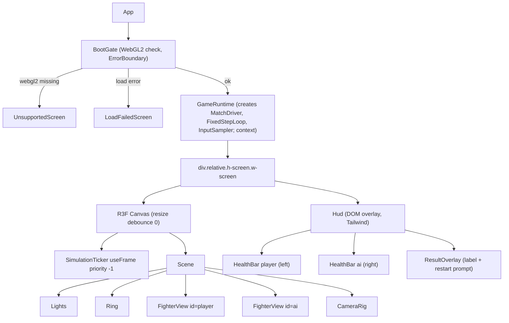
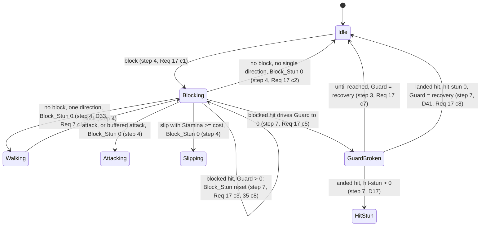

# Design Document: Project RING

## Overview

Project RING is a client-only 3D arcade boxing game. Its core is a pure TypeScript Game_Simulation that advances one fixed 1/60 s Tick per call, owns all gameplay state in one plain-data, JSON-serializable Simulation_State, and is driven only by per-Tick Fighter_Commands. A thin browser shell around it supplies those commands from the keyboard (Input_System) and from a deterministic AI_Controller, advances it from a fixed-timestep accumulator (Simulation_Loop), and draws interpolated results with React Three Fiber plus a React/Tailwind HUD. Keeping the simulation free of time, DOM, and rendering dependencies makes it deterministic, replayable, and testable in Node with property-based tests.

> **Note:** This document is written in parts. Part 1 covers core architecture and M1. Part 2 (P2 full combat) is included in the section "Part 2: Full Combat (P2)", placed after Part 1's Components and Interfaces. Parts 3–4 (P3 match structure, P4 presentation) will be appended later.

Conventions: "Req 10 c6" means Requirement 10, acceptance criterion 6. "D4" refers to Design Decision D4 in requirements.md. "Fx" is the fixed-point position unit defined in section 2.

---

## Architecture

### 1. Architecture and Module Responsibilities

#### 1.1 Runtime data flow

```mermaid
flowchart LR
    KB[Keyboard events] --> IS[Input_System<br/>src/input]
    subgraph Browser shell
        IS -->|player command mask per Tick| DRV
        LOOP[Simulation_Loop<br/>src/loop<br/>FixedStepLoop] -->|n Ticks per frame, alpha| DRV
        DRV[MatchDriver<br/>src/sim/driver.ts]
        DRV -->|prev, curr, alpha| R3F[Renderer<br/>src/render<br/>R3F scene]
        DRV -->|per-frame HUD snapshot| HUDS[(useHudStore<br/>Zustand)]
        HUDS --> HUD[Fight_HUD and result overlay<br/>src/ui]
        UIS[(useUiStore<br/>Zustand: screen)] --> HUD
        HUD -->|restart| DRV
    end
    subgraph Pure simulation: no DOM, React, Three, time
        DRV -->|player commands for Tick T| SIM[Game_Simulation step<br/>src/sim]
        SIM -->|step 2: state at T-1 read-only, rng copy| AI[AI_Controller<br/>src/sim/ai]
        AI -->|AI mask + rng| SIM
        SIM -->|Simulation_State + Game_Events| DRV
    end
    RAF[R3F frame loop: single rAF owner] --> LOOP
```

Per display frame: R3F's frame loop calls the `SimulationTicker` callback first. It asks `FixedStepLoop` how many Ticks to run. For each Tick, `MatchDriver` samples the player mask from the Input_System and calls `step()` with the player's commands only. Inside the Tick, at the start of step 2, the Game_Simulation calls the AI_Controller with the read-only previous state and a copy of the PRNG state, and commits the returned PRNG state (D40). After the Ticks, the renderer reads `prev`, `curr`, and `alpha`, and the HUD store receives at most one snapshot (section 11).

#### 1.2 Directory layout

```
src/
  sim/                      Pure TS. No React, Three, DOM, Web Audio, time, Math.random.
    index.ts                Public API: createMatch, step, stepInto, serialize, parse, types
    types.ts                SimulationState, FighterState, FsmState, events, commands
    fixed.ts                Fixed-point helpers (toFx, fromFx, i32, roundHalfUp)
    rng.ts                  sfc32 PRNG (state stored in Simulation_State)
    config/
      defaults.ts           Default GameConfig (world units)
      attacks.ts            Attack_Registry data (M1: jab)
      schema.ts             zod schemas + cross-field checks (Req 5 c4-c6, 7 c7, 7 c11, 11 c9)
      compile.ts            Validated config -> CompiledConfig (Fx units, derived reach)
    state.ts                createInitialState, copyStateInto
    step.ts                 Tick pipeline (Req 35 c1)
    fsm.ts                  Transition table (data) + transition()
    movement.ts             Movement, separation, clamp, facing (Req 7)
    combat.ts               Combat_Resolver (Req 10, 35 c4-c9)
    observation.ts          Player_Observation_History ring buffer (Req 12 c9-c12)
    serialize.ts            JSON round-trip + strict parse (Req 3 c4, c6)
    fingerprint.ts          FNV-1a 32-bit over canonical JSON of validated config (D42)
    ai/
      m1Ai.ts               decideAi(state, rng, cfg) -> { mask, rng }; called by step 2 (Req 12, D40)
    driver.ts               MatchDriver: double buffers, player commands + step per Tick, restart
  loop/
    fixedStepLoop.ts        Accumulator, 5-Tick cap, pause, alpha (Req 1). Takes nowMs as input.
  input/
    keymap.ts               KeyboardEvent.code -> command bit (pure)
    inputSampler.ts         Edge/held logic, per-Tick sampling (pure core, Req 8)
    domKeyboard.ts          The only DOM-bound part: window listeners -> InputSampler
  render/
    Scene.tsx, Ring.tsx, FighterView.tsx, CameraRig.tsx, SimulationTicker.tsx
    cameraMath.ts           Pure fit-distance math (Req 6 c5-c6), unit-testable
  ui/
    stores.ts               useUiStore, useHudStore (Zustand)
    Hud.tsx, HealthBar.tsx, ResultOverlay.tsx, UnsupportedScreen.tsx, LoadFailedScreen.tsx
  app/
    main.tsx, App.tsx, BootGate.tsx (WebGL2 check, error boundary), GameRuntime.tsx
```

**Decision: the AI lives in `src/sim/ai/` and runs inside `step()`.** The AI_Controller must be a deterministic function of the Simulation_State (Req 3 c7, Req 12 c2) and must read the Player_Observation_History stored there (D32). Placing it inside `src/sim` puts it under the same import ban, Node test project, and determinism properties as the simulation. `step()` calls it at the start of step 2 (D40, Req 35 c1), so the player's commands are the only external gameplay input (Req 2 c2). `decideAi` stays a separate exported pure function so AI-level properties can call it directly. Tests that drive both Fighters set `cfg.ai.enabled = false`, which makes step 2 accept external AI_Fighter commands instead (section 9).

**Decision: the Simulation_Loop lives in `src/loop/`, outside `src/sim`.** It is not part of the Game_Simulation (it deals with real time), but it receives time as a number argument, so it is pure and runs in the Node test project too.

#### 1.3 Responsibilities

| Module | Owns | Reads | Must not |
|---|---|---|---|
| `src/sim` (Game_Simulation) | Simulation_State transitions, Game_Events, config validation, serialization | Previous state, Tick commands, CompiledConfig | Read time, input, DOM, renderer; import React/Three (Req 2 c1, c3) |
| `src/sim/ai` (AI_Controller) | AI command mask and returned PRNG state per Tick, called from step 2 | Simulation_State (read-only), PRNG state copy, AI config | Mutate state, read input/time/render (Req 12 c2, c6) |
| `src/sim/driver.ts` (MatchDriver) | Double-buffered prev/curr states, per-Tick player-command + step sequencing, restart | Input mask callback, config | Call the AI itself; know about frames or time |
| `src/loop` (Simulation_Loop) | Accumulator, Tick count per frame, alpha, pause | `nowMs` supplied by caller | Call `performance.now()` itself |
| `src/input` (Input_System) | Key-to-command mapping, press edges, held keys, blur reset | Keyboard/focus events | Touch Simulation_State |
| `src/render` (Renderer) | Three.js scene graph, camera, interpolation | prev, curr (deep-readonly), alpha | Mutate Simulation_State (Req 2 c5) |
| `src/ui` (HUD, overlays, stores) | UI-level state (screen; later difficulty, pause) | HUD snapshot | Store UI fields in Simulation_State (Req 2 c6) |
| `src/app` | Boot, WebGL2 check, error screens, wiring | Everything above | Contain gameplay logic (Req 14 c3 is satisfied by `src/sim`) |

#### 1.4 Dependency rule and enforcement (Req 2 c1, c3)

Allowed import direction: `app → ui, render, input, loop, sim`; `render → sim (types only), ui/stores`; `ui → sim (types only)`; `input → sim (command bit constants)`; `loop → nothing`; `sim → zod only`.

Enforcement is layered so that a violation fails at least two independent checks:

| Check | Scope | Mechanism |
|---|---|---|
| ESLint `no-restricted-imports` | `src/sim/**`, `src/loop/**` | Ban `react`, `react-dom`, `three`, `three/*`, `@react-three/*`, `zustand`, and any relative path into `src/render`, `src/ui`, `src/app`, `src/input` |
| ESLint `no-restricted-globals` / `no-restricted-properties` | same | Ban `window`, `document`, `navigator`, `performance`, `Date`, `requestAnimationFrame`, `AudioContext`, `setTimeout`, `Math.random` |
| Separate `tsconfig.sim.json` | same | `"lib": ["ES2022"]` with no `DOM`, `"types": []`, so DOM identifiers fail type-checking; included in `npm run typecheck` |
| Vitest project `sim` | `src/sim/**/*.test.ts`, `src/loop/**/*.test.ts` | `environment: 'node'`; a smoke test imports `src/sim/index.ts` and asserts `typeof window === 'undefined'`; any transitive DOM/Three import throws or fails here |

The transitive part of Req 2 c1 is covered because both ESLint rules and the `lib` restriction apply to every file under `src/sim`, and `src/sim` may only import from itself and `zod` (zod has no DOM dependency).

---

## Data Models

### 2. Core Types and Authoritative Simulation State (Data Models)

#### 2.1 Numeric representation decisions

**Decision: positions and all spatial values are integer fixed-point, 1 world unit = 1000 Fx.**

| Concern | Float positions | Integer Fx (chosen) |
|---|---|---|
| Bit-identical replay (Req 3 c1) | Deterministic on one engine for `+ − × ÷`, but `Math.sin/pow/exp` are not specified bit-exactly across engines | Integer add/sub/compare only in the hot path; exact everywhere |
| JSON round-trip (Req 3 c4) | `-0` serializes as `0`, breaking `Object.is` equality; fractions print fine | Integers round-trip exactly; `-0` is normalized away by `i32()` |
| "Distance equals minimum separation" (Req 7 c5) and invariant `≥` (Req 7 c10) | `a − b` can land at `minSep − ε`, failing the invariant | Exact equality |
| Touching edges do not overlap (Req 10 c2) | Edge equality depends on rounding history | Exact strict comparison |
| Cost | none | Convert at render (`x / 1000`) and at config compile; odd shortfall split needs a rule (section 7) |

Rules:
- Config is authored in world units (up to 3 decimals) and converted once by `toFx(v) = Math.round(v * 1000)` in `compile.ts`.
- Every integer written to state passes through `i32(x) = x | 0` (which also turns `-0` into `0`). All Fx magnitudes stay far below 2^31.
- Health, damage, and Tick counts are integers (D5). M1 damage is `max(1, roundHalfUp(base))` with `roundHalfUp(x) = Math.floor(x + 0.5)` for `x ≥ 0` (Req 35 c7). P2 multipliers must be applied by plain multiplication; combo scaling `k^(n−1)` is computed by repeated multiplication, never `Math.pow`.
- Event payloads may hold non-integer numbers (hit position, section 8); they are computed only with `+ − × ÷`, so they are still deterministic.

**Decision: PRNG is sfc32**, seeded from the 32-bit seed (Req 3 c2, range 0–4,294,967,295) through splitmix32 to fill its four 32-bit words, then advanced 12 times to discard warm-up output. State is `[a, b, c, d]` of unsigned 32-bit integers stored in the Simulation_State. Implementation uses only `Math.imul`, `+`, `>>>`, `|`, `^`, so output is bit-exact on every engine. sfc32 is chosen over mulberry32 because mulberry32 has a single 32-bit state word and cannot produce every 32-bit output, while sfc32 has 128 bits of state and passes PractRand; cost is the same. M1 consumes no random values; the PRNG is present so that determinism and round-trip properties cover it from day one.

**Decision: state mutation uses double buffering with an in-place core.**
- Core: `stepInto(prev: Readonly<SimulationState>, next: SimulationState, input, cfg): GameEvent[]`. It first runs `copyStateInto(next, prev)` (field-wise copy into preallocated objects, including the 121-entry history), then mutates `next`.
- `MatchDriver` owns two buffers. Each Tick it swaps them so `prev` holds the last state and writes the new Tick into the other. After a frame's Ticks, `prev` and `curr` are exactly the two most recent states the renderer needs for interpolation (Req 1 c5), even after 5 catch-up Ticks.
- Pure wrapper for tests and tools: `step(state, input, cfg): StepResult` allocates `next = cloneState(state)` and calls `stepInto`. Both paths share all logic.
- Rationale against Req 34 c3 (< 1 ms mean per Tick): a state copy is about 121 × 6 history fields plus two fighters, a few microseconds at most, with no garbage per Tick except the small event array. `structuredClone` per Tick would also fit the budget but allocates about 130 objects per Tick and produces GC pauses that threaten Req 34 c2 frame-time limits; double buffering avoids that.

#### 2.2 Commands

**Decision: external commands are a list; internal commands are a bitmask per Fighter.**

```ts
export type FighterId = 'player' | 'ai';
export type CommandType =
  | 'move-left' | 'move-right' | 'jab'
  | 'cross' | 'hook' | 'uppercut' | 'block' | 'slip';   // last five: P2

export interface FighterCommand { fighter: FighterId; type: CommandType }
export type TickInput = readonly FighterCommand[];        // empty = no command (Req 2 c2)
// TickInput carries the Player_Fighter's commands. Entries for 'ai' are accepted only when
// cfg.ai.enabled === false (tests); otherwise they are dropped and the AI mask comes from step 2 (D40).

export const CMD = {                                      // internal bit values
  MoveLeft: 1 << 0, MoveRight: 1 << 1, Jab: 1 << 2,
  Cross: 1 << 3, Hook: 1 << 4, Uppercut: 1 << 5, Block: 1 << 6, Slip: 1 << 7,
} as const;
export type CommandMask = number;
export const M1_ENABLED_MASK = CMD.MoveLeft | CMD.MoveRight | CMD.Jab;
```

The list form is the public contract (Req 2 c2) and is what Req 2 c7 talks about: entries with an unknown `fighter` or `type` (runtime values from JS or deserialized replays) are dropped during intake. Entries for P2 types are also dropped in M1 because they are outside `M1_ENABLED_MASK`. While the AI_Controller is enabled, `ai` entries are dropped too, because the AI_Fighter's commands are produced inside the Tick (Req 2 c2, D40). The bitmask makes duplicate commands idempotent, is cheap to copy, and is the natural generator domain for property tests (`fc.integer({min: 0, max: 255})`). Input_System and AI_Controller produce masks directly; `MatchDriver` converts the player mask to the list form only at the API boundary.

#### 2.3 Fighter FSM state (discriminated union)

```ts
export type GTick = number;                       // Gameplay_Tick index (section 4)
export type AttackPhase = 'startup' | 'active' | 'recovery';

export type FsmState =
  | { kind: 'Idle';      enteredAt: GTick }
  | { kind: 'Walking';   enteredAt: GTick; dir: -1 | 1 }
  | { kind: 'Attacking'; enteredAt: GTick; attackId: AttackId; phase: AttackPhase; contactUsed: boolean }
  | { kind: 'HitStun';   enteredAt: GTick; until: GTick }   // leaves HitStun on Gameplay_Tick `until`
  | { kind: 'Defeated';  enteredAt: GTick };
// P2 adds: { kind: 'Blocking'; blockStunUntil }, { kind: 'Slipping'; ... }, { kind: 'GuardBroken'; until }
// P3 adds: { kind: 'KnockedDown'; ... }. New members extend the union and the transition table only.

export type FsmKind = FsmState['kind'];
```

`phase` is stored (not only derived) because Req 9 c3 requires recording phase each Tick and Player_Observations copy it.

#### 2.4 Fighter and Simulation_State

```ts
export type Fx = number;                          // integer, 1 world unit = 1000 Fx

export interface FighterState {
  id: FighterId;
  x: Fx;                                          // horizontal center
  facing: 1 | -1;                                 // +1 if opponent x is greater (Req 7 c8)
  health: number;                                 // integer 0..maxHealth
  fsm: FsmState;
  lastJabStartAt: GTick | null;                   // AI attack interval reference (Req 12 c4)
  // P2: stamina, guard, inputBuffer, comboCounter ...; P3: knockdowns ...
}

export type RngState = [number, number, number, number];  // sfc32 words, uint32

export interface PlayerObservation {
  at: GTick;                                      // Gameplay_Tick at whose end it was recorded
  x: Fx; facing: 1 | -1; fsm: FsmKind;
  attackId: AttackId | null; phase: AttackPhase | null;
}

export interface ObservationHistory {
  entries: PlayerObservation[];                   // always length 121 (section 10)
  head: number;                                   // index of newest entry, 0..120
  count: number;                                  // valid entries, 1..121
}

export type MatchResult =
  | { kind: 'win'; winner: FighterId; at: GTick }
  | { kind: 'draw'; at: GTick };

export interface SimulationState {
  version: 1;
  ruleset: 'm1';                                  // P3 adds 'match'; selects M1 vs P3 end rules
  tick: number;                                   // Ticks processed since Match start
  gameplayTick: GTick;                            // non-frozen Ticks; equals tick in M1
  hitStopRemaining: number;                       // P4 Hit_Stop; always 0 in M1
  matchStartAt: GTick;                            // 0; P3 also tracks roundStartAt
  seed: number;                                   // uint32
  configFingerprint: number;                      // uint32, FNV-1a over canonical JSON of validated config (D42, Req 3 c8)
  rng: RngState;                                  // sfc32 words, uint32
  fighters: [FighterState, FighterState];         // [0] = player, [1] = ai
  history: ObservationHistory;
  result: MatchResult | null;                     // M1 winner/draw (Req 11 c7-c8)
}

export interface StepResult {
  state: SimulationState;
  events: GameEvent[];                            // exactly this Tick's events, in D10 order (Req 2 c4)
  trace?: FsmTransitionRecord[];                  // test-only, opt-in; not Game_Events (section 6)
}
```

Initial state (`createInitialState(cfg)`): `tick = gameplayTick = 0`, both Fighters at their start positions, `health = maxHealth`, `fsm = Idle@0`, facing computed from positions, `lastJabStartAt = null`, `rng = seedSfc32(cfg.seed)`, `configFingerprint = cfg.fingerprint`, history containing only the observation for Gameplay_Tick 0, `result = null`. Tick 0 is the Match-start snapshot; the first processed Tick is Tick 1, on which both Fighters are Idle before commands apply (Req 4 c9).

The state holds no UI fields (screen, difficulty, pause) (Req 2 c6) and no config. It holds `configFingerprint`, computed once in `compile.ts` as FNV-1a 32-bit over a canonical JSON serialization of the validated config (object keys sorted, attacks in registry order, numbers in their authored world-unit form). `parseSimulationState(json, cfg)` rejects a state whose fingerprint differs from `cfg.fingerprint` with a `config-mismatch` error and leaves the caller's state unchanged (D42, Req 3 c9).

#### 2.5 Attack definitions

```ts
export type AttackId = string;                    // 1-32 chars

export interface AttackDefinition {               // authored, world units
  id: AttackId;
  startup: number;   active: number;   recovery: number;    // integer Ticks, D2 ranges
  damage: number;    staminaCost: number;  guardDamage: number;   // finite, >= 0
  hitStun: number;   blockStun: number;                     // integer Ticks, D2 ranges
  hitbox: { offset: { x: number; y: number }; size: { w: number; h: number } }; // offset to box center; size > 0
  cancelWindow?: { start: number; end: number };            // P2
  followUps?: AttackId[];                                   // P2
  hitStop?: number;                                         // P4, integer 0-30, default 0
}

export interface CompiledAttack extends Readonly<AttackDefinition> {
  hitboxFx: { ox: Fx; oy: Fx; w: Fx; h: Fx };
  total: number;                                  // startup + active + recovery
  reachFx: Fx;                                    // Hitbox_Reach = ox + w/2 (rounded down)
  connectRange2: number;                          // 2·ox + w + hurt.w, doubled Fx (Connect_Range, section 8.2)
  nearEdge2: number;                              // 2·ox − w − hurt.w, doubled Fx (section 8.4)
  reach: { dLo: Fx; dHi: Fx } | null;             // integer connect interval within [minSeparation, ring width]; null if empty
}
```

#### 2.6 Game events (M1)

```ts
export type GameEvent =
  | { type: 'hit-landed'; at: GTick; attacker: FighterId; target: FighterId;
      attackId: AttackId; damage: number; hitPos: { x: number; y: number } } // world units
  | { type: 'fighter-defeated'; at: GTick; fighter: FighterId }
  | { type: 'match-result'; at: GTick; result: MatchResult };
// P2: attack-blocked, slip-evaded, counterpunch, guard-broken; P3: knockdown, knockdown-count, round-start, round-end
```

#### 2.7 GameConfig and validation ranges

| Field | Type / unit | Valid range | Error if invalid | Req |
|---|---|---|---|---|
| `ring.min`, `ring.max` | world units | finite; `max − min > minSeparation` | `config.ring: width must exceed minSeparation` | 7 c7 |
| `start.player`, `start.ai` | world units | within `[ring.min, ring.max]`; `abs(ai − player) ≥ minSeparation` | names the failing field; values never adjusted | 7 c11 |
| `minSeparation` | world units | finite, `> 0` | `config.minSeparation` | 7 c5 |
| `walkSpeed` | world units per Tick | finite, `> 0` | `config.walkSpeed` | 7 c1 |
| `hurtbox` `{w, h, centerY}` | world units | `w > 0`, `h > 0`, `centerY` finite | `config.hurtbox.*` | 10 c1 |
| `maxHealth` | integer | 1–1,000 | `config.maxHealth` | 11 c1, c9 |
| `ai.enabled` | boolean, default `true` | `true` or `false`; `false` only in tests, where step 2 accepts external AI_Fighter commands | `config.ai.enabled` | 2 c2, D40 |
| `ai.reactionDelay` | integer Ticks | 0–120 | `config.ai.reactionDelay` | 12 c5 |
| `ai.attackInterval` | integer Ticks | 1–600 | `config.ai.attackInterval` | 12 c4 |
| `seed` | integer | 0–4,294,967,295 | `config.seed` | 3 c2 |
| `attacks` | `AttackDefinition[]` | non-empty; each per Req 5 c5 / D2; unique ids; exactly one `jab` whose startup is strictly lowest | `attacks[i or id].field: reason`, all collected | 5 c4–c6, 9 c1 |
| jab reachability | cross-field, doubled Fx (section 8.4) | jab Hitbox vertically overlaps the Hurtbox, and the integer connect interval `[dLo, dHi]` over distances `≥ minSeparation` is non-empty; additionally the near edge is below `minSeparation` (`nearEdge2 < 2·minSeparation`) so every AI jab distance connects | `attacks[jab]: cannot connect at any distance >= minSeparation` / `attacks[jab]: near edge exceeds minSeparation; AI jab distances would miss` | 15 c7, c8 |

Attack field checks (Req 5 c5, D2): `startup` 1–60, `active` 1–60, `recovery` 0–60, `hitStun` 0–120, `blockStun` 0–120, all integers; `damage`, `staminaCost`, `guardDamage`, `hitbox.offset.x`, `hitbox.offset.y` finite and `≥ 0`; `hitbox.size.w`, `hitbox.size.h` finite and `> 0`; `id` a string of 1–32 characters. Every violation is collected (zod `safeParse` returns all issues; cross-field checks append to the same list), and each message names the attack by `id`, or by `attacks[index]` when `id` is missing (Req 5 c5). An empty registry yields the single error `attacks: empty registry` (Req 5 c6).

`createMatch(rawConfig)` returns `{ ok: true, driver } | { ok: false, errors: ConfigError[] }`. Nothing is produced until validation passes (Req 5 c4); there are no silent defaults or corrections (Req 7 c11, D22).

---

## Components and Interfaces

### 3. Simulation Loop (Fixed 60 Hz)

#### 3.1 FixedStepLoop

`FixedStepLoop` (in `src/loop`) is a small pure class. It never reads a clock; the caller passes `nowMs`.

```ts
const TICK_MS = 1000 / 60;          // 16.666... ms
const MAX_TICKS_PER_FRAME = 5;      // D1

class FixedStepLoop {
  private acc = 0;                  // ms, always in [0, TICK_MS) after frame()
  private lastMs: number | null = null;
  private paused = false;

  /** Returns how many Ticks to run this frame and the interpolation alpha. */
  frame(nowMs: number): { ticks: number; alpha: number } {
    if (this.paused) {                         // Req 1 c4
      this.acc = 0;
      this.lastMs = nowMs;                     // keep last timestamp current while paused
      return { ticks: 0, alpha: 0 };
    }
    let dt = this.lastMs === null ? 0 : nowMs - this.lastMs;
    this.lastMs = nowMs;
    if (!Number.isFinite(dt) || dt <= 0) dt = 0;   // Req 1 c7: zero, negative, NaN, Infinity add 0
    this.acc += dt;                                // Req 1 c2
    let ticks = Math.floor(this.acc / TICK_MS);
    if (ticks > MAX_TICKS_PER_FRAME) {             // Req 1 c3, D1
      ticks = MAX_TICKS_PER_FRAME;
      this.acc = 0;                                // excess time discarded
    } else {
      this.acc -= ticks * TICK_MS;                 // remainder carried (Req 1 c2)
      if (this.acc < 0) this.acc = 0;              // guard against float residue
    }
    const alpha = Math.min(this.acc / TICK_MS, 1 - Number.EPSILON); // Req 1 c5: [0, 1)
    return { ticks, alpha };
  }

  pause(): void  { this.paused = true;  this.acc = 0; }
  resume(nowMs: number): void { this.paused = false; this.acc = 0; this.lastMs = nowMs; } // Req 1 c6
}
```

Notes:
- If `nowMs` itself is not finite, `lastMs` becomes non-finite and the next `dt` is also non-finite, which adds 0 again. The frame after a valid timestamp arrives resumes normally, because `lastMs` is overwritten every frame.
- `resume(nowMs)` resets `lastMs`, so the first frame after resume counts only `now − resumeTime` (Req 1 c6). Pause entry arrives in P3 (Req 29); M1 has the API and its tests.
- Tick count depends only on accumulated time, never on frame rate. The simulation itself never sees `dt` (Req 1 c1).
- A hidden tab stops rAF. On return, `dt` is large, so exactly 5 Ticks run and the accumulator resets: the fight does not fast-forward.

#### 3.2 Where the loop runs

**Decision: R3F's frame loop is the single rAF owner.** A `SimulationTicker` component calls `useFrame(cb, -1)`. R3F runs `useFrame` subscribers in ascending priority order, and only positive priorities take over rendering, so priority `-1` runs before every visual callback (priority 0) in the same frame without disabling R3F's automatic render. (Verify against the installed R3F version during implementation; see Q11.)

Rationale:
- One rAF callback means the simulation update and the draw that uses it happen in the same frame, in a fixed order. A second rAF loop would run in an unspecified order relative to R3F, so some frames would draw a state one Tick stale. That adds latency against Req 34 c4 and causes visible jitter.
- If WebGL2 is unavailable, the Canvas never mounts, so the Game_Simulation never starts (Req 14 c7) with no extra code.

The ticker callback reads `performance.now()` (allowed in `src/render`, not in `src/sim`/`src/loop`), then:

```ts
const { ticks, alpha } = loop.frame(performance.now());
for (let i = 0; i < ticks; i++) driver.tick(input.sampleTick());  // one sample per Tick
driver.setAlpha(alpha);
publishHudSnapshotIfChanged(driver.curr);                         // at most once per frame (section 11)
```

#### 3.3 Command sampling per Tick

- **Player:** `InputSampler.sampleTick()` returns one mask per call. Keyboard events arrive between frames and are queued. The first `sampleTick()` after an attack or slip key press includes that command once and then clears the latched press (Req 8 c5). A movement key is included on every sample taken after its press and before its release, and not on the first sample after its release. A movement press and release that both happen between two samples produce no movement command (Req 8 c6, D43). Movement is therefore level-sampled from the held-key set at sample time, while attack keys stay edge-latched. Both directions held produces neither (Req 8 c8). When several attack keys are pressed before one sample, only the first-arriving is kept (Req 8 c9). On window `blur` all keys reset and nothing is delivered until a fresh press (Req 8 c7). Keys are matched by `KeyboardEvent.code` (`KeyA`, `ArrowLeft`, `KeyD`, `ArrowRight`, `KeyJ`), which is independent of Shift and Caps Lock (Req 8 c1–c2), and `event.repeat` presses are ignored (Req 8 c5). Unmapped codes produce nothing (Req 8 c10).
- **AI:** the driver does not sample the AI. Step 2 of each Tick calls `decideAi(prev, prev.rng copy, cfg)` with the state at the end of the previous Tick and commits the returned PRNG state (section 9, D40). With catch-up, each of the 5 Ticks gets a fresh AI decision.
- During catch-up, all Ticks in one frame see the same held-key set, because no browser events are delivered while the frame callback runs. Edge-triggered commands land only on the first of those Ticks ("first Tick that begins after the press", Req 8 c5).

---

### 4. Ticks vs Gameplay_Ticks

| Term | Definition | Counter | Advances when |
|---|---|---|---|
| Display frame | One rAF callback / rendered image | none in state | Browser vsync |
| Tick | One `step()` call, 1/60 s of simulated time | `state.tick` | Every `step()` |
| Gameplay_Tick | A Tick not frozen by Hit_Stop (D36) | `state.gameplayTick` | Every `step()` with `hitStopRemaining == 0` |

In M1, `hitStopRemaining` is always 0, so `gameplayTick == tick` after every step. Both counters exist from M1 so that P4 Hit_Stop is a change to step 1 of the pipeline only.

**Measured in Gameplay_Ticks** (type `GTick`): `fsm.enteredAt`, attack phase boundaries (derived from `enteredAt` and the CompiledAttack), `HitStun.until`, `lastJabStartAt`, `matchStartAt`, `PlayerObservation.at` and all history indexing, AI attack interval and reaction delay, `MatchResult.at`, `GameEvent.at`. P2/P3 add Block_Stun, Input_Buffer age, slip windows, and round timer, all in Gameplay_Ticks.

**Measured in Ticks:** only `state.tick` itself and `hitStopRemaining` (P4). Nothing in M1 gameplay logic reads `state.tick`.

Rule for implementers: every timer in `src/sim` compares against `state.gameplayTick`, never `state.tick`. A lint-level check is not practical, so the P4 test suite will add a property: inserting frozen Ticks shifts every gameplay timestamp by exactly the number of frozen Ticks.

---

### 5. Tick Resolution Pipeline

#### 5.1 `stepInto` pseudocode (Req 35 c1)

```ts
function stepInto(prev, next, input: TickInput, cfg): GameEvent[] {
  copyStateInto(next, prev);
  const ev = new EventCollector();                // per-Fighter queues + global queue (5.3)
  next.tick += 1;

  // (1) Hit_Stop check [P4]. M1: hitStopRemaining is 0, so this always falls through.
  if (next.hitStopRemaining > 0) { next.hitStopRemaining -= 1; return ev.flush(); }
  next.gameplayTick += 1;
  const g = next.gameplayTick;

  // (2a) AI_Controller decision and PRNG commit (D40, Req 12 c5-c6, c14)
  let aiMask = 0;
  if (cfg.ai.enabled) {
    const out = decideAi(prev, [...prev.rng], cfg);  // read-only state at end of T-1, rng copy
    aiMask = out.mask;
    next.rng = out.rng;                              // commit; M1 returns the copy unchanged
  }

  // (2b) Command intake and validation (Req 2 c2, c7; Req 4 c10; Req 11 c7; Req 13 c3)
  const mask = [0, aiMask];
  for (const c of input) {
    const i = fighterIndex(c.fighter); const bit = commandBit(c.type);
    if (i < 0 || bit === 0) continue;             // unknown fighter or type: drop silently
    if (i === 1 && cfg.ai.enabled) continue;      // external AI commands only when AI disabled
    mask[i] |= bit;
  }
  for (const i of [0, 1]) {
    mask[i] &= M1_ENABLED_MASK;                   // P2 commands dropped in M1
    if (next.result !== null || next.fighters[i].fsm.kind === 'Defeated') mask[i] = 0;
  }

  // (3) Timer advancement: attack phase, HitStun expiry (section 6, 8)
  for (const f of next.fighters) advanceTimers(f, g, cfg);   // Attacking -> Idle at total; HitStun -> Idle at until

  // (4) Action selection per Fighter, priority D9 (M1: jab > movement > Idle)
  const moveDir = [0, 0];
  for (const i of [0, 1]) moveDir[i] = selectAction(next.fighters[i], mask[i], g, cfg);
  //   ableToAct = Idle | Walking.  Not able: attack bits discarded (Req 4 c11 M1), movement ignored (Req 7 c9).

  // (5) Stamina deduction [P2]. M1: no-op.

  // (6) Movement limited to the Ring_Boundary, then separation, then facing (D38, D39; section 7)
  applyMovement(next.fighters, moveDir, cfg);
  updateFacing(next.fighters);

  // (7) Hit detection and outcomes against one shared snapshot (section 8)
  if (next.result === null) {
    const hits = detectHits(next.fighters, cfg);  // phase A: pure reads only
    applyHits(next.fighters, hits, g, cfg, ev);   // phase B: mutations
  }

  // (8) Health-zero checks (Req 35 c9-c10, Req 11 c6-c8, D6, D7)
  if (next.result === null) checkHealthZero(next, g, ev);

  // (9) Round timer and round end [P3]. M1: no-op.

  // (10) Game_Event emission in D10 order, then end-of-Gameplay_Tick bookkeeping
  pushObservation(next.history, observe(next.fighters[0], g));  // Req 12 c9
  return ev.flush();
}
```

`MatchDriver.tick(playerMask)` wraps this: build `TickInput` from the player mask only, swap buffers, `stepInto(prev, curr, input, cfg)`, append events to the frame's event list. The AI decision happens inside `stepInto` (step 2a), so `step()` and `MatchDriver` produce identical results for the same player commands.

#### 5.2 What M1 does in each step

| Step | M1 behavior | Key reqs |
|---|---|---|
| 1 Hit_Stop | No-op (counter is 0) | D36 |
| 2 AI + intake | If `ai.enabled`: `decideAi` on the previous state and an rng copy, commit returned rng (unchanged in M1); then build masks, drop unknown fighters/types, P2 types, and external `ai` entries while the AI is enabled; zero masks after result or for Defeated | Req 2 c2, c7; 4 c10; 11 c7; 12 c6, c14; 13 c3; D40 |
| 3 Timers | Attacking: recompute `phase` from `g − enteredAt`; at `total` go Idle. HitStun: at `g ≥ until` go Idle | Req 9 c3–c4; 35 c8 |
| 4 Action | Able_To_Act Fighters: jab → Attacking; exactly one direction → Walking with `dir`; otherwise Walking → Idle. Records `lastJabStartAt = g` on jab start | Req 7 c2–c4; 9 c2; 35 c2–c3; D9 |
| 5 Stamina | No-op | P2 |
| 6 Movement | Walking Fighters with a direction move; intended move limited to the Ring_Boundary, separation with the D39 split, facing | Req 7 c1–c10; D38, D39 |
| 7 Combat | Detect from snapshot, then apply both hits | Req 10; 35 c4, c7–c9; D3, D4 |
| 8 Health zero | Health 0 → Defeated (overrides HitStun set in step 7); set result | Req 11 c6–c8; 35 c9–c10; D6, D7 |
| 9 Round | No-op | P3 |
| 10 Events | Flush in D10 order; record Player_Observation | Req 2 c4; 35 c12; 12 c9 |

#### 5.3 Shared snapshot, Health-zero priority, and the draw rule

- **Snapshot (Req 35 c4, D4).** Step 7 is two-phase. `detectHits` reads positions, facings, phases, and `contactUsed` for both Fighters and returns at most one `PendingHit` per attacker, without writing anything. `applyHits` then applies every pending hit. Since no write happens before all reads, results cannot depend on whether the player or AI is processed first, and no state copy is needed. Phase B order (player's hit first) affects only event order, not values.
- **Health-zero priority (Req 35 c9, D6).** Step 7 may put a target into HitStun. Step 8 then checks `health === 0` and transitions that Fighter to Defeated in the same Tick. This is one transition per step (Req 4 c5), with the later step overriding.
- **Results.** After step 8 sets Defeated states:
  - exactly one Fighter Defeated → `result = { kind: 'win', winner: other, at: g }` (Req 11 c7);
  - both reached 0 on this Tick → both Defeated, `result = { kind: 'draw', at: g }` (Req 11 c8, Req 35 c10, D7).
  Health never goes below 0 because `applyHits` clamps (Req 11 c2).

#### 5.4 Event emission order (D10, Req 35 c12)

`EventCollector` holds three queues: `player[]`, `ai[]`, `global[]`. Each event is pushed during the step that produces it, into the queue of its owning Fighter:

| Event | Owner | Produced in step |
|---|---|---|
| `hit-landed` | attacker | 7 |
| `fighter-defeated` | defeated Fighter | 8 |
| `match-result` | global | 8 |

`flush()` returns `[...player, ...ai, ...global]`. Within each queue, events are already in processing-step order, so the output satisfies D10: Player_Fighter events before AI_Fighter events, and within a Fighter in step order. Match-level events, which belong to neither Fighter, come last (D10).

#### 5.5 Player_Observation recording

After all gameplay effects of the Tick, `observe(player, g)` copies the Player_Fighter's `x`, `facing`, `fsm.kind`, and attack id and phase (or `null`) into the next ring-buffer slot (Req 12 c9). It runs only on Gameplay_Ticks; with P4 Hit_Stop, step 1 returns early and records nothing, which keeps "Tick T − 1 − D" in Gameplay_Ticks (D32, D36).

---

### 6. Fighter FSM

#### 6.1 M1 transition table (data)

The table is exported data in `src/sim/fsm.ts`. All state changes go through `transition()`, which looks up the rule; the invariant property (Req 4 c8) checks the same table.

```ts
export type Trigger =
  | 'move'          // exactly one movement command while Able_To_Act
  | 'stop'          // Walking with no (or both) movement commands
  | 'attack'        // attack command accepted while Able_To_Act
  | 'attack-end'    // g − enteredAt reached startup + active + recovery
  | 'hit'           // landed hit with hitStun > 0
  | 'hit-no-stun'   // landed hit with hitStun == 0 on an Attacking target (D41)
  | 'stun-end'      // g >= HitStun.until
  | 'health-zero';  // Health reached 0

export interface TransitionRule { from: FsmKind; to: FsmKind; trigger: Trigger; step: 3 | 4 | 7 | 8 }

export const M1_TRANSITIONS: readonly TransitionRule[] = [
  { from: 'Idle',      to: 'Walking',   trigger: 'move',        step: 4 }, // Req 7 c2
  { from: 'Idle',      to: 'Attacking', trigger: 'attack',      step: 4 }, // Req 9 c2
  { from: 'Walking',   to: 'Attacking', trigger: 'attack',      step: 4 }, // Req 9 c2, D9
  { from: 'Walking',   to: 'Idle',      trigger: 'stop',        step: 4 }, // Req 7 c3, c4
  { from: 'Attacking', to: 'Idle',      trigger: 'attack-end',  step: 3 }, // Req 9 c4
  { from: 'Idle',      to: 'HitStun',   trigger: 'hit',         step: 7 }, // Req 10 c4
  { from: 'Walking',   to: 'HitStun',   trigger: 'hit',         step: 7 },
  { from: 'Attacking', to: 'HitStun',   trigger: 'hit',         step: 7 }, // Req 10 c8, D3
  { from: 'HitStun',   to: 'HitStun',   trigger: 'hit',         step: 7 }, // refresh, Req 35 c8
  { from: 'Attacking', to: 'Idle',      trigger: 'hit-no-stun', step: 7 }, // D41, D3: attack ends, no HitStun
  // D41: a zero hit-stun hit on Idle, Walking, or HitStun changes Health only (no rule, no transition).
  // P2 adds { Slipping -> Idle } and { GuardBroken -> Idle } with trigger 'hit-no-stun'.
  { from: 'HitStun',   to: 'Idle',      trigger: 'stun-end',    step: 3 },
  { from: 'Idle',      to: 'Defeated',  trigger: 'health-zero', step: 8 }, // Req 11 c6, 35 c9
  { from: 'Walking',   to: 'Defeated',  trigger: 'health-zero', step: 8 },
  { from: 'Attacking', to: 'Defeated',  trigger: 'health-zero', step: 8 },
  { from: 'HitStun',   to: 'Defeated',  trigger: 'health-zero', step: 8 }, // D6
  // Defeated has no outgoing rules (Req 4 c10).
];
```

Matrix view (rows = from, columns = to; cell = trigger):

| from \ to | Idle | Walking | Attacking | HitStun | Defeated |
|---|---|---|---|---|---|
| Idle | – | move | attack | hit | health-zero |
| Walking | stop | (dir change, not a transition) | attack | hit | health-zero |
| Attacking | attack-end, hit-no-stun | – | – | hit | health-zero |
| HitStun | stun-end | – | – | hit (refresh) | health-zero |
| Defeated | – | – | – | – | – |

Zero hit-stun hits follow D41 (Req 10 c10): they never enter HitStun. An Attacking target becomes Idle (its attack ends per D3); an Idle, Walking, or HitStun target keeps its state, and a HitStun target's `until` is not changed, so a zero-stun hit never extends a Combo (relevant from P2). Hits with `hitStun > 0` use the `hit` rules (Req 10 c11).

#### 6.2 `transition()` and entry-Tick recording

```ts
function transition(f: FighterState, to: FsmState, trigger: Trigger, step: Step, g: GTick, trace?: Trace): boolean {
  const rule = RULE_INDEX.get(key(f.fsm.kind, to.kind, trigger));
  if (!rule || rule.step !== step) { trace?.violation(f.id, f.fsm.kind, to.kind, trigger); return false; }
  trace?.record({ fighter: f.id, from: f.fsm.kind, to: to.kind, trigger, step, at: g });
  f.fsm = to;            // `to` carries enteredAt = g (Req 4 c7)
  return true;
}
```

- New states are built with `enteredAt: g` (Req 4 c7). The HitStun refresh is the one self-transition: it keeps `enteredAt` and updates `until`, because the Fighter has not left HitStun (this matters for D14 combos in P2).
- A per-step guard allows at most one transition per Fighter per step (Req 4 c5). Up to four transitions can happen in one Tick, for example Attacking →(3) Idle →(4) Attacking →(7) HitStun →(8) Defeated, each in a different step.
- `trace` is an opt-in `StepResult.trace` used only by tests. It is not a Game_Event, so Req 2 c4 ("exactly the Game_Events") is unaffected.

#### 6.3 Illegal transitions and discarded commands

- `selectAction` (step 4) only proposes `move`, `stop`, or `attack` when the Fighter is Able_To_Act (Idle or Walking in M1). For any other state, attack bits are discarded (Req 4 c11, M1 behavior; P2 routes them to the Input_Buffer) and movement bits are ignored (Req 7 c9). Nothing else changes: no Health, position, or counters (Req 4 c6, Req 9 c6).
- If `transition()` ever finds no rule, it leaves the state unchanged and reports a violation through the trace. Such a case is a code defect, not a player action; the FSM invariant property fails on it.

#### 6.4 Extension points

P2 adds `Blocking`, `Slipping`, `GuardBroken` members and rules (for example `Blocking → Walking` on block release for D33), and widens Able_To_Act to Blocking with 0 Block_Stun. P3 adds `KnockedDown` and replaces the `health-zero → Defeated` rules with `health-zero → KnockedDown` when `ruleset === 'match'`. Each phase exports its own rule array; the active table is the concatenation for the current ruleset, and the invariant property uses that same table.

---

### 7. Movement, Positioning, and Separation

#### 7.1 Algorithm (step 6, Req 7 c1–c8)

All values are Fx integers. Let `v = walkSpeedFx`, `S = minSeparationFx`, `[B0, B1] = ring` in Fx. Because separation is always `≥ S > 0`, the Fighters can never pass each other, so the "left" and "right" Fighter are fixed for the whole Match by the start positions.

```ts
function applyMovement(fs, moveDir, cfg) {
  const [L, R] = leftRight(fs);                     // by x; order never changes
  const dL = moveDir[L.idx] * v, dR = moveDir[R.idx] * v;  // -v, 0, +v; 0 unless Walking with exactly one direction

  // a) Intended move limited to the Ring_Boundary first (Req 7 c6, D38)
  let xL = clamp(L.x + dL, B0, B1), xR = clamp(R.x + dR, B0, B1);

  // b) Separation: shorten only movement toward the opponent (Req 7 c5, D39)
  const tL = Math.max(0, xL - L.x);                 // L's toward-movement (rightward)
  const tR = Math.max(0, R.x - xR);                 // R's toward-movement (leftward)
  const short = S - (xR - xL);
  if (short > 0) {                                  // proven: short <= tL + tR (7.3)
    let sL: number, sR: number;
    if (tL > 0 && tR > 0) {                         // both moved toward: split equally
      const lo = Math.floor(short / 2), hi = short - lo;
      // D39 odd remainder: extra 1 Fx to the larger toward-mover; Player_Fighter on ties
      const lGetsHi = tL > tR || (tL === tR && L.id === 'player');
      [sL, sR] = lGetsHi ? [hi, lo] : [lo, hi];
      // D39 cap: a share cannot exceed own toward-move; the rest goes to the other Fighter
      if (sL > tL) { sR += sL - tL; sL = tL; }
      if (sR > tR) { sL += sR - tR; sR = tR; }      // cannot re-exceed tL because short <= tL + tR
    } else if (tL > 0) { sL = short; sR = 0; }
    else               { sL = 0; sR = short; }
    xL -= sL; xR += sR;
  }

  // c) Defensive clamp; a no-op by construction (7.3), kept as a cheap guard
  L.x = i32(clamp(xL, B0, B1)); R.x = i32(clamp(xR, B0, B1));
}

function updateFacing(fs) {                         // Req 7 c8, end of step 6
  fs[0].facing = fs[1].x > fs[0].x ? 1 : -1;
  fs[1].facing = fs[0].x > fs[1].x ? 1 : -1;
}
```

- **Single direction (c1):** `selectAction` sets `moveDir = ±1` only for an Able_To_Act Fighter with exactly one of MoveLeft/MoveRight. The Fighter enters or stays in Walking (c2).
- **Both directions (c4):** the mask has both bits, so the result is "no movement". A Walking Fighter goes Idle (c3); an Idle Fighter stays Idle.
- **Blocked movement:** a Walking Fighter pressed against a wall or the opponent stays Walking with zero displacement. State follows commands; displacement follows geometry.
- **Odd remainder (D39):** in Fx, a shortfall can be odd. The extra 1 Fx (0.001 world units) goes to the Fighter with the larger toward-movement, with the Player_Fighter breaking ties. The split is exactly equal whenever `short` is even and within 1 Fx otherwise.
- **Unequal toward-movement cap (D39):** a Fighter cannot be shortened by more than it moved toward the opponent; the excess shifts to the other Fighter. Because `short ≤ tL + tR` (7.3), the other Fighter can always absorb it. In M1 this cap never triggers: movement toward the opponent cannot hit a wall (the opponent is in between), so both toward-movements equal `v` and each half is at most `v`. The cap is needed from P2, where a Blocking Fighter moves at reduced speed.

#### 7.2 Why the boundary limit is applied before separation (D38)

Clamping only after separation can break the invariant (Req 7 c10). Example: L is at the left wall and walks left (away), while R walks toward L. Separation computed against L's out-of-bounds position lets R come close; a later clamp pulls L back inside and leaves the distance below `S`. D38 and Req 7 c5–c6 therefore require the boundary limit first (step a), then separation (step b). Req 7 c6's guarantee ("a Fighter at a boundary is never pushed") holds, because shortening only reduces movement toward the opponent and never adds displacement.

#### 7.3 Invariant argument (Req 7 c10)

Claim: after every Tick, `B0 ≤ x ≤ B1` for both Fighters and `xR − xL ≥ S`.

- **Base:** config validation guarantees both start positions lie in the boundary and are at least `S` apart (Req 7 c11), and `B1 − B0 > S` (Req 7 c7).
- **Step:** assume the claim before the Tick. Non-Walking Fighters have `d = 0`.
  1. After (a), both positions are in bounds by construction.
  2. Write `aL, aR ≥ 0` for away-movement after the clamp. Then `xR − xL = (R.x − L.x) + aL + aR − tL − tR ≥ S − tL − tR`, so `short ≤ tL + tR`. The split therefore always finds enough toward-movement to absorb the shortfall.
  3. Shortening moves each Fighter back toward its own previous position by at most its toward-movement. Its new position lies between its previous position and its post-(a) position. Both are in bounds, and the interval between them is in bounds.
  4. If `short > 0`, the final distance is exactly `S`. Otherwise it is unchanged and already `≥ S`.
  5. Step (c) therefore changes nothing.
- Hence the invariant holds after every Tick for every command sequence. Property 11 (Correctness Properties) checks it directly.

#### 7.4 Configuration checks

`schema.ts` runs these after per-field validation and reports each failing setting by name, without adjusting any value:

| Check | Error | Req |
|---|---|---|
| `ring.max − ring.min > minSeparation` | `config.ring: width (X) must be greater than minSeparation (Y)` | 7 c7 |
| `ring.min ≤ start.player ≤ ring.max` | `config.start.player: outside ring boundary` | 7 c11 |
| `ring.min ≤ start.ai ≤ ring.max` | `config.start.ai: outside ring boundary` | 7 c11 |
| `abs(start.ai − start.player) ≥ minSeparation` | `config.start: distance below minSeparation` | 7 c11 |

Checks run on the compiled Fx values, so a value that rounds across a limit is judged exactly as the simulation will use it.

---

### 8. Jab, Hit Detection, and Damage

#### 8.1 Attack timing (Req 9 c2–c4, Req 5 c7)

A jab accepted in step 4 of Gameplay_Tick `N` sets `fsm = { kind: 'Attacking', enteredAt: N, attackId: 'jab', phase: 'startup', contactUsed: false }` and `lastJabStartAt = N`. On each later Tick, step 3 computes `e = g − enteredAt`:

| `e` | Phase recorded | Gameplay_Ticks |
|---|---|---|
| `0 … S−1` | `startup` | `N … N+S−1` |
| `S … S+A−1` | `active` | `N+S … N+S+A−1` |
| `S+A … S+A+R−1` | `recovery` | `N+S+A … N+S+A+R−1` |
| `S+A+R` | transition `attack-end` → Idle | `N+S+A+R` |

On Tick `N+S+A+R`, the Fighter becomes Idle in step 3, so step 4 of the same Tick can accept a new command (Req 9 c4). An uninterrupted attack is therefore Attacking on exactly `S+A+R` Ticks (Req 5 c7). The phase transitions in step 3 happen before step 7, so the first `active` Tick is also tested for hits. The only M1 early exits are a landed hit (Req 10 c8, D3) and Defeated; later phases add the exits listed in Req 9 c5.

The Attack_Registry is the only source of these numbers (Req 5 c3): `advanceTimers` and `detectHits` read `CompiledAttack` by id.

#### 8.2 Boxes in doubled Fx coordinates

To keep half-sizes exact for odd Fx sizes, box tests use doubled coordinates (value × 2). Axes are x (movement axis) and y (height above the floor). Depth is ignored because both Fighters stand on the same line.

```
Hitbox of attacker A (Req 10 c1, mirrored by facing):
  cx2 = 2 * (A.x + A.facing * ox)      halfW2 = w        (so the box spans cx2 ± w in doubled units)
  cy2 = 2 * oy                         halfH2 = h
Hurtbox of target T (configured size, centered on T):
  cx2 = 2 * T.x                        halfW2 = hurt.w
  cy2 = 2 * hurt.centerY               halfH2 = hurt.h

overlap(a, b) =  |a.cx2 − b.cx2| < a.halfW2 + b.halfW2
              && |a.cy2 − b.cy2| < a.halfH2 + b.halfH2      // strict: touching edges do not overlap (Req 10 c2)
```

**Hit position (Req 10 c5):** intersection interval on each axis is `[max(a.lo, b.lo), min(a.hi, b.hi)]` in doubled units, where `lo = cx2 − halfW2` and `hi = cx2 + halfW2`. The center is `(lo' + hi') / 4` Fx, emitted as world units `/ 1000`. Only `+ − ÷` are used, so the value is deterministic.

**Connect_Range (used by the AI):** for a Fighter facing its opponent at center distance `d`, the far-edge condition is `2d < 2·ox + w + hurt.w`. `CompiledAttack.connectRange2 = 2·ox + w + hurt.w` is stored in doubled units. The AI approaches while `2·d ≥ connectRange2` and may jab while `2·d < connectRange2` (strict, Req 12 c3–c4), which matches the strict overlap test. Section 8.4 adds the near-edge and vertical conditions.

#### 8.3 Detection and application (step 7)

```ts
function detectHits(fs, cfg): PendingHit[] {          // phase A: reads only (Req 35 c4)
  const out = [];
  for (const i of [0, 1]) {
    const A = fs[i], T = fs[1 - i];
    if (A.fsm.kind !== 'Attacking' || A.fsm.phase !== 'active' || A.fsm.contactUsed) continue; // Req 10 c3, c7
    const atk = cfg.attacks.get(A.fsm.attackId);
    const hb = hitbox(A, atk), hu = hurtbox(T, cfg);
    if (overlap(hb, hu)) out.push({ attacker: i, target: 1 - i, atk, pos: intersectionCenter(hb, hu) });
  }
  return out;                                          // player's hit first if both: Trade (Req 10 c6, D4)
}

function applyHits(fs, hits, g, cfg, ev) {           // phase B
  for (const h of hits) (fs[h.attacker].fsm as Attacking).contactUsed = true;  // before any outcome
  for (const h of hits) {                              // M1 outcome is always "landed hit" (Req 35 c5)
    const T = fs[h.target];
    const dmg = Math.max(1, roundHalfUp(h.atk.damage)); // Req 35 c7 M1 subset, D5
    T.health = Math.max(0, T.health - dmg);            // Req 11 c2
    const H = h.atk.hitStun;
    if (H > 0) {                                       // Req 10 c11
      if (T.fsm.kind === 'HitStun') T.fsm.until = g + H;                   // reset (Req 35 c8)
      else transition(T, { kind: 'HitStun', enteredAt: g, until: g + H }, 'hit', 7, g);  // ends any attack (D3)
    } else if (T.fsm.kind === 'Attacking') {           // D41, Req 10 c10: never enters HitStun
      transition(T, { kind: 'Idle', enteredAt: g }, 'hit-no-stun', 7, g);  // attack ends (D3)
    }                                                  // D41: Idle/Walking/HitStun keep state; `until` untouched
    // P2: Slipping/GuardBroken -> Idle on zero stun; zero-stun hits never update the combo counter (D41)
    ev.push(fs[h.attacker].id, { type: 'hit-landed', at: g, attacker: fs[h.attacker].id,
      target: T.id, attackId: h.atk.id, damage: dmg, hitPos: h.pos });     // Req 10 c5
  }
}
```

- **One contact per attack instance (Req 10 c3):** `contactUsed` lives on the Attacking state object, which is created fresh for each attack start. It is set when the contact registers and blocks further tests for the rest of that attack.
- **Interrupted attacks (Req 10 c8, D3):** the hit replaces the target's Attacking state with HitStun (or Idle), so the ended attack can register no further contact.
- **Trade (Req 10 c6, D4):** both pending hits come from phase A, before either Fighter's state changes. Both apply, both attacks end, and each Fighter takes the other's damage.
- **HitStun duration:** with `until = g + H`, step 3 returns the Fighter to Idle on Gameplay_Tick `g + H`. The Fighter is in HitStun at the end of Ticks `g … g+H−1`, which is exactly `H` Ticks.
- **Health-zero:** if a hit drops Health to 0, the HitStun set here is overridden by Defeated in step 8 on the same Tick (Req 35 c9, D6).
- **No overlap, no change (Req 10 c9):** Health changes only inside `applyHits`, and only for entries produced by `overlap()` during an Active_Phase. Without an overlap, there is no entry, so no damage and no event.
- **Zero hit-stun (D41):** Health changes and the event is emitted as usual; only the FSM effect differs, as shown above.

#### 8.4 Jab reachability (Req 15 c7–c8)

Because Fighters always face each other (Req 7 c8) and never cross, the jab Hitbox always points at the opponent. With the attacker at 0 and the target at center distance `d > 0`, the strict overlap test of 8.2 reduces to three conditions in doubled Fx units:

| Condition | Doubled-unit test | Meaning |
|---|---|---|
| Vertical overlap | `|2·oy − 2·hurt.centerY| < h + hurt.h` | Independent of `d`; if false the jab can never land |
| Near edge | `2·d > nearEdge2`, `nearEdge2 = 2·ox − w − hurt.w` | Target not inside the Hitbox's near gap |
| Far edge | `2·d < connectRange2`, `connectRange2 = 2·ox + w + hurt.w` | Within Connect_Range |

`compile.ts` derives the integer connect interval over achievable distances:

```ts
const dLo = Math.max(S, Math.floor(nearEdge2 / 2) + 1);      // smallest Fx d with 2d > nearEdge2, at least S
const dHi = Math.min(B1 - B0, Math.ceil(connectRange2 / 2) - 1); // largest Fx d with 2d < connectRange2, within ring width
// jab.reach = { dLo, dHi } stored on CompiledAttack
```

Validation at init (section 2.7):
- **Req 15 c8:** refuse with `attacks[jab]: cannot connect at any distance >= minSeparation` unless the vertical overlap holds and `dLo ≤ dHi`.
- **AI jab distances connect (Req 15 c7):** the AI jabs at every observed distance in `[S, Connect_Range)` (section 9.2). All of these connect exactly when, additionally, `nearEdge2 < 2·S`. `compile.ts` checks this too and refuses with `attacks[jab]: near edge exceeds minSeparation; AI jab distances would miss`. This is stricter than Req 15 c8 alone, and it keeps the AI from standing still at a distance where every jab whiffs.

Tests: a unit test proves both conditions for the default config and checks, by direct `detectHits` calls, that the jab connects at `S`, at `dHi`, and at every Fx distance sampled from `[S, dHi]` (Req 15 c7). Property 26 checks the derived interval against brute-force overlap for generated configs.

---

### 9. M1 AI with Delayed Observation

#### 9.1 Placement in the Tick (D40)

**Decision:** `stepInto` calls `decideAi(prev, rngCopy, cfg)` at the start of step 2 (step 2a in 5.1), when `cfg.ai.enabled` is true. The returned mask becomes the AI_Fighter's mask, which step 2b then validates like any other commands. The returned `rng` is committed to `next.rng`.

Reasons:
- Req 12 c1 requires the AI to use the same command interface and acceptance rules as the Input_System. Feeding its mask through step 2b guarantees this.
- Req 12 c5 requires decisions for Tick T to come from state at the end of T−1. `prev` is exactly that state.
- Req 2 c2 makes the player's commands the only external gameplay input. Running the AI inside `step()` means replays, determinism properties, and restore equivalence need only the player's command sequence.
- Req 12 c6 and D40 thread the PRNG explicitly: the AI receives a copy, never the state's own array, so it cannot modify the Simulation_State (Req 12 c2). Step 2 commits whatever it returns.
- Tests that need to drive both Fighters directly set `cfg.ai.enabled = false`; step 2a is skipped and external `ai` commands are accepted. Req 34 c3 timing includes the AI because it runs inside `stepInto`.

#### 9.2 Decision logic (Req 12 c3–c8, c13)

```ts
interface AiDecision { mask: CommandMask; rng: RngState }

function decideAi(s: DeepReadonly<SimulationState>, rng: RngState, cfg): AiDecision {
  if (s.result !== null) return { mask: 0, rng };          // Req 12 c8: nothing until restart
  const me = s.fighters[1];                                // own state: current, no delay (Req 12 c5)
  const T = s.gameplayTick + 1;                            // the Tick being decided
  const obs = observationFor(s.history, T - 1 - cfg.ai.reactionDelay, s.matchStartAt); // 9.3
  const d = Math.abs(obs.x - me.x);                        // player only via obs (Req 12 c13)
  const jab = cfg.attacks.get('jab');
  if (2 * d >= jab.connectRange2) {                        // at least Connect_Range (Req 12 c3)
    return { mask: obs.x > me.x ? CMD.MoveRight : CMD.MoveLeft, rng }; // one move toward player
  }
  // strictly less than Connect_Range: no movement (Req 12 c4)
  if (!ableToAct(me)) return { mask: 0, rng };             // Req 12 c7
  const ref = me.lastJabStartAt ?? s.matchStartAt;         // previous jab or Match start
  return { mask: T - ref >= cfg.ai.attackInterval ? CMD.Jab : 0, rng }; // Req 12 c4
  // M1 draws no random values: every path returns the received rng unchanged (Req 12 c14, D40)
}
```

- The approach command is issued whether or not the AI_Fighter is Able_To_Act, as Req 12 c3 states; step 4 ignores it when the Fighter cannot act (Req 7 c9).
- "Previous jab" is the Gameplay_Tick on which the AI_Fighter's last jab entered Attacking (`lastJabStartAt`, set in step 4). Because the AI issues a jab only while Able_To_Act, every jab it issues is accepted on that Tick, so "issued" and "started" coincide.
- The thresholds are strict on the jab side: at exactly Connect_Range the AI approaches, because the strict overlap test (Req 10 c2) cannot land there. With the near-edge check of 8.4, every distance at which the AI jabs lets the jab connect (Req 15 c7).
- The AI uses no randomness in M1 and returns the received `rng` unchanged (Req 12 c14). From P2 it draws from the copy with the sfc32 functions and returns the advanced words; step 2a commits them (Req 12 c6, D40).

#### 9.3 Observation lookup (Req 12 c5, c10, D32)

```ts
function observationFor(h: ObservationHistory, k: GTick, startAt: GTick): PlayerObservation {
  const target = k < startAt ? startAt : k;          // Req 12 c10 fallback to Match-start observation
  const newest = h.entries[h.head];
  const offset = newest.at - target;                 // 0 = newest
  // Guaranteed 0 <= offset < h.count (section 10.2); assert in tests.
  return h.entries[(h.head - offset + 121) % 121];
}
```

#### 9.4 Determinism (Req 3 c7, Req 12 c2)

`decideAi` is a pure function of `(SimulationState, RngState, CompiledConfig)`. Its state parameter type is `DeepReadonly<SimulationState>`, and it receives a copy of the PRNG words rather than the state's array. It allocates nothing in state and reads no globals, which the `src/sim` lint rules enforce. Identical state and Difficulty_Level (config) therefore give identical commands and identical returned PRNG state. Because the AI reads only the history and its own Fighter, a change to the Player_Fighter's live fields that the delayed observation does not reflect cannot change its output; Property 19 (Correctness Properties) checks this.

---

### 10. Player Observation History and Restart

#### 10.1 Ring buffer layout

```ts
const HISTORY_SIZE = 121;                              // reaction delays 0..120 (D32)

function initHistory(obs0: PlayerObservation): ObservationHistory {
  return { entries: Array.from({ length: HISTORY_SIZE }, () => ({ ...obs0 })), head: 0, count: 1 };
}
function pushObservation(h: ObservationHistory, obs: PlayerObservation): void {
  h.head = (h.head + 1) % HISTORY_SIZE;
  Object.assign(h.entries[h.head], obs);              // reuse slot: no allocation per Tick
  h.count = Math.min(h.count + 1, HISTORY_SIZE);      // oldest is overwritten once full (Req 12 c9)
}
```

- `entries` always has 121 elements. Unused slots hold copies of the Match-start observation, so the JSON form never contains `null` and has a fixed shape for strict parsing.
- The buffer is part of `SimulationState`, so `copyStateInto`, serialization, and the determinism and round-trip properties all cover it (Req 12 c11).
- **Serialization:** `JSON.stringify(state)`. `parseSimulationState(json, cfg)` first checks shape and ranges, then rejects `configFingerprint !== cfg.fingerprint` with a `config-mismatch` error (Req 3 c9). It also checks `entries.length === 121`, `0 ≤ head < 121`, `1 ≤ count ≤ 121`, consecutive `at` values for the `count` valid entries ending at `head`, and `entries[head].at === gameplayTick`. Any failure rejects the input (Req 3 c6).

#### 10.2 Why the lookup never misses

At the end of Gameplay_Tick `G`, the history holds observations for `max(startAt, G−120) … G`. The AI deciding Tick `T = G + 1` asks for `k = G − D` with `0 ≤ D ≤ 120`.
- If `k ≥ startAt`: `G − 120 ≤ k ≤ G`, so `k` is held.
- If `k < startAt`: the target becomes `startAt`. Then `G − startAt < D ≤ 120`, so fewer than 121 Ticks have passed and the oldest held entry is still the Match-start observation.

#### 10.3 Restart (Req 13 c4–c6, D8, Req 12 c12)

Restart is a UI action, not a Fighter_Command. While `result !== null`, the result overlay listens for Enter and for clicks on the restart prompt, and calls `driver.restart()`:

```ts
restart(): void {
  const s0 = createInitialState(this.cfg);   // start positions, maxHealth, Idle@0, facing, no attacks,
                                             // rng = seedSfc32(cfg.seed) (D8), history = [obs0] (Req 12 c12)
  copyStateInto(this.prev, s0);
  copyStateInto(this.curr, s0);              // prev == curr: no interpolation from the old fight
}
```

The restart happens between Ticks, so the very next Tick already processes commands (Req 13 c4 "within 1 Tick", c5). The HUD snapshot sees `result === null` on the same frame and hides the result label.

#### 10.4 Restart identity (Req 13 c6) — proof sketch

Req 13 c6: given the same validated config, seed, and Fighter_Command sequence, every Tick of each restarted fight produces the same Simulation_State as the corresponding Tick of the initial fight.

1. `createInitialState` is a pure function of `cfg`. `cfg` is immutable after compile, and the seed is the configured seed every time (D8). So `restart()` produces a state deep-equal to the initial `s0`, including `tick`, `gameplayTick`, `rng`, `configFingerprint`, and `history`.
2. `copyStateInto` overwrites every field. No field of the previous fight survives, which the round-trip and copy tests check by comparing full deep equality.
3. `stepInto(s, ·, input, cfg)` is pure in `(s, input, cfg)`, and the AI runs inside it (D40). By induction on the Tick index, the same player command sequence from the same `s0` gives the same state after every Tick.

Loop and input state are outside the Simulation_State and do not affect it. In play, a player holding a key during restart gives a different command sequence, which the requirement does not constrain.

---

### 11. Rendering Architecture (React Three Fiber)

#### 11.1 Component tree



#### 11.2 Reading state without mutating it (Req 2 c5, Req 6 c8)

- `GameRuntime` exposes `driverRef` through React context. Visual components read `driver.view()`, which returns `{ prev, curr, alpha }` typed as `DeepReadonly<SimulationState>`.
- `FighterView` and `CameraRig` use `useFrame` (priority 0, after the ticker) and set Three.js object transforms imperatively through refs. They never call React `setState` per frame, so a frame causes no React re-render of the scene.
- Interpolated position: `x = lerp(prev.x, curr.x, alpha) / 1000` world units (Req 1 c5). Facing and pose come from `curr` (Req 6 c8), applied as `group.scale.x = facing`.
- Enforcement: the readonly types catch writes at compile time. A jsdom/`@react-three/test-renderer` test deep-clones `prev` and `curr`, advances the scene several frames, and asserts deep equality afterward.

#### 11.3 Zustand stores (Req 2 c6, Req 34 c7)

| Store | M1 contents | Written by | Later phases add |
|---|---|---|---|
| `useUiStore` | `screen: 'boot' \| 'fight' \| 'unsupported' \| 'load-failed'` | BootGate | `difficulty` (P2), `paused` (P3), menu screens (P3) |
| `useHudStore` | `health: [p, a]`, `maxHealth`, `result: MatchResult \| null` | SimulationTicker | stamina, guard, round, timer, counts |

`useHudStore` is a derived per-frame snapshot, not a second source of truth. After each frame's Ticks, the ticker builds the snapshot from `driver.curr` and calls `setState` only if a field differs (shallow compare). That is at most one update per displayed frame using the latest state (Req 34 c7), and a Health change appears by the next displayed frame (Req 11 c5).

`HealthBar` renders an inner element with `style={{ width: `${(100 * health) / maxHealth}%` }}`. This is exact, so it satisfies the 1% tolerance (Req 11 c4). The player bar is left-aligned and labeled "PLAYER"; the AI bar is right-aligned, fills from the right, and is labeled "AI" (Req 11 c3).

#### 11.4 Result label and restart prompt (Req 13 c2–c5)

`ResultOverlay` renders when `hud.result !== null`: "YOU WIN", "AI WINS", or "DRAW", plus a "Press Enter or click to restart" button. The result is set on the Tick it happens, and the snapshot is published the same frame, which is well within 1 second (c2). While visible, a `keydown` listener for `Enter` and the button's `onClick` call `driver.restart()` (c4). The overlay disappears on the next snapshot because `result` is `null` (c5). Commands are ignored while the result stands because step 2 zeros both masks, so Health cannot change (c3).

#### 11.5 M1 auto-start (Req 13 c1)

When BootGate reaches `fight`, `GameRuntime` creates the driver from the default config and the ticker starts stepping on the first frame. No input is required. The Fighters start at configured positions, at max Health, Idle, and facing each other. D26 replaces this with the Main_Menu in P3.

#### 11.6 Client-only delivery (Req 14 c1–c5)

- Vite production build with `base: './'`, so the output uses relative asset URLs and works from the root or any subdirectory of a static host (c1, c2). No SSR, no server code, no `import.meta.env` values required at runtime.
- All fonts and assets are bundled or self-hosted (no Google Fonts or CDNs), so the page requests only same-origin static files (c4).
- No accounts or network calls exist (c5). All gameplay, AI, and scoring run in `src/sim` in the browser (c3).

---

### 12. Camera, Arena, and Placeholder Fighters

#### 12.1 Ring geometry (Req 6 c1)

World axes: x = movement axis (screen horizontal), y = up, z = toward the camera. Fighters stand at `z = 0`. The ring is centered on `x = (ring.min + ring.max) / 2`, and its playable width is a little larger than the Ring_Boundary so Fighters never clip the ropes.

| Element | Mesh | Count |
|---|---|---|
| Canvas floor | Box (thin), ring color | 1 |
| Apron / skirt | Box under floor | 1 |
| Corner posts | Cylinder at four corners | 4 |
| Ropes | 3 heights × 4 sides; one `InstancedMesh` of thin boxes | 1 (12 instances) |
| Background / ground plane | Plane | 1 |

The four ropes on the camera side (front, `z > 0`) sit between camera and Fighters. They are thin and use a semi-transparent material so they do not hide the Fighters (see Q10).

#### 12.2 Placeholder fighters (Req 6 c2, M1 attack pose)

Each `FighterView` is a group of four meshes sharing one `MeshStandardMaterial` with a fixed color: player red `#d64545`, AI blue `#3f6fd6`. Colors never change during a Match.

| Part | Geometry | Notes |
|---|---|---|
| Torso | Box | Height and width match the configured Hurtbox for readability |
| Head | Sphere | On top of torso |
| Lead arm | Box | Pose driven by FSM |
| Rear arm | Box | Fixed guard pose |

Lead-arm pose by `curr.fsm`: `startup` = half extended, `active` = fully extended to Hitbox_Reach, `recovery` = half extended, otherwise guard. HitStun tilts the torso back by 10°. Defeated lays the group on its side. The pose switches with no blend, so the first startup frame is visible at once (consistent with D28).

#### 12.3 Camera math (Req 6 c4–c6)

Perspective camera with vertical FOV `θ` (default 35°), looking along `−z`, no tilt, so the movement axis maps to screen x (c4).

Inputs per frame: interpolated positions `x1, x2` (world units), aspect `a = width / height`, model half-width `b` (the largest of torso half-width and fully extended arm reach, since any pose must fit), model height `hM`, model half-depth `dM`, padding `p`.

```
tV = tan(θ / 2)              // vertical half-extent per unit distance
tH = a * tV                  // horizontal half-extent per unit distance

m  = (x1 + x2) / 2           // pan target
sH = |x1 − x2| / 2 + b + p   // required horizontal half-extent
sV = hM / 2 + p              // required vertical half-extent (camera at y = hM / 2)

D  = max(sH / tH, sV / tV, Dmin)   // distance from camera to the Fighters' front face (z = dM)
camera.position = (m, hM / 2, dM + D);   camera.lookAt(m, hM / 2, 0)
```

- **Pan (c5):** the camera x is set to `m` every frame with no smoothing, so the midpoint is exactly at screen center (error 0, well within 1%).
- **Fit (c6):** at distance `D` from the plane `z = dM`, the visible half-width is `D·tH ≥ sH`, and the half-height is `D·tV ≥ sV`. The front face is the closest part of the Fighters' bounds, so it is the most demanding plane; points farther back fit with more margin. The formula uses the live aspect, so it holds for every aspect from 4:3 to 21:9. 4:3 is the worst case and gives the largest `D` at maximum separation (`|x1 − x2| = ring width`).
- **Dolly smoothing:** zoom-out is applied immediately (`z = target` when `target > z`), so the bounds are never outside the view. Zoom-in eases with `z += (target − z) · (1 − e^(−6·dt))`. Easing only toward the closer position can never cut off a Fighter.
- `cameraMath.ts` is pure and unit-tested: for sampled positions across the Ring_Boundary and aspects in [4/3, 21/9], all 8 corners of both Fighters' bounding boxes project inside NDC `[−1, 1]`.

#### 12.4 Resize (Req 6 c7)

The Canvas container is `position: fixed; inset: 0` (the window's inner size). R3F's built-in ResizeObserver resizes the canvas and sets `camera.aspect = width / height` and `updateProjectionMatrix()`. `<Canvas resize={{ debounce: 0, scroll: false }}>` removes the default debounce so the update lands by the next frame. `dpr={[1, 2]}` caps pixel ratio for performance.

#### 12.5 Draw-call budget (Req 34 c5)

| Item | Draw calls |
|---|---|
| Ring (floor, apron, 4 posts, instanced ropes, background) | 8 |
| Fighters (4 meshes × 2) | 8 |
| Shadow pass (one directional light, Fighters only cast) | about 8 |
| **M1 total** | **about 24** |

That leaves more than 75 draw calls for P4 effects within the 100-call limit. A dev overlay reads `gl.info.render.calls` each frame, and the Playwright smoke test asserts the count is ≤ 100.

---

## Part 2: Full Combat (P2)

Part 2 extends the Part 1 architecture with cross, hook, uppercut, blocking and Guard, slipping, Stamina, the Input_Buffer, combos, Counterpunches, and difficulty-based AI (Req 16–22). Nothing in Part 1 is redesigned: the pipeline (section 5), the FSM table mechanism (section 6), movement (section 7), the two-phase Combat_Resolver (section 8), and the in-Tick AI with threaded PRNG (section 9, D40) all stay. Part 2 adds state fields, table rows, and work inside existing pipeline steps. All new code lives in `src/sim` under the same import ban and Node test project (section 1.4).

New files in `src/sim`: `p2/actions.ts` (step 4 selection, Input_Buffer, cancels), `p2/resources.ts` (step 5 Stamina and Guard), `p2/outcomes.ts` (step 7 outcome classification, damage, combos, counters), `config/p2Schema.ts` (P2 fields, registry relations, difficulty profiles), `ai/p2Ai.ts` (difficulty AI). `fsm.ts` gains `P2_TRANSITIONS`.

### P2.1 State and Type Extensions

#### P2.1.1 Combat mode flag

```ts
export type CombatMode = 'm1' | 'p2';            // GameConfig.combat; default 'p2' from P2 on
export const ALL_COMMANDS_MASK = 0xff;           // all eight CMD bits

// compile.ts
cfg.p2 = raw.combat === 'p2' ? compileP2(raw) : null;          // CompiledP2 | null
cfg.enabledMask = cfg.p2 ? ALL_COMMANDS_MASK : M1_ENABLED_MASK;
```

- Step 2b replaces the constant `M1_ENABLED_MASK` with `cfg.enabledMask`. Every P2 hook in the pipeline is guarded by `cfg.p2 !== null`, so `combat: 'm1'` reproduces Part 1 bit for bit. M1 Properties 1–28 keep running in `'m1'` mode as a regression suite.
- `state.ruleset` stays `'m1'` through P2. Health 0 still means Defeated, with the M1 win and draw rules (Req 11 c6–c8). P3 introduces `'match'`.
- The FSM rule table is `M1_TRANSITIONS` in `'m1'` mode and `M1_TRANSITIONS ++ P2_TRANSITIONS` in `'p2'` mode (section 6.4). The FSM invariant property checks whichever table is active.

#### P2.1.2 FSM state additions (Req 4 c3)

```ts
export type FsmStateP2 =
  | { kind: 'Blocking';    enteredAt: GTick; blockStunUntil: GTick }               // Block_Stun = max(0, blockStunUntil − g)
  | { kind: 'Slipping';    enteredAt: GTick; invulnUntil: GTick; until: GTick }    // invulnerable while g < invulnUntil
  | { kind: 'GuardBroken'; enteredAt: GTick; until: GTick };                       // Idle on g == until

// Attacking gains two per-instance flags (created fresh at every attack start, including cancels):
//   { kind: 'Attacking'; enteredAt; attackId; phase; contactUsed: boolean;
//     landed: boolean;       // this instance landed a hit; opens the Cancel_Window (D13)
//     lowStamina: boolean }  // Stamina before deduction was below cost (Req 19 c2)

export type FsmState = FsmStateM1 | FsmStateP2;   // FsmStateM1 = the Part 1 union (section 2.3)
```

All timers are stored as absolute Gameplay_Ticks (section 4), never as countdowns, so a state copy needs no per-Tick decrement and P4 Hit_Stop cannot skew them.

| Timer | Set on Gameplay_Tick g | Stored | Meaning |
|---|---|---|---|
| Block_Stun B (Req 17 c3, c11) | blocked hit on g | `blockStunUntil = g + B` | Remaining Block_Stun on Tick t is `max(0, blockStunUntil − t)`: B after the hit on g, then B−1 on g+1, and 0 on g+B, when the Fighter is Able_To_Act again. "Decrease by 1 each Tick" holds by construction |
| Slip duration Dur, invulnerable I (Req 18 c3, c6) | slip start on N | `invulnUntil = N + I`, `until = N + Dur` | Invulnerable on N … N+I−1 (the start Tick counts as the first); Slipping on N … N+Dur−1; Idle on N+Dur in step 3 |
| Guard-break Ticks K (Req 17 c5, c7) | Guard reaches 0 on g | `until = g + K` | GuardBroken on g … g+K−1; on g+K step 3 sets Guard to the recovery value and Idle |
| Input_Buffer (Req 20 c1, c3) | command received on r | `receivedAt = r` | Held on r … r+5 (6 Ticks counting r); step 3 discards it when `g − r ≥ 6` |
| Post-slip window W (Req 21 c2) | slip-evade on e | `postSlip = { from: e+1, until: e+W }` | Counterpunch window e+1 … e+W |

`ableToAct(f, g)` (Glossary Able_To_Act) is `Idle`, `Walking`, or `Blocking` with `blockStunUntil ≤ g`.

#### P2.1.3 FighterState additions

```ts
export interface FighterStateP2Fields {           // added to FighterState (section 2.4)
  stamina: number;                                // integer 0..stamina.max (Req 19 c5, c6)
  guard: number;                                  // integer 0..guard.max (Req 17 c12, Req 19 c6)
  inputBuffer: { attackId: AttackId; receivedAt: GTick } | null;   // single slot (Req 20 c1-c4)
  comboCounter: number;                           // integer >= 0 (Req 20 c7-c9, D14, D37)
  lastBlockedAt: GTick | null;                    // last blocked hit; guard regeneration delay (Req 17 c9)
  postSlip: { from: GTick; until: GTick } | null; // Counterpunch window (Req 21 c2); cleared on use or expiry
  pendingGuardRecovery: boolean;                  // D17: GuardBroken -> HitStun with Guard 0; recover when HitStun ends
  lastAttackStartAt: GTick | null;                // any attack start (new, buffered, cancel); AI interval reference (P2-Q11)
}
```

`lastJabStartAt` (Part 1) stays and is still used by the M1 AI in `'m1'` mode.

#### P2.1.4 Simulation_State and observation additions

```ts
export interface PlayerObservationP2 extends PlayerObservation {
  attackEnteredAt: GTick | null;                  // enteredAt of the current Attacking instance, else null
}
export interface AiMemory {
  heldBlockFor: GTick | null;                     // attackEnteredAt of the observed player attack being blocked (Req 22 c4)
}
export interface SimulationStateP2 extends Omit<SimulationState, 'version' | 'fighters' | 'history'> {
  version: 2;
  fighters: [FighterState & FighterStateP2Fields, FighterState & FighterStateP2Fields];
  history: { entries: PlayerObservationP2[]; head: number; count: number };   // still 121 entries
  aiMemory: AiMemory;
}
```

- `attackEnteredAt` lets the AI detect "entered Startup_Phase on Tick k" and "entered Recovery_Phase on Tick k" from one history entry (section P2.10), so the 121-entry history is still sufficient.
- `aiMemory` is the only AI-owned data. It is in the Simulation_State so the AI stays a pure function and determinism, round-trip, and restore properties cover it. The AI returns a new `AiMemory` and step 2a commits it like the PRNG state (P2-Q1).
- `createInitialState` in `'p2'` mode: `stamina = stamina.max`, `guard = guard.max` (Req 19 c5, Req 17 c12), `inputBuffer = null`, `comboCounter = 0`, `lastBlockedAt = null`, `postSlip = null`, `pendingGuardRecovery = false`, `lastAttackStartAt = null`, `aiMemory.heldBlockFor = null`, `attackEnteredAt = null` in every history entry. In `'m1'` mode `stamina = guard = 0` and the P2 fields never change. `restart()` (section 10.3) uses the same function, so all P2 fields reset.
- **Serialization.** One state shape, `version: 2`, in both modes. `parseSimulationState` rejects any other version as `invalid-Simulation_State`; no v1 states are persisted anywhere, so no migration exists. Added parse checks: `stamina`, `guard` integers within `[0, max]`; `comboCounter` integer `≥ 0`; `inputBuffer.attackId` in the registry and `gameplayTick − 5 ≤ receivedAt ≤ gameplayTick`; `Blocking.blockStunUntil ≥ enteredAt`; `Slipping` `enteredAt < invulnUntil ≤ until`; `GuardBroken.until > enteredAt`; `GuardBroken` implies `guard === 0`; `postSlip.from ≤ postSlip.until`; `Attacking.landed` implies `contactUsed`.
- **Fingerprint (D42).** The canonical config serialization now includes `combat`, every P2 field, all three difficulty profiles, and the selected Difficulty_Level. Restoring a state under another difficulty is therefore a `config-mismatch`.

#### P2.1.5 Game events (P2)

```ts
export type GameEventP2 =
  | { type: 'attack-blocked'; at: GTick; attacker: FighterId; blocker: FighterId; attackId: AttackId;
      chip: number; guardDamage: number; hitPos: { x: number; y: number } }     // Req 17 c4
  | { type: 'guard-break'; at: GTick; fighter: FighterId }                      // Req 17 c5
  | { type: 'slip-evaded'; at: GTick; fighter: FighterId; attacker: FighterId; attackId: AttackId } // Req 18 c5
  | { type: 'counterpunch'; at: GTick; attacker: FighterId; target: FighterId;
      attackId: AttackId; damage: number }                                     // Req 21 c5, final damage
  | { type: 'combo'; at: GTick; attacker: FighterId; count: number };           // Req 20 c8, new count
export type GameEvent = GameEventM1 | GameEventP2;   // GameEventM1 = section 2.6 union
```

Event ownership for D10 (P2-Q14): every event produced while resolving an attack's contact in step 7 is owned by the **attacker**, like `hit-landed` in Part 1. For one contact the order is: `hit-landed`, `counterpunch`, `combo`; or `attack-blocked`, `guard-break`; or `slip-evaded`. `fighter-defeated` stays owned by the defeated Fighter (step 8), and `match-result` stays global.

#### P2.1.6 P2 GameConfig fields and validation ranges

All checks run in `config/p2Schema.ts` after the Part 1 checks. Errors are collected together and name the setting (Req 19 c7), with nothing adjusted (D22 style). Integer fields reject non-integers; all fields reject non-finite values.

| Field | Type / unit | Valid range | Req |
|---|---|---|---|
| `combat` | `'m1' \| 'p2'` | either | P2.1.1 |
| `stamina.max` | integer | 1–1,000 | 19 c5, c7 |
| `stamina.regenPerTick` | integer per Tick | ≥ 0 | 19 c3, c7 |
| `stamina.lowStaminaMultiplier` | number | > 0 and ≤ 1 | 19 c2, c7 |
| `guard.max` | integer | 1–1,000 | 17 c12 |
| `guard.chipFraction` | number | 0–1 | 17 c3 |
| `guard.breakTicks` | integer Ticks | 1–180 | 17 c5 |
| `guard.recovery` | integer | 1 to `guard.max` | 17 c7 |
| `guard.regenDelay` | integer Ticks | 0–600 | 17 c9 |
| `guard.regenPerTick` | integer per Tick | ≥ 0 | 17 c9 |
| `guard.blockWalkMultiplier` | number | 0–1 | 17 c10 |
| `slip.cost` | integer Stamina | ≥ 0 (no upper bound in requirements; P2-Q6) | 18 c1, c2 |
| `slip.duration` | integer Ticks | 1–60 | 18 c3 |
| `slip.invulnerable` | integer Ticks | 1 to `slip.duration` | 18 c3 |
| `slip.postSlipWindow` | integer Ticks | 1–60 | 21 c2 |
| `combo.scaling` | number | 0.5–1.0 | 20 c10 |
| `counter.damageMultiplier` | number | 1.0–3.0 | 21 c3 |
| `counter.hitStunMultiplier` | number | 1.0–3.0 | 21 c4 |
| `attacks[*].cancelWindow` | `{ start, end }` integers, 0-based from the first Recovery_Phase Tick | required in `'p2'`; `0 ≤ start ≤ end ≤ recovery − 1` | 20 c5, c11 |
| `attacks[*].followUps` | `AttackId[]` | 0–4 ids, each an id in the registry | 20 c5 |
| registry relations | cross-field | P2.4 | 16 c1–c4, c8 |
| `ai.difficulties.{easy,normal,hard}` | `DifficultyProfile` | P2.10.1 | 22 c2, c3, c8, c11 |
| `ai.selected` | `'easy' \| 'normal' \| 'hard'` | supplied by `createMatch`, default `'normal'` | 22 c10 |

`compile.ts` converts once: `blockWalkFx = toFx(walkSpeed × blockWalkMultiplier)`, `costInt = roundHalfUp(staminaCost)`, `guardDamageInt = roundHalfUp(guardDamage)` per attack (D5, P2-Q5), and the PRNG thresholds of section P2.10.

#### P2.1.7 Shell changes

- **Input_System (Req 8 c3, c4).** `keymap.ts` adds `KeyK` cross, `KeyL` hook, `KeyI` uppercut, `KeyS` and `ArrowDown` block, `Space` slip, all matched by `KeyboardEvent.code`. Block is level-sampled like movement (Req 8 c6, D43). Cross, hook, uppercut, and slip are edge-latched like the jab (Req 8 c5), and the first-arriving attack or slip press per sample wins (Req 8 c9). `domKeyboard.ts` calls `preventDefault()` for Space and the arrow keys so the page does not scroll.
- **Difficulty selection (Req 2 c6, Req 22 c10).** `useUiStore` gains `difficulty` (default `'normal'`). `GameRuntime` passes it to `createMatch(rawConfig, { difficulty })`. It never enters the Simulation_State; only the fingerprint reflects it. P2 has no Main_Menu (P3, Req 28), so P2-Q17 covers where the player picks it.
- **Renderer placeholders.** `FighterView` adds poses with no blend: Blocking (both arms raised), Slipping (torso leaned 20° away from the opponent), GuardBroken (arms lowered, torso tilted). The lead arm extends to each attack's own Hitbox_Reach. Animation, effects, and audio for P2 events belong to P4.

### P2.2 Pipeline Changes per Step (Req 35 c1)

The step order of section 5.1 is unchanged. P2 adds work inside steps 2–8. The `started` record (`{ attack: boolean; slip: boolean }` per Fighter) is a local of `stepInto`, written in step 4 and read in step 5; it is not state.

| Step (Req 35 c1) | P2 work added | Reqs and decisions |
|---|---|---|
| 1 Hit_Stop | None (P4) | D36 |
| 2a AI decision | `'p2'` mode calls `decideAiP2(prev, rngCopy, cfg)` → `{ mask, rng, memory }`; step 2a commits `rng` and `aiMemory` | Req 22, D18, D32, D40, P2-Q1 |
| 2b Intake | `mask &= cfg.enabledMask` (all eight bits in `'p2'`); masks still zeroed for Defeated Fighters and after a result | Req 2 c2, c7; Req 4 c10 |
| 3 Timers | In this order per Fighter: (a) Attacking phase update or `attack-end` → Idle; (b) HitStun `stun-end` → Idle, then reset the opponent's `comboCounter` to 0 and apply `pendingGuardRecovery`; (c) Slipping `slip-end` → Idle at `until`; (d) GuardBroken `guard-recover` → Guard = `guard.recovery`, Idle at `until`; (e) Block_Stun needs no work (derived from `blockStunUntil`); (f) Input_Buffer discarded when `g − receivedAt ≥ 6`; (g) `postSlip` cleared when `g > postSlip.until` | Req 9 c4; 17 c7, c11; 18 c6; 20 c3, c9; D17 |
| 4 Action selection | `selectActionP2` (P2.3): new attack > buffered attack > slip > block > movement > Idle; cancels; buffering of attack commands; sets `started` | D9, D12, D33; Req 7 c12; 16 c5–c7; 17 c1, c2, c10, c11; 18 c1, c2, c7; 20 c1–c4, c6; 35 c2, c3 |
| 5 Stamina and Guard | (a) deduct attack cost (`costInt`) and set `lowStamina` for each Fighter with `started.attack`; deduct `slip.cost` for `started.slip`; (b) Stamina regeneration; (c) Guard regeneration. Regeneration reads the post-step-4 FSM state | Req 17 c9; 18 c1; 19 c1–c4; D16; P2-Q3 |
| 6 Movement | Per-Fighter speed: Walking `walkSpeedFx`, Blocking (Able_To_Act) `blockWalkFx`, otherwise 0. Boundary limit, D39 split (whose cap now matters because speeds can differ), facing | Req 7 c1, c12; 17 c10, c11; D38, D39 |
| 7 Combat | Phase A unchanged plus snapshot capture of each target's FSM kind, phase, slip invulnerability, and each attacker's `postSlip`; phase B classifies slip-evade > block > landed and applies outcomes (P2.5, P2.6, P2.8, P2.9) | Req 35 c4–c8; 17 c3–c5, c8; 18 c3–c5, c8; 20 c7, c8, c10, c12, c13; 21 |
| 8 Health zero | Unchanged M1 rules (Defeated, win, draw), now also from Blocking, Slipping, GuardBroken (for example chip damage to 0). Leaving HitStun for Defeated resets the opponent's combo counter | Req 11 c6–c8; 35 c9, c10; D6, D7 |
| 9 Round | None (P3) | – |
| 10 Events | Flush in D10 order with the P2 ownership rule (P2.1.5); record `PlayerObservationP2` including `attackEnteredAt` | Req 35 c12; 12 c9 |

#### P2.2.1 Step 5 detail

```ts
function resourcesStep(fs, started, g, p2: CompiledP2) {
  for (const i of [0, 1]) {
    const f = fs[i];
    // (a) deductions for actions started this Tick (Req 19 c1, Req 18 c1)
    if (started[i].attack) {
      const atk = attackOf(f);                                   // the new Attacking instance
      f.fsm.lowStamina = f.stamina < atk.costInt;                // before deduction (Req 19 c2)
      f.stamina = Math.max(0, f.stamina - atk.costInt);          // minimum 0 (Req 19 c1)
    } else if (started[i].slip) {
      f.stamina -= p2.slip.cost;                                 // gated in step 4: stamina >= cost (D15)
    }
    // (b) Stamina regeneration (Req 19 c3, c4, D16)
    const regenState = f.fsm.kind === 'Idle' || f.fsm.kind === 'Walking' || f.fsm.kind === 'Blocking';
    if (regenState && !started[i].attack && !started[i].slip)
      f.stamina = Math.min(p2.stamina.max, f.stamina + p2.stamina.regenPerTick);
    // (c) Guard regeneration (Req 17 c9); never while GuardBroken (Req 17 c6)
    if (f.fsm.kind !== 'GuardBroken' &&
        (f.lastBlockedAt === null || g - f.lastBlockedAt > p2.guard.regenDelay))
      f.guard = Math.min(p2.guard.max, f.guard + p2.guard.regenPerTick);
  }
}
```

- **Regeneration placement (P2-Q3).** Req 35 c1 lists no regeneration step. Step 5 is the first point where this Tick's action is known, which D16 needs. Regeneration is evaluated against the state after step 4; a hit in step 7 of the same Tick does not undo it. Under this placement a Fighter that started an attack or slip is never in a regeneration state, so the D16 guard is redundant but kept for clarity and for later phases.
- **Guard regeneration delay.** "Blocked no hit during the last D Ticks" with the check before this Tick's step 7 means the window is Ticks g−D … g−1, so regeneration runs when `g − lastBlockedAt > D`. With D = 0 it resumes on the Tick after the block.
- Regeneration also runs during HitStun with `pendingGuardRecovery` set, because Req 17 c9 only excludes GuardBroken. D17 then sets Guard to `guard.recovery` when that HitStun ends (P2-Q4).

#### P2.2.2 Step 3 ordering note

Each Fighter has exactly one FSM state, so at most one of (a)–(d) can fire per Fighter, which keeps Req 4 c5's one-transition-per-step rule. The combo reset in (b) writes the **opponent's** `comboCounter`; it is a field write, not a transition. Step 3 runs for the player first, then the AI, and no sub-step reads the other Fighter's step-3 results, so the order does not affect values.

### P2.3 Input Buffering and Action Priorities

#### P2.3.1 Command classes

| Class | Bits | Sampling (Input_System) | Not Able_To_Act |
|---|---|---|---|
| Attack | Jab, Cross, Hook, Uppercut | Edge-latched (Req 8 c5) | Buffered in bufferable states, discarded otherwise (D12, Req 20 c1, c4), or used for a cancel (Req 20 c6) |
| Slip | Slip | Edge-latched (Req 8 c5) | Ignored (Req 17 c6, 18 c7); never buffered |
| Block | Block | Level-sampled (Req 8 c6) | Ignored; a Blocking Fighter in Block_Stun stays Blocking regardless (Req 17 c11) |
| Movement | MoveLeft, MoveRight | Level-sampled (Req 8 c6) | Ignored (Req 7 c9) |

When a mask holds several attack bits (possible from the AI or from tests with `ai.enabled = false`), only the highest by D9 (uppercut > hook > cross > jab) is considered and the others are discarded (Req 35 c3, Req 16 c7). The Input_System itself delivers at most one attack or slip press per Tick (Req 8 c9).

#### P2.3.2 Bufferable states (D12)

| Fighter state on the Tick the attack command arrives | Effect |
|---|---|
| Able_To_Act (Idle, Walking, Blocking with Block_Stun 0) | Attack starts now (no buffering) |
| Attacking, Tick outside an open Cancel_Window (any phase; the whole attack if it has not landed, D13) | Buffered |
| Attacking, Tick inside an open Cancel_Window, command is a permitted follow-up | Cancel into it now (P2.8.2) |
| Attacking, Tick inside an open Cancel_Window, command not permitted | Discarded (literal D12; P2-Q8) |
| HitStun | Buffered |
| Blocking with Block_Stun ≥ 1 | Buffered |
| Slipping | Buffered |
| GuardBroken | Discarded (Req 17 c6) |
| Defeated, or a result is set | Mask already zeroed in step 2b |

A newly buffered command replaces any held one and restarts the 6-Tick count (Req 20 c1). All buffer ages are in Gameplay_Ticks (D36). A held command is not cleared by later state changes except by being used or by expiry (P2-Q9).

#### P2.3.3 Step 4 selection algorithm (D9, Req 35 c2)

```ts
const ATTACK_PRIORITY = ['uppercut', 'hook', 'cross', 'jab'] as const;  // D9

function selectActionP2(f, mask, g, cfg, started): MoveIntent {   // returns { dir: -1|0|1, speedFx }
  const atk = topAttack(mask);                     // highest attack bit or null; the rest discarded (Req 35 c3)
  const dir = oneDirection(mask);                  // -1 or +1 if exactly one; 0 for none or both (Req 7 c4)
  const p2 = cfg.p2;

  if (ableToAct(f, g)) {                           // at most one action starts (Req 35 c2)
    if (atk !== null)       { startAttack(f, atk, g); f.inputBuffer = null; started.attack = true; return STILL; }
    if (f.inputBuffer)      { startAttack(f, f.inputBuffer.attackId, g); f.inputBuffer = null;     // Req 20 c2
                              started.attack = true; return STILL; }
    if (mask & CMD.Slip) {
      if (f.stamina >= p2.slip.cost) {             // Req 18 c1, D15
        transition(f, { kind: 'Slipping', enteredAt: g, invulnUntil: g + p2.slip.invulnerable,
                        until: g + p2.slip.duration }, 'slip', 4, g);
        started.slip = true; return STILL;
      }
      return STILL;                                // Req 18 c2: state and Stamina unchanged; no movement (Req 4 c6; P2-Q7)
    }
    if (mask & CMD.Block) {                        // Req 17 c1
      if (f.fsm.kind !== 'Blocking')
        transition(f, { kind: 'Blocking', enteredAt: g, blockStunUntil: g }, 'block', 4, g);
      return { dir, speedFx: p2.blockWalkFx };     // Req 17 c10, Req 7 c1: reduced speed, stays Blocking
    }
    if (dir !== 0) {                               // Req 7 c1, c2; D33 / Req 7 c12 from Blocking
      if (f.fsm.kind === 'Walking') f.fsm.dir = dir;                        // direction change, not a transition
      else transition(f, { kind: 'Walking', enteredAt: g, dir }, 'move', 4, g);
      return { dir, speedFx: cfg.walkSpeedFx };    // full walk speed, also on the D33 Tick
    }
    if (f.fsm.kind === 'Walking' || f.fsm.kind === 'Blocking')            // Req 7 c3, Req 17 c2
      transition(f, { kind: 'Idle', enteredAt: g }, 'stop', 4, g);
    return STILL;
  }

  // Not Able_To_Act: slip, block, and movement bits are ignored (Req 7 c9, 17 c6, c11, 18 c7)
  if (f.fsm.kind === 'Attacking' && cancelOpen(f, g, cfg)) {               // P2.8.2
    const fu = cfg.attacks.get(f.fsm.attackId).followUps;
    const pick = atk !== null && fu.includes(atk) ? atk
               : f.inputBuffer && fu.includes(f.inputBuffer.attackId) ? f.inputBuffer.attackId
               : null;                                                     // new attack > buffered (D9)
    if (pick !== null) { cancelInto(f, pick, g); f.inputBuffer = null; started.attack = true; }
    return STILL;                                  // a non-permitted new command is discarded (P2-Q8)
  }
  if (atk !== null && bufferable(f, g)) f.inputBuffer = { attackId: atk, receivedAt: g };   // Req 20 c1
  return STILL;                                    // otherwise discarded (Req 20 c4)
}

function startAttack(f, id, g) {                   // Req 16 c5, Req 9 c2
  transition(f, { kind: 'Attacking', enteredAt: g, attackId: id, phase: 'startup',
                  contactUsed: false, landed: false, lowStamina: false }, 'attack', 4, g);
  f.lastAttackStartAt = g;
  if (id === 'jab') f.lastJabStartAt = g;          // kept for Part 1 compatibility
}
const bufferable = (f, g) => f.fsm.kind === 'Attacking' || f.fsm.kind === 'HitStun'
  || f.fsm.kind === 'Slipping' || (f.fsm.kind === 'Blocking' && f.fsm.blockStunUntil > g);
```

Notes:
- **Buffered start timing.** A command received on Tick r while the Fighter cannot act is held on r … r+5. The earliest it can start is r+1. If the Fighter becomes Able_To_Act on Tick t (after step 3 of t), the buffered attack starts in step 4 of t when `t − r ≤ 5` (Req 20 c2); if `t − r ≥ 6` step 3 has already discarded it (Req 20 c3). Step 3 runs before step 4, so a Fighter whose attack, HitStun, slip, or Block_Stun ends on Tick t can use its buffer on t itself.
- **New beats buffered (D9).** When an Able_To_Act Fighter receives a new attack and also holds one, the new one starts and the buffer is cleared.
- **Rejected slip.** A slip with too little Stamina leaves the FSM state, Stamina, and position unchanged that Tick, even when block or movement bits are also present (literal Req 18 c2 with Req 4 c6; P2-Q7). A Walking Fighter therefore stays Walking with zero displacement on that Tick.
- **D33.** Releasing block while exactly one direction is held moves Blocking → Walking in step 4 and moves at `walkSpeedFx` in step 6 of the same Tick, with no Idle Tick (Req 7 c12).
- **Block entry.** `blockStunUntil = g` on entry means Block_Stun 0. Entering Blocking from Walking with a direction held moves at the reduced speed on the entry Tick, because the Fighter is already Blocking (Req 17 c10).
- **One transition per step.** Every branch performs at most one `transition()` call, so Req 4 c5 and Property 8 (extended to the P2 table) still hold.

#### P2.3.4 Movement speed per Fighter (step 6)

`applyMovement` (section 7.1) now takes per-Fighter displacements `d[i] = dir[i] × speedFx[i]` instead of `±v`. The invariant argument of section 7.3 used only toward-movement, never equal speeds, so it is unchanged. With unequal speeds (one Fighter Blocking), the D39 cap of section 7.1 becomes reachable: when the shortfall half exceeds the slower Fighter's toward-movement, the excess goes to the faster Fighter. A Blocking Fighter in Block_Stun, and every Fighter that is not Able_To_Act, has `dir = 0` (Req 17 c11).

### P2.4 Cross, Hook, and Uppercut (Req 16)

#### P2.4.1 Use of Attack_Definitions

The new punches use the Part 1 `AttackDefinition` and `CompiledAttack` types and code paths unchanged: timing from section 8.1 (Req 5 c7, Req 9 c3 apply to every attack), boxes and overlap from section 8.2, `connectRange2` and `nearEdge2` per attack. Combat code never branches on attack id, with one exception required by Req 18 c3–c4 and Req 35 c5: the slip-evade rule checks `attackId !== 'uppercut'`. All values come from the Attack_Registry (Req 5 c3).

#### P2.4.2 Registry relation checks (Req 16 c1–c4, c8)

Run in `p2Schema.ts` after per-field validation (Req 5 c5) and only when every attack involved passed it. Each failure is reported together with the others, naming the punch type and the relation (Req 16 c8):

| # | Relation | Error text (example) | Req |
|---|---|---|---|
| R1 | Exactly one definition each with id `jab`, `cross`, `hook`, `uppercut` | `attacks: missing 'hook'` / `attacks: duplicate 'cross'` | 16 c1 |
| R2 | `cross.damage > jab.damage` | `attacks[cross]: damage (3) must be greater than jab damage (4)` | 16 c2 |
| R3 | `cross.startup > jab.startup` (with Req 9 c1, jab startup is strictly lowest overall) | `attacks[cross]: startup must be greater than jab startup` | 16 c2, 9 c1 |
| R4 | `hook.guardDamage > cross.guardDamage` | `attacks[hook]: guardDamage must be greater than cross guardDamage` | 16 c3 |
| R5 | `hook` Hitbox_Reach `<` `cross` Hitbox_Reach, compared exactly as `2·ox + w` in Fx (doubled, section 8.2) | `attacks[hook]: Hitbox_Reach must be less than cross Hitbox_Reach` | 16 c3 |
| R6 | `uppercut.damage >` damage of jab, cross, and hook | `attacks[uppercut]: damage must be greater than hook damage` (one error per violated pair) | 16 c4 |
| R7 | `uppercut.recovery >` recovery of jab, cross, and hook | `attacks[uppercut]: recovery must be greater than cross recovery` | 16 c4 |

Damage and guard-damage relations compare the authored values (before rounding), which is what the requirement states. Hitbox_Reach is compared on compiled Fx values, like the Part 1 reachability checks, so the comparison matches the simulation exactly. Extra registry ids beyond the four are not rejected by the requirements; they are accepted but unreachable unless named as a follow-up (P2-Q18).

#### P2.4.3 Reachability of the new punches

Req 15 c8 makes jab reachability an initialization check. The requirements set no such rule for the other punches, so `compile.ts` computes `reach = { dLo, dHi } | null` for every attack (section 8.4 formula) but does not refuse a config when a non-jab punch cannot connect (P2-Q18). The AI uses each attack's `connectRange2` for defense triggers (P2.10). A unit test asserts that every punch in the **default** config has a non-empty connect interval within `[minSeparation, ring width]`.

#### P2.4.4 Example default values

The defaults below satisfy R1–R7, the D2 ranges, the cancel-window rule (Req 20 c11), and the reachability checks, assuming the Part 1 default geometry is hurtbox `w = 0.5`, `h = 1.8`, `centerY = 0.9`, and `minSeparation = 0.8` (world units). They are tuning values, not requirements; `defaults.ts` is the source.

| Field | jab | cross | hook | uppercut |
|---|---|---|---|---|
| startup / active / recovery (Ticks) | 4 / 2 / 8 | 7 / 3 / 12 | 8 / 3 / 14 | 9 / 3 / 20 |
| damage | 4 | 7 | 8 | 12 |
| staminaCost / guardDamage | 60 / 60 | 100 / 100 | 130 / 180 | 160 / 120 |
| hitStun / blockStun (Ticks) | 14 / 8 | 18 / 10 | 20 / 12 | 26 / 14 |
| hitbox offset (x, y) / size (w, h) | (0.50, 1.45) / (0.40, 0.25) | (0.60, 1.45) / (0.40, 0.25) | (0.50, 1.40) / (0.30, 0.30) | (0.40, 1.30) / (0.40, 0.40) |
| Hitbox_Reach / Connect_Range | 0.70 / 0.95 | 0.80 / 1.05 | 0.65 / 0.90 | 0.60 / 0.85 |
| cancelWindow (0-based recovery Ticks) | 0–4 | 0–5 | 0–5 | 0–0 |
| followUps | cross, hook | hook, uppercut | uppercut | – |

All four near edges (`ox − w/2 − hurt.w/2`) are at most 0.15, below `minSeparation`, all four Hitboxes overlap the Hurtbox vertically, so each punch connects at every distance from `minSeparation` up to its Connect_Range. The uppercut has an empty follow-up list but still needs a valid window because Req 20 c5 requires one for every definition.

Other P2 defaults (tuning): `stamina.max 1000`, `regenPerTick 3`, `lowStaminaMultiplier 0.6`; `guard.max 1000`, `chipFraction 0.2`, `breakTicks 90`, `recovery 400`, `regenDelay 90`, `regenPerTick 2`, `blockWalkMultiplier 0.5`; `slip.cost 80`, `duration 18`, `invulnerable 10`, `postSlipWindow 20`; `combo.scaling 0.85`; `counter.damageMultiplier 1.5`, `hitStunMultiplier 1.25`.

### P2.5 Block and Guard (Req 17, D17, D33, D41)

#### P2.5.1 Blocking lifecycle



- **Entry (Req 17 c1).** Only from an Able_To_Act state and only when no new attack, buffered attack, or startable slip outranks it (D9).
- **Holding (Req 17 c10).** A Blocking Fighter with Block_Stun 0 and the block bit stays Blocking and moves at `blockWalkFx` toward a single held direction. `blockWalkMultiplier = 0` gives a stationary block.
- **Block_Stun (Req 17 c11).** While `blockStunUntil > g` the Fighter is not Able_To_Act: it stays Blocking and stationary whether or not the block bit is present, slip and movement are ignored, and attacks are buffered (D12). The block bit is not required to keep blocking during Block_Stun.
- **Exit (Req 17 c2, D33).** On the first Tick with Block_Stun 0 and no block bit, the Fighter goes to Walking (exactly one direction, full speed) or Idle.
- **Blocking is a regeneration state** for Stamina (Req 19 c3), including during Block_Stun.

#### P2.5.2 Blocked-hit application (step 7 phase B)

Classification happens in P2.9.1. For a contact classified as **block** (target Blocking in the snapshot, Req 35 c5):

```ts
function applyBlocked(A, T, atk, pos, g, p2, ev) {
  A.fsm.contactUsed = true;                                    // Req 10 c3; landed stays false (D13)
  const chip = roundHalfUp(atk.damage * p2.guard.chipFraction); // may be 0 (Req 35 c7)
  T.health = Math.max(0, T.health - chip);                     // Req 17 c3, Req 11 c2
  T.guard = Math.max(0, T.guard - atk.guardDamageInt);         // minimum 0 (Req 17 c3)
  T.lastBlockedAt = g;                                         // guard regeneration delay (Req 17 c9)
  ev.push(A.id, { type: 'attack-blocked', at: g, attacker: A.id, blocker: T.id, attackId: atk.id,
                  chip, guardDamage: atk.guardDamageInt, hitPos: pos });       // Req 17 c4
  if (T.guard === 0) {                                         // Req 17 c5
    transition(T, { kind: 'GuardBroken', enteredAt: g, until: g + p2.guard.breakTicks },
               'guard-break', 7, g);                           // replaces Blocking: Block_Stun discarded
    ev.push(A.id, { type: 'guard-break', at: g, fighter: T.id });
  } else {
    T.fsm.blockStunUntil = g + atk.blockStun;                  // reset, not added (Req 35 c8)
  }
  // No combo counter change (Req 20 c12); never a Counterpunch (Req 21 c7)
}
```

- Chip damage uses the attack's base damage only; combo, low-stamina, and counter multipliers apply to landed hits (literal Req 35 c7; P2-Q16). Chip that reduces Health to 0 makes the Fighter Defeated in step 8 (Blocking → Defeated, or GuardBroken → Defeated if the same block also broke the Guard).
- `blockStun = 0` leaves Block_Stun at 0, so the Fighter may act on the next Tick.
- A blocked hit does not end the attacker's attack and does not open its Cancel_Window (D13).

#### P2.5.3 GuardBroken and D17

- **While GuardBroken (Req 17 c6).** Block, slip, movement, and attack commands are rejected; attacks are discarded, not buffered (D12). Guard regeneration is skipped, so Guard stays 0.
- **Expiry (Req 17 c7).** On `g === until`, step 3 sets `guard = guard.recovery` and transitions to Idle. Step 4 of the same Tick may then start an action, and step 5 may regenerate Guard if the delay since `lastBlockedAt` (the breaking block) has passed.
- **Hit while GuardBroken (Req 17 c8, D17).** The contact classifies as a landed hit (the Fighter is not Blocking). With effective hit-stun `H > 0` the Fighter moves GuardBroken → HitStun with Guard still 0 and `pendingGuardRecovery = true`. The guard-break timer is gone with the GuardBroken state, so the expiry above never runs. When that HitStun ends (step 3), Guard is set to `guard.recovery` and the flag clears. HitStun refreshes keep the flag. With `H = 0`, D41 moves the Fighter GuardBroken → Idle and Guard is set to `guard.recovery` on that Tick.
- **Defeated with the flag set.** The flag has no effect in P2; P3's D34 resolves it on rising.

#### P2.5.4 P2 transition rows

`Trigger` gains `'block' | 'slip' | 'cancel' | 'slip-end' | 'guard-break' | 'guard-recover'`. The full P2 table (exported data, concatenated with `M1_TRANSITIONS` in `'p2'` mode):

```ts
export const P2_TRANSITIONS: readonly TransitionRule[] = [
  { from: 'Slipping',    to: 'Idle',        trigger: 'slip-end',      step: 3 }, // Req 18 c6
  { from: 'GuardBroken', to: 'Idle',        trigger: 'guard-recover', step: 3 }, // Req 17 c7
  { from: 'Idle',        to: 'Blocking',    trigger: 'block',         step: 4 }, // Req 17 c1
  { from: 'Walking',     to: 'Blocking',    trigger: 'block',         step: 4 },
  { from: 'Blocking',    to: 'Idle',        trigger: 'stop',          step: 4 }, // Req 17 c2
  { from: 'Blocking',    to: 'Walking',     trigger: 'move',          step: 4 }, // D33, Req 7 c12
  { from: 'Blocking',    to: 'Attacking',   trigger: 'attack',        step: 4 }, // Req 16 c5, 20 c2
  { from: 'Idle',        to: 'Slipping',    trigger: 'slip',          step: 4 }, // Req 18 c1
  { from: 'Walking',     to: 'Slipping',    trigger: 'slip',          step: 4 },
  { from: 'Blocking',    to: 'Slipping',    trigger: 'slip',          step: 4 },
  { from: 'Attacking',   to: 'Attacking',   trigger: 'cancel',        step: 4 }, // Req 20 c6, new instance
  { from: 'Blocking',    to: 'GuardBroken', trigger: 'guard-break',   step: 7 }, // Req 17 c5
  { from: 'Slipping',    to: 'HitStun',     trigger: 'hit',           step: 7 }, // Req 18 c8
  { from: 'Slipping',    to: 'Idle',        trigger: 'hit-no-stun',   step: 7 }, // D41
  { from: 'GuardBroken', to: 'HitStun',     trigger: 'hit',           step: 7 }, // D17
  { from: 'GuardBroken', to: 'Idle',        trigger: 'hit-no-stun',   step: 7 }, // D41, Req 17 c8
  { from: 'Blocking',    to: 'Defeated',    trigger: 'health-zero',   step: 8 }, // chip to 0
  { from: 'Slipping',    to: 'Defeated',    trigger: 'health-zero',   step: 8 },
  { from: 'GuardBroken', to: 'Defeated',    trigger: 'health-zero',   step: 8 },
];
```

There is no rule from Blocking to HitStun: a contact against a Blocking Fighter always classifies as a block (Req 35 c5). Block_Stun resets and Walking direction changes are field updates, not transitions. The `cancel` self-transition creates a new Attacking object with `enteredAt = g`, so Req 4 c7 entry-Tick recording and per-instance `contactUsed` work unchanged.

### P2.6 Slipping and Counter Windows (Req 18, Req 21)

#### P2.6.1 Slip timeline

A slip accepted on Gameplay_Tick N (step 4, Stamina ≥ `slip.cost`, cost deducted in step 5; Req 18 c1, D15):

| Ticks | State | Hurtbox vs jab, cross, hook | Hurtbox vs uppercut |
|---|---|---|---|
| N … N+I−1 | Slipping, invulnerable | Contact → slip-evade (Req 18 c3, c5) | Landed hit (Req 18 c4) |
| N+I … N+Dur−1 | Slipping, vulnerable | Landed hit, same outcome as against Idle (Req 18 c4) | Landed hit |
| N+Dur | Idle in step 3 (Req 18 c6); step 4 may act or use the Input_Buffer | normal | normal |

`I = slip.invulnerable` and `Dur = slip.duration`. With `I = Dur` the whole slip is invulnerable to non-uppercut punches. A slip with too little Stamina is rejected with no state, Stamina, or position change (Req 18 c2, P2.3.3). While Slipping, movement, block, and slip are ignored and attacks are buffered (Req 18 c7). Slipping is not a Stamina regeneration state (Req 19 c3–c4).

"The same outcome as against an Idle Fighter" (Req 18 c4) means a landed hit with the normal damage and FSM effect: HitStun for `H > 0` (Req 18 c8, Req 10 c11) or Idle for `H = 0` (D41). Slipping is not Startup_Phase or Recovery_Phase, so a hit on a slipping Fighter is never a Counterpunch through Req 21 c1.

#### P2.6.2 Slip-evade application

```ts
function applySlipEvade(A, T, atk, g, p2, ev) {
  A.fsm.contactUsed = true;                         // the contact is used (Req 10 c3, Req 18 c5)
  T.postSlip = { from: g + 1, until: g + p2.slip.postSlipWindow };   // Req 21 c2; replaces an older window
  ev.push(A.id, { type: 'slip-evaded', at: g, fighter: T.id, attacker: A.id, attackId: atk.id });
  // Health, Stamina, Guard unchanged; combo counter unchanged (Req 20 c12); not a Counterpunch (Req 21 c7)
}
```

Because `contactUsed` is set, an attack instance produces at most one `slip-evaded` event even if its Active_Phase overlaps the Hurtbox for several invulnerable Ticks (Req 18 c5). A slip-evaded attack has `landed = false`, so its Cancel_Window never opens (D13).

#### P2.6.3 Counterpunch classification (Req 21 c1–c2, c6–c8)

Classification uses only snapshot data captured in step 7 phase A (Req 35 c4), never values written in phase B:

```ts
interface Snap {                                     // one per Fighter, captured after step 6
  kind: FsmKind; phase: AttackPhase | null;          // target side
  slipInvuln: boolean;                               // Slipping && g < invulnUntil
  postSlipActive: boolean;                           // attacker side: postSlip && from <= g <= until
}

function isCounter(hit, snaps, trade: boolean): boolean {
  if (trade) return false;                           // Req 35 c6, Req 21 c8 (P2.9.2)
  const t = snaps[hit.target], a = snaps[hit.attacker];
  const byPhase = t.kind === 'Attacking' && (t.phase === 'startup' || t.phase === 'recovery');  // Req 21 c1
  const bySlip = a.postSlipActive;                   // Req 21 c2
  return byPhase || bySlip;                          // one Counterpunch even if both hold (Req 21 c6)
}
```

- Only landed hits are classified; blocked and slip-evaded contacts never are (Req 21 c7).
- **Post-slip window use.** The first landed hit by the Fighter during `postSlip.from … postSlip.until` clears `postSlip`, whether or not it ended up a Counterpunch, so only the first such hit can count (Req 21 c2). A landed hit in a Trade also clears it (P2-Q15). Blocked hits do not clear it. Step 3 clears an expired window.
- **Effects (Req 21 c3–c5).** One Counterpunch applies `counter.damageMultiplier` once in the damage product (P2.8.3), sets the effective hit-stun to `roundHalfUp(atk.hitStun × counter.hitStunMultiplier)`, and emits one `counterpunch` event with the final damage after the `hit-landed` event. A base hit-stun of 0 stays 0, so D41 still applies.
- The effective hit-stun may exceed 120 Ticks; D2 bounds only the authored field.

### P2.7 Stamina (Req 19)

#### P2.7.1 Stamina changes per Tick

Stamina changes only in step 5 (P2.2.1). Every other step leaves it untouched, including hits, blocks, and slip-evades.

| Situation after step 4 | Change in step 5 | Req |
|---|---|---|
| Attack started this Tick (new, buffered, or cancel) | `max(0, s − costInt)`; `lowStamina = s < costInt` recorded on the new Attacking instance | 19 c1, c2 |
| Slip started this Tick | `s − slip.cost` (step 4 guaranteed `s ≥ cost`) | 18 c1, D15 |
| Idle, Walking, or Blocking (including Block_Stun), nothing started | `min(max, s + regenPerTick)` | 19 c3 |
| Attacking (continuing), HitStun, Slipping (continuing), GuardBroken, Defeated | none | 19 c4 |
| Slip rejected for low Stamina | none (state kept, so Idle/Walking/Blocking regeneration still applies) | 18 c2 |

On a cancel Tick the old attack ends and the follow-up starts, so the follow-up's cost is deducted exactly once on that Tick (Req 19 c1). An attack ended early by a hit refunds nothing.

#### P2.7.2 Low-stamina multiplier

`lowStamina` is captured once per attack instance in step 5 of its start Tick, from Stamina before the deduction, and stored on the Attacking state. Every landed hit of that instance applies `lowStaminaMultiplier` (Req 19 c2, Req 35 c7). Regeneration later in the attack does not clear it. Because the flag lives in the Simulation_State, determinism, serialization, and restore cover it.

Low Stamina never blocks an attack (D15): an attack with `s < costInt` still starts and Stamina becomes 0.

#### P2.7.3 Range invariant (Req 19 c6)

For every Tick and command sequence, Health, Stamina, and Guard are integers within `[0, max]`:
- Stamina: deductions clamp at 0 or are pre-checked; regeneration clamps at `max`; the initial value is `max`; `costInt`, `slip.cost`, and `regenPerTick` are integers.
- Guard: blocked-hit reduction clamps at 0 with integer `guardDamageInt`; regeneration clamps at `max`; `guard.recovery` is validated in `[1, max]`.
- Health: Part 1 clamping, plus integer chip (round-half-up) and integer damage.

Property 29 checks the invariant over generated sequences.

### P2.8 Combos and the Damage Pipeline (D14, D37, Req 20 c5–c13, Req 35 c7)

#### P2.8.1 Combo counter

```ts
// Step 7 phase B, landed hits only. snapT is the target's snapshot (Req 20 c13); H is the effective hit-stun.
function updateCombo(A, snapT, H, g, ev): number {
  if (snapT.kind !== 'HitStun') A.comboCounter = 1;            // Req 20 c7 (also for zero-stun hits)
  else if (H > 0) { A.comboCounter += 1; ev.queueCombo(A.id, A.comboCounter); }   // Req 20 c8, D14
  // else: zero-stun hit on a target in HitStun: unchanged, no combo event (D41; P2-Q2)
  return A.comboCounter;                                         // n for the damage formula (D37)
}

// Reset (Req 20 c9): inside transition(), whenever a Fighter leaves HitStun for any other state
if (from.kind === 'HitStun' && to.kind !== 'HitStun') opponentOf(f).comboCounter = 0;
```

- **Exactly once per landed hit (Req 20 c12).** `updateCombo` is called once per landed contact and never for blocks or slip-evades. The one exception is a zero-stun hit on a target already in HitStun, which leaves the counter unchanged because D41 says such hits never extend a Combo (P2-Q2). This refines the Part 1 comment in section 8.3: a zero-stun hit on a target that is not in HitStun still sets the counter to 1 under Req 20 c7.
- **"From the attacker's previous hit" (Req 20 c8).** With two Fighters, only the attacker can have put the target in HitStun, so the snapshot's `kind === 'HitStun'` is sufficient.
- **Reset timing.** HitStun can end only in step 3 (`stun-end`) or step 8 (`health-zero`). A step-7 refresh is a self-transition and does not reset. If the target leaves HitStun in step 3 of Tick g and is hit in step 7 of g, the snapshot shows it out of HitStun, so the counter becomes 1.
- **Trades (Req 20 c13).** Each attacker's update reads its own target's snapshot, so both updates are independent of processing order.

#### P2.8.2 Cancel_Window

`cancelWindow = { start, end }` counts from the first Recovery_Phase Tick, 0-based (Req 20 c5). Validation (Req 20 c11) rejects `end < start` and `end > recovery − 1` (beyond the last Recovery_Phase Tick); negative values already fail Req 5 c5. A definition with `recovery = 0` therefore cannot have a valid window, and Req 20 c5 requires a window on every definition, so such a definition is rejected in `'p2'` mode (P2-Q10).

```ts
function cancelOpen(f, g, cfg): boolean {                     // D13, Req 20 c6
  if (f.fsm.kind !== 'Attacking' || !f.fsm.landed || f.fsm.phase !== 'recovery') return false;
  const a = cfg.attacks.get(f.fsm.attackId);
  const r = g - f.fsm.enteredAt - a.startup - a.active;        // 0-based Recovery_Phase index
  return r >= a.cancelWindow.start && r <= a.cancelWindow.end;
}
```

`cancelInto(f, id, g)` performs the `cancel` transition (a fresh Attacking instance with `enteredAt = g`, `contactUsed = landed = false`, phase `startup`), sets `lastAttackStartAt = g`, clears the Input_Buffer, and marks `started.attack` so step 5 deducts the follow-up's cost (Req 19 c1). The ended attack registers no further contact because its state object is gone (Req 9 c5).

#### P2.8.3 Damage formula (Req 35 c7)

```ts
function landedDamage(atk, n, lowStamina, counter, p2): number {
  let x = atk.damage;                                          // authored base damage
  for (let i = 1; i < n; i++) x *= p2.combo.scaling;           // k^(n−1) by repeated multiplication, never Math.pow
  if (lowStamina) x *= p2.stamina.lowStaminaMultiplier;        // Req 19 c2
  if (counter)    x *= p2.counter.damageMultiplier;            // once (Req 21 c3, c6)
  return Math.max(1, roundHalfUp(x));                          // round once at the end; landed hit >= 1 (D5)
}
// Blocked chip (P2.5.2): roundHalfUp(atk.damage × chipFraction), may be 0.
```

- The multiplication order is fixed (combo, then low Stamina, then counter). Only `×` and `Math.floor` are used, so results are bit-identical across engines. Floating-point products can land just below a `.5` boundary (for example a product that is mathematically 8.5); the test oracle uses the same function and operation order, so tests stay exact, and the risk is listed in section 15.2.
- `n ≥ 1` for every landed hit, because `updateCombo` runs first and returns at least 1.
- With `combo.scaling ≥ 0.5`, damage never increases with n, and the minimum of 1 keeps long combos meaningful.

#### P2.8.4 Worked example (default values from P2.4.4)

The player lands a jab on an Idle AI_Fighter and cancels through the chain jab → cross → hook → uppercut. The jab starts on Tick N.

| Hit | Tick | Target in HitStun in snapshot? | n | Product | Damage | Target HitStun until |
|---|---|---|---|---|---|---|
| jab | N+4 (first active) | no | 1 | 4 | 4 | N+18 |
| cross (cancel at N+6, recovery index 0) | N+13 | yes | 2 | 7 × 0.85 = 5.95 | 6 | N+31 |
| hook (cancel at N+16) | N+24 | yes | 3 | 8 × 0.85 × 0.85 = 5.78 | 6 | N+44 |
| uppercut (cancel at N+27) | N+36 | yes | 4 | 12 × 0.85³ = 7.3695 | 7 | N+62 |

`combo` events carry counts 2, 3, and 4. Each follow-up's active Tick falls before the previous HitStun ends, so the chain is a true Combo (D14).

Variant: a post-slip uppercut thrown with low Stamina against an Idle target (n = 1, Counterpunch through Req 21 c2): `12 × 0.6 × 1.5 = 10.8` → damage 11; effective hit-stun `roundHalfUp(26 × 1.25) = roundHalfUp(32.5) = 33`. Events in order: `hit-landed` (damage 11), `counterpunch` (damage 11).

### P2.9 Simultaneous Hits, Hit-Stun, and Interruptions

#### P2.9.1 Step 7 in P2 (extends section 8.3)

```ts
function combatStepP2(fs, g, cfg, ev) {
  // Phase A: reads only (Req 35 c4)
  const hits = detectHits(fs, cfg);                // Part 1, unchanged; each PendingHit also keeps a
                                                   // reference to the attacker's Attacking object (h.att)
  const snaps = [snapOf(fs[0], g), snapOf(fs[1], g)];          // P2.6.3 Snap
  const trade = hits.length === 2;                 // both Fighters have an Active_Phase contact
  const plans = hits.map(h => ({ h, outcome: classify(h, snaps) }));

  // Phase B: writes
  for (const p of plans) {                         // before any outcome, as in Part 1
    p.h.att.contactUsed = true;                    // Req 10 c3: landed, blocked, or evaded
    if (p.outcome === 'landed') p.h.att.landed = true;         // D13
  }
  for (const p of plans) {                         // player's contact first: affects event order only
    const A = fs[p.h.attacker], T = fs[p.h.target];
    if (p.outcome === 'evade')      applySlipEvade(A, T, p.h.atk, g, cfg.p2, ev);       // P2.6.2
    else if (p.outcome === 'block') applyBlocked(A, T, p.h.atk, p.h.pos, g, cfg.p2, ev); // P2.5.2
    else applyLanded(A, T, p.h, snaps, trade, g, cfg.p2, ev);                           // below
  }
}

function classify(h, snaps): 'evade' | 'block' | 'landed' {    // first match wins (Req 35 c5)
  const t = snaps[h.target];
  if (t.slipInvuln && h.atk.id !== 'uppercut') return 'evade'; // Req 18 c3, c4
  if (t.kind === 'Blocking') return 'block';                   // Blocking is never GuardBroken
  return 'landed';
}

function applyLanded(A, T, h, snaps, trade, g, p2, ev) {
  const snapT = snaps[h.target], snapA = snaps[h.attacker];
  const counter = isCounter(h, snaps, trade);                  // P2.6.3
  if (snapA.postSlipActive) A.postSlip = null;                 // first landed hit in the window uses it
  const H = counter ? roundHalfUp(h.atk.hitStun * p2.counter.hitStunMultiplier) : h.atk.hitStun;  // Req 21 c4
  const n = updateCombo(A, snapT, H, g, ev);                   // P2.8.1
  const dmg = landedDamage(h.atk, n, h.att.lowStamina, counter, p2);   // P2.8.3
  T.health = Math.max(0, T.health - dmg);                      // Req 10 c4, Req 11 c2
  if (H > 0) {                                                 // Req 10 c11
    if (T.fsm.kind === 'HitStun') T.fsm.until = g + H;         // reset, not added (Req 35 c8)
    else {
      const fromGuardBroken = T.fsm.kind === 'GuardBroken';
      transition(T, { kind: 'HitStun', enteredAt: g, until: g + H }, 'hit', 7, g);
      if (fromGuardBroken) T.pendingGuardRecovery = true;      // D17
    }
  } else {                                                     // D41
    if (T.fsm.kind === 'Attacking' || T.fsm.kind === 'Slipping')
      transition(T, { kind: 'Idle', enteredAt: g }, 'hit-no-stun', 7, g);
    else if (T.fsm.kind === 'GuardBroken') {
      transition(T, { kind: 'Idle', enteredAt: g }, 'hit-no-stun', 7, g);
      T.guard = p2.guard.recovery;                             // Req 17 c8
    }                                                          // Idle, Walking, HitStun: state kept
  }
  ev.push(A.id, { type: 'hit-landed', at: g, attacker: A.id, target: T.id,
                  attackId: h.atk.id, damage: dmg, hitPos: h.pos });
  if (counter) ev.push(A.id, { type: 'counterpunch', at: g, attacker: A.id, target: T.id,
                               attackId: h.atk.id, damage: dmg });   // Req 21 c5
  ev.flushQueuedCombo(A.id);                                   // 'combo' event, if updateCombo queued one
}
```

- **Attacker data comes from phase A.** In a Trade, the player's hit is applied first and replaces the AI_Fighter's Attacking object with HitStun before the AI_Fighter's own hit is applied. `contactUsed`, `landed`, and `lowStamina` are therefore read from and written to the Attacking object captured in phase A (`h.att`), never through `A.fsm`. Writes to a replaced object are harmless because nothing references it afterwards.
- **Each Fighter is the target of at most one contact per Tick**, because each attacker has at most one pending hit. No target field is written twice in phase B, and the counters written on the attacker side (`comboCounter`, `postSlip`) belong to that attacker only. Phase B results are therefore independent of loop order; only event order follows D10.

#### P2.9.2 Trades (Req 10 c6, Req 35 c4, c6, Req 20 c13)

A pending hit requires its attacker to be Attacking in the Active_Phase. When both Fighters have pending hits, each target is an Attacking Fighter, which is neither Blocking nor Slipping, so both contacts classify as landed. Every simultaneous double contact is therefore a Trade with both attacks in the Active_Phase:
- Both hits apply in full, both attacks end (D3, D4), and each target takes the other's damage.
- Neither hit is a Counterpunch, including through a post-slip window (Req 35 c6, Req 21 c8). The window is still used (P2-Q15).
- Each attacker's combo counter updates from its own target's snapshot (Req 20 c13). In practice both targets were Attacking, so both counters become 1.
- Both hits use their own `lowStamina` flags and combo n; damage values are independent.

#### P2.9.3 Hit-stun and interruption summary

| Target state in snapshot | Contact outcome | Target afterwards (H > 0) | Target afterwards (H = 0, D41) | Notes |
|---|---|---|---|---|
| Idle, Walking | landed | HitStun until g+H | unchanged | |
| Attacking, any phase | landed | HitStun; attack ended (D3) | Idle; attack ended | Counterpunch if startup or recovery (Req 21 c1) |
| HitStun | landed | `until = g + H`, `enteredAt` kept (Req 35 c8) | unchanged, `until` untouched | Combo extends only when H > 0 |
| Blocking (any Block_Stun) | block | Blocking with `blockStunUntil = g + blockStun`, or GuardBroken | same | Block_Stun reset, not added (Req 35 c8) |
| Slipping, invulnerable, not uppercut | slip-evade | unchanged | unchanged | Opens the defender's post-slip window |
| Slipping, otherwise | landed | HitStun; slip ended (Req 18 c8) | Idle | |
| GuardBroken | landed | HitStun with `pendingGuardRecovery` (D17) | Idle, Guard = recovery (Req 17 c8) | |

- The target's Input_Buffer is kept when it is hit; HitStun is bufferable (D12), so a buffered attack can still start when the HitStun ends within its 6 Ticks.
- **Health zero.** Step 8 applies the M1 rules unchanged (Req 35 c9, c10, Req 11 c6–c8): any Fighter at Health 0 becomes Defeated, overriding HitStun, Blocking, Slipping, or GuardBroken set earlier in the Tick; one Defeated Fighter means a win for the other, two mean a draw. KnockedDown arrives in P3.
- Step 7 is skipped once a result exists, as in Part 1, so no contact can change resources after the fight ends.

### P2.10 AI Difficulty and Behavior (Req 22, D18, D32, D40)

#### P2.10.1 DifficultyProfile and validation

```ts
export type DifficultyLevel = 'easy' | 'normal' | 'hard';      // exactly three (Req 22 c1)

export interface DifficultyProfile {                            // authored, Req 22 c2, c8
  reactionDelay: number;                                        // integer Ticks (band per level, below)
  blockProbability: number; slipProbability: number;            // 0–1 each, sum <= 1
  comboProbability: number; counterProbability: number;         // 0–1
  attackInterval: number;                                       // integer 1–600 Ticks
  weights: { jab: number; cross: number; hook: number; uppercut: number };   // finite, > 0
  lowStaminaThreshold: number;                                  // fraction 0–1 of stamina.max
  lowStaminaIntervalMultiplier: number;                         // finite, > 1
}

export interface CompiledProfile extends Readonly<DifficultyProfile> {
  blockThr: number; blockSlipThr: number;                       // uint32 thresholds, see P2.10.4
  comboThr: number; counterThr: number;
  attackThr: readonly number[];                                 // cumulative over ATTACK_PRIORITY order
  followUpThr: ReadonlyMap<AttackId, readonly number[]>;        // cumulative over each attack's followUps
  lowStaminaBelow: number;                                      // lowStaminaThreshold × stamina.max
  lowInterval: number;                                          // Math.ceil(attackInterval × lowStaminaIntervalMultiplier)
}
```

`GameConfig.ai` in `'p2'` mode is `{ enabled, difficulties: { easy, normal, hard } }`; `createMatch(raw, { difficulty })` selects one (default `'normal'`, Req 22 c10) and `cfg.ai.profile` holds the compiled profile for the whole Match. Restart reuses it; a different selection needs a new `createMatch`.

| Check | Rule | Error example | Req |
|---|---|---|---|
| Presence | All three levels and every field present | `ai.difficulties.hard.weights.uppercut: missing` | 22 c11 |
| Reaction delay band | Integer; Easy 20–40, Normal 12–19, Hard 6–11 | `ai.difficulties.normal.reactionDelay: must be 12–19` | 22 c3 |
| Probabilities | Each of block, slip, combo, counter in `[0, 1]`; `block + slip ≤ 1` | `ai.difficulties.easy: block + slip probability exceeds 1` | 22 c2 |
| Ordering | For block, slip, combo, counter: Easy ≤ Normal ≤ Hard | `ai.difficulties.easy.slipProbability (0.3) must be at most normal (0.2)` | 22 c3 |
| Attack interval | Integer 1–600 | `ai.difficulties.hard.attackInterval` | 22 c2 |
| Weights | Each finite and > 0 | `ai.difficulties.normal.weights.hook: must be greater than 0` | 22 c2 |
| Low Stamina | Threshold in `[0, 1]`; multiplier finite and > 1 | `ai.difficulties.easy.lowStaminaIntervalMultiplier` | 22 c8 |

All violations are collected; every message names the Difficulty_Level and the parameter (Req 22 c11). On failure `createMatch` returns errors, no Match starts, the runtime shows the error screen, and `useUiStore.difficulty` is left unchanged.

#### P2.10.2 Placement and AI-owned state

`decideAiP2(prev, rngCopy, cfg) → { mask, rng, memory }` runs at the start of step 2, like the M1 AI (section 9.1, D40). Step 2a commits `rng` and `memory` into `next`. The function reads only `prev` (deep-readonly), its own PRNG copy, and `cfg`.

| Data the AI needs | Where it lives | Why in the Simulation_State |
|---|---|---|
| Player position, FSM, attack id, phase, attack entry Tick | `history` (`PlayerObservationP2`), read at `T−1−D` (D32) | Already covered by Part 1 properties |
| Held block target | `aiMemory.heldBlockFor` | The block decision is a random draw that later Ticks cannot recompute (Req 22 c4) |
| Previous attack start | `fighters[1].lastAttackStartAt` | Interval reference (Req 12 c4, P2-Q11) |
| Own Stamina, FSM, `landed`, attack timing | `fighters[1]` | Own state is read without delay (Req 12 c5) |
| PRNG | `rng` | D40 |

#### P2.10.3 Decision procedure (Req 22 c4–c9, D18)

Let `T = prev.gameplayTick + 1`, `D = profile.reactionDelay`, `k = T − 1 − D`, `obs = observationFor(history, k, matchStartAt)` (section 9.3), `me = prev.fighters[1]`, `d2 = 2·|obs.x − me.x|` (doubled Fx, delayed player position against the AI_Fighter's current position, as in section 9.2), and `jab = cfg.attacks.get('jab')`.

```ts
function decideAiP2(s, rng, cfg): AiDecision {
  if (s.result !== null) return { mask: 0, rng, memory: { heldBlockFor: null } };   // Req 12 c8
  const P = cfg.ai.profile; const mem = { ...s.aiMemory };
  let action = 0, held = 0;

  // Held block: keep while the observed player is still in the same attack instance (Req 22 c4)
  if (mem.heldBlockFor !== null) {
    if (obs.fsm === 'Attacking' && obs.attackEnteredAt === mem.heldBlockFor) held = CMD.Block;
    else mem.heldBlockFor = null;
  }

  // 1. Defense: observed Startup_Phase entry on Tick k within that attack's Connect_Range (Req 22 c4)
  if (k >= s.matchStartAt && obs.fsm === 'Attacking' && obs.attackEnteredAt === k
      && d2 < cfg.attacks.get(obs.attackId).connectRange2) {
    const u = next(rng);                                           // 1 draw
    if (u < P.blockThr)          { action = CMD.Block; mem.heldBlockFor = k; }
    else if (u < P.blockSlipThr) { action = CMD.Slip; }
  }
  // 2. Counterpunch: observed Recovery_Phase entry on Tick k within jab Connect_Range (Req 22 c5)
  if (action === 0 && k >= s.matchStartAt && obs.fsm === 'Attacking' && obs.phase === 'recovery'
      && k === obs.attackEnteredAt + atkOf(obs).startup + atkOf(obs).active && d2 < jab.connectRange2) {
    const g1 = next(rng), g2 = next(rng);                          // 2 draws, always both
    if (g1 < P.counterThr) action = attackBit(pick(g2, P.attackThr, ATTACK_PRIORITY));   // Req 22 c6
  }
  // 3. Combo follow-up: own Cancel_Window opens on Tick T after a landed hit (Req 22 c7)
  const a = me.fsm.kind === 'Attacking' ? cfg.attacks.get(me.fsm.attackId) : null;
  if (action === 0 && a && me.fsm.landed && a.followUps.length > 0
      && T === me.fsm.enteredAt + a.startup + a.active + a.cancelWindow.start) {
    const g1 = next(rng), g2 = next(rng);                          // 2 draws, always both
    if (g1 < P.comboThr) action = attackBit(pick(g2, P.followUpThr.get(a.id), a.followUps));
  }
  // 4. Regular attack (Req 12 c4, c7 with Req 22 c2, c6, c8)
  const low = me.stamina < P.lowStaminaBelow;                      // Req 22 c8
  if (action === 0 && ableToAct(me, s.gameplayTick) && d2 < jab.connectRange2) {
    const ref = me.lastAttackStartAt ?? s.matchStartAt;
    if (T - ref >= (low ? P.lowInterval : P.attackInterval)) {
      const u = next(rng);                                         // 1 draw
      action = attackBit(pick(u, P.attackThr, ATTACK_PRIORITY));
    }
  }
  // 5. Movement (Req 12 c3, c4; Req 22 c8)
  if (action === 0) {
    const toward = obs.x > me.x ? CMD.MoveRight : CMD.MoveLeft;
    if (low) {
      const away = toward === CMD.MoveRight ? CMD.MoveLeft : CMD.MoveRight;
      const atWall = away === CMD.MoveLeft ? me.x === cfg.ring.minFx : me.x === cfg.ring.maxFx;
      if (!atWall) action = away;                                  // retreat unless at the Ring_Boundary
    } else if (d2 >= jab.connectRange2) action = toward;           // approach (Req 12 c3)
  }
  return { mask: action | held, rng, memory: mem };                // one action command plus a held block (D18)
}
```

- **Exact reaction-delay timing.** `k` advances by exactly one per Gameplay_Tick, so each observed Tick is examined once. An attack that the player started on Tick k is seen exactly on Tick `k + D + 1`, the first Tick whose decision reads the end of Tick k, which is "reaction-delay Ticks later as observed through D32" (Req 22 c4, c5). Before `k` reaches Match start, the fallback observation is the Idle Match-start entry, so no trigger fires.
- **Triggers cannot collide on one observation.** An observation has one phase, so the defense trigger (Startup entry) and the counterpunch trigger (Recovery entry) never fire on the same Tick. The combo trigger reads the AI_Fighter's own state and can coincide with either; D18 then lets the higher priority win.
- **Priority (D18, Req 22 c9).** Each decision is evaluated only if its trigger holds and no higher decision has produced an action command this Tick. A defense draw of "no defense" produces no action, so lower decisions still run. A held block is added on top of whatever action is chosen (D18 "plus a held block"). Because D9 ranks a new attack above block, a regular attack while a block is held makes the AI_Fighter attack out of its block (literal reading; P2-Q13).
- **Commands that cannot execute.** Block and slip chosen while the AI_Fighter cannot act are ignored by step 4, like any player command (Req 12 c1). Counterpunch and combo attacks are issued regardless of Able_To_Act and are buffered or used for a cancel by step 4; only the regular attack requires Able_To_Act (Req 12 c7 applied to the regular attack only; P2-Q12).
- **Own state "now".** `ableToAct(me, s.gameplayTick)` evaluates the AI_Fighter at the end of Tick T−1, the same convention as section 9.2.
- **Low Stamina (Req 22 c8).** `low` is re-evaluated every Tick, so normal behavior returns on the first Tick with Stamina at or above the threshold. The longer interval uses `lowInterval = ceil(attackInterval × multiplier)`, computed once at compile.

#### P2.10.4 Deterministic draws

- `next(rng)` advances the AI's own sfc32 copy and returns a uint32 (section 2.1). Step 2a commits the advanced words (D40, Req 12 c6).
- **Integer thresholds.** A probability p becomes `thr(p) = p >= 1 ? 2**32 : Math.floor(p * 2**32)`, computed once at compile; a draw u succeeds when `u < thr(p)`. `p = 0` never succeeds and `p = 1` always does. All values stay below 2^53, so comparisons are exact integers. `blockSlipThr = thr(block + slip)` and `block + slip ≤ 1` is validated, so `blockThr ≤ blockSlipThr ≤ 2^32`.
- **Weighted choice (Req 22 c6).** For weights `w_1 … w_m` in a fixed order (ATTACK_PRIORITY for all four, list order for follow-ups), `cum_i = floor(2^32 × (w_1 + … + w_i) / W)` with the last forced to `2^32`. `pick(u)` returns the first i with `u < cum_i`. Each type's probability is within 2^−32 of `w_i / W`. Follow-up choice is proportional to weight among the permitted follow-ups.
- **Fixed draw counts.** Defense: 1 draw. Counterpunch: 2 (gate, type), drawn even when the gate fails. Combo: 2 (gate, type). Regular attack: 1. Movement and held block: 0. Draws happen in priority order, so the PRNG advance per Tick is a deterministic function of which triggers fired. A tuning change to a probability changes outcomes but never the number of draws, which keeps replays and test fixtures aligned across tuning.

### P2.11 P2 Deterministic Testing

All P2 tests run in the Vitest `sim` project (Node, no DOM; Req 15 c5). Scenario and property tests that need both Fighters scripted set `ai.enabled = false` and pass AI_Fighter commands as external input (D40). The tooling, tagging, and seed reporting of section 13.1 apply unchanged.

#### P2.11.1 Unit tests per mechanic

| Mechanic | Example and edge-case tests |
|---|---|
| Registry relations (Req 16 c1–c4, c8) | One failing config per relation R1–R7, each asserting the punch name and relation in the error; several violations reported together; defaults pass |
| Cancel_Window validation (Req 20 c5, c11) | `end < start`; `end = recovery` (one past the last Tick); `recovery = 0` with a window; 5 follow-ups; unknown follow-up id |
| P2 config ranges (Req 19 c7, Req 17) | Each field of P2.1.6 just below and just above its range, and non-integer for integer fields; `guard.recovery = 0` and `= max + 1`; `slip.invulnerable = duration + 1` |
| Difficulty validation (Req 22 c11) | Each level's delay at band edges (Easy 19/20/40/41, Normal 11/12/19/20, Hard 5/6/11/12); `block + slip = 1` accepted, `1.0001` rejected; ordering violations Easy > Normal and Normal > Hard per probability; weight 0; multiplier exactly 1; missing level; UI selection unchanged after failure |
| Action priority (D9, Req 35 c2, c3) | All four attack bits on one Tick start the uppercut; attack + slip + block + move starts the attack; buffered vs new on the same Tick (new wins, buffer cleared); slip + block with enough Stamina slips; with too little Stamina the state is kept and nothing moves (P2-Q7) |
| Input_Buffer (Req 20 c1–c4) | Command on Tick r during HitStun ending on r+5 starts on r+5; ending on r+6 is discarded; replacement restarts the count; GuardBroken discards; buffered during Slipping starts on the slip's Idle Tick |
| Blocking (Req 17 c1, c2, c10, c11, D33) | Entry from Idle and Walking; reduced speed with `blockWalkMultiplier` 0, 0.5, 1; Block_Stun keeps Blocking without the block bit; D33 release into Walking at full speed with no Idle Tick; release with no direction → Idle |
| Block outcome (Req 17 c3–c5, Req 35 c7, c8) | Chip rounding (0.5 → 1, 0.49 → 0, chip 0 allowed); Guard clamp at 0; Block_Stun reset on a second block, not added; Guard to 0 → GuardBroken with Block_Stun discarded and `guard-break` event after `attack-blocked` |
| GuardBroken (Req 17 c6–c8, D17, D41) | Lasts exactly `breakTicks`; Guard 0 throughout; recovery value and Idle on expiry; hit with H > 0 → HitStun, Guard 0, recovery when HitStun ends; zero-stun hit → Idle with recovery on that Tick |
| Guard regeneration (Req 17 c9) | Delay 0 resumes next Tick; delay 90 resumes on `lastBlockedAt + 91`; never while GuardBroken; clamp at max |
| Slip (Req 18) | Invulnerable vs jab, cross, hook on Ticks N … N+I−1; uppercut lands on N; jab lands on N+I; one `slip-evaded` per instance across several overlap Ticks; Idle on N+Dur; Stamina deducted once; rejected slip leaves Stamina unchanged |
| Counterpunch (Req 21) | Hit on startup and on recovery targets; post-slip window from e+1 to e+W (e and e+W+1 not counters); first hit only; both conditions → one counter, multipliers once; blocked and evaded contacts never counter; hit-stun `roundHalfUp(H × m)` including an exact .5 case |
| Combo (Req 20 c7–c9, c12, c13, D41) | Worked example of P2.8.4 reproduced exactly; reset when the target leaves HitStun; zero-stun hit on a HitStun target leaves the counter unchanged with no event; block and evade leave it unchanged |
| Cancels (Req 20 c6, D13) | Permitted follow-up on the first and last window Tick cancels; one Tick before or after does not; blocked or evaded attack never cancels; non-permitted command inside the window is discarded (P2-Q8); buffered permitted command cancels at window open |
| Stamina (Req 19) | Low-Stamina attack starts, Stamina 0, every hit of that instance uses the multiplier; no regeneration on attack and slip start Ticks (D16); regeneration while Blocking in Block_Stun; cancel deducts the follow-up cost once |
| Trade (Req 35 c6, Req 20 c13) | Both hits apply, neither counter, both combo counters 1, post-slip window used; event order player then AI |
| P2 AI (Req 22 c4–c9, D18) | Defense on Tick `k + D + 1` exactly, not on `k + D` or `k + D + 2`; block held until the observed attack ends; counterpunch on observed recovery entry inside jab range only; combo at window open with `comboProbability` 1 and 0; low-Stamina retreat, at-wall stop, interval `ceil(interval × m)`; priority collisions (defense with combo, block chosen suppresses lower decisions this Tick) |

#### P2.11.2 Scenario tests

Scripted fights in `src/sim/p2/scenarios.test.ts` with `ai.enabled = false`, each asserting the full event list and selected state fields per Tick: (1) the P2.8.4 combo chain; (2) block until guard break, then a punish combo on the GuardBroken Fighter (D17); (3) slip a jab and counter with a cross inside the post-slip window; (4) a Trade of two jabs with one Fighter in its post-slip window; (5) a low-Stamina fight where Stamina reaches 0 and regenerates while blocking; (6) chip damage to Health 0 while blocking (Defeated, win). One AI-enabled scenario per Difficulty_Level runs a 3,600-Tick fight against a scripted player and stores a golden hash of the final state, so any change to the AI's draw order fails visibly.

#### P2.11.3 Property tests

New P2 properties are Properties 29–48 in the Correctness Properties section. Each uses at least 100 runs and command sequences of 1–600 Ticks (Req 15 c2, c6). Generators are listed in section 13.7.

#### P2.11.4 How P2 extends the M1 properties

| Part 1 property | In `'m1'` mode | In `'p2'` mode |
|---|---|---|
| 1–4, 21, 25 (determinism, round trip, restore, invalid states, restart, fingerprint) | Unchanged | Same statements over P2 configs and full masks; states include P2 fields and `aiMemory`; Property 4's corruptions add the P2 parse checks of P2.1.4; Property 25 adds a difficulty change |
| 7 (invalid commands ignored) | Unchanged (P2 types dropped) | Only unknown fighters and types (and AI entries while the AI is enabled) are dropped |
| 8 (FSM table) | Unchanged | Checks `M1_TRANSITIONS ++ P2_TRANSITIONS` |
| 9 (cannot act → no effect) | Unchanged | Replaced by Property 31: commands to a Fighter that cannot act affect only its Input_Buffer or a cancel |
| 11, 12 (invariants, movement) | Unchanged | Same, with per-Fighter speeds (Blocking) in the D39 model; Property 29 adds resources |
| 13, 14 (hits, damage) | Unchanged | Property 13 generalizes to "a contact event (hit-landed, attack-blocked, or slip-evaded) iff an active overlap with an unused contact"; Property 14's damage clause is replaced by Property 37 |
| 15 (order independence) | Unchanged | Extended by Property 43 to P2 outcomes |
| 16, 17, 28 | Unchanged | Same; Property 17 uses the P2 ownership rule |
| 18, 27 (M1 AI) | Unchanged | Not applicable; replaced by Properties 46–48 |
| 10, 20, 22, 23, 24, 26 | Unchanged | Unchanged; Property 10 runs for all four punches; Property 23 adds K, L, I, S, Down, Space |

---

## Error Handling

M1 error conditions, how each is detected, and the resulting behavior. The mechanisms are designed in sections 2, 5, 6, and 11.

| Condition | Detection | Behavior | Req |
|---|---|---|---|
| No WebGL2 | `BootGate` calls `document.createElement('canvas').getContext('webgl2')` before mounting the Canvas | Show "Project RING requires WebGL2" screen synchronously on first render (well under 2 s); Canvas never mounts, so the simulation never starts | 14 c7 |
| Main bundle or chunk fails to load | Inline script in `index.html` registers a capture-phase `error` listener for `<script>`/`<link>` load failures and a boot timeout; the app clears a `#boot-status` element when React mounts. Dynamic import failures reach BootGate's ErrorBoundary | Show "Failed to load. Please reload." and never start a Match. Audio (P4) and stylized models (P4) use their own fallbacks | 14 c8 |
| Invalid config | `createMatch` returns `{ ok: false, errors }` | Show LoadFailedScreen listing errors (developer-facing); simulation not created | 5 c4–c6, 7 c7, 7 c11, 11 c9 |
| Invalid serialized state | `parseSimulationState` returns `{ ok: false, error: 'invalid-Simulation_State', issues }` | Caller's current state untouched | 3 c6 |
| Serialized state from a different config | `parseSimulationState` compares `configFingerprint` with `cfg.fingerprint`; returns `{ ok: false, error: 'config-mismatch' }` | Caller's current state untouched | 3 c9, D42 |
| Jab cannot connect | `compile.ts` reachability check (section 8.4) | Initialization refused with an error naming the jab | 15 c8 |
| External AI command while AI enabled | Step 2b intake | Dropped silently | 2 c2, D40 |
| Unknown command fighter or type | Step 2 intake | Dropped silently; other commands processed | 2 c7 |
| FSM rule missing | `transition()` returns false | State unchanged; trace violation fails tests | 4 c6, c8 |
| Uncaught runtime error in scene | R3F ErrorBoundary | Show LoadFailedScreen; log to console | 14 c6 (detects) |
| P2: Stamina, Guard, slip, combo, or counter setting out of range | `p2Schema.ts` range checks (P2.1.6) | Initialization refused; every failing setting named; no values adjusted | 19 c7; 17 c3, c5, c7, c9, c10, c12; 18 c3; 20 c10; 21 c2–c4 |
| P2: Registry relation violated (missing or duplicate punch type, damage, startup, guard damage, reach, recovery) | Relation checks R1–R7 (P2.4.2) | Initialization refused; each error names the punch type and the violated relation | 16 c1–c4, c8 |
| P2: Cancel_Window or follow-up list invalid | `p2Schema.ts` (P2.8.2) | That Attack_Definition is rejected per Req 5: error names the attack id and field; initialization refused | 20 c5, c11; 5 c4 |
| P2: Difficulty profile missing or invalid (band, probability, ordering, weights, low-Stamina fields) | `p2Schema.ts` (P2.10.1) | Match not started; error screen names the Difficulty_Level and parameter; UI difficulty selection unchanged | 22 c11 |
| P2: Serialized state with `version !== 2` or a P2 field out of range | `parseSimulationState` (P2.1.4) | `invalid-Simulation_State`; caller's state untouched | 3 c6 |
| P2: Restore under a different difficulty or P2 setting | Fingerprint compare (D42) | `config-mismatch`; caller's state untouched | 3 c9 |
| P2: Slip with Stamina below cost | Step 4 (P2.3.3) | Slip rejected; state, Stamina, and position unchanged that Tick | 18 c2, D15 |
| P2: Attack command in a non-bufferable state (GuardBroken; non-permitted command inside an open Cancel_Window) | Step 4 | Discarded silently; no other effect | 20 c4, D12 |
| P2: Block, slip, or movement while not Able_To_Act | Step 4 | Ignored; no effect | 7 c9; 17 c6, c11; 18 c7 |
| P2: Missing selected Difficulty_Level at `createMatch` | `createMatch` options | Defaults to Normal | 22 c10 |

---

## Testing Strategy

### 13. M1 Testing Strategy and Acceptance

#### 13.1 Tooling

| Item | Choice | Notes |
|---|---|---|
| Runner | Vitest with two projects | `sim`: `environment: 'node'`, includes `src/sim/**`, `src/loop/**`, `src/input/inputSampler*`, `src/render/cameraMath*`. `ui`: `environment: 'jsdom'`, includes `src/ui/**`, `src/render/**/*.test.tsx` (scene graph via `@react-three/test-renderer`) |
| Property-based testing | `fast-check` with `@fast-check/vitest` (`test.prop`) | `fc.configureGlobal({ numRuns: 100 })` as the minimum; `FC_SEED` env var replays a seed |
| Browser smoke | Playwright Test | See 13.5 |
| Command | `vitest --run` | Single run, no watch; exit code 0 only on full pass (Req 15 c3) |

Failure reporting (Req 15 c4): fast-check failures print the shrunk counterexample, the `seed`, and the `path`. Vitest prints the test name. Every property test file reads `process.env.FC_SEED` so the failure can be replayed exactly.

Each property test carries a tag comment in this form:

```ts
// Feature: project-ring, Property 1: Determinism (with AI) — identical inputs give identical states and events
```

Each property in the Correctness Properties section (after this section) is implemented by exactly one property-based test with at least 100 runs.

#### 13.2 Generators

| Generator | Produces | Bias for coverage |
|---|---|---|
| `arbConfig` | Valid GameConfig: ring width 4–20 units, `minSeparation` 0.5–2, `walkSpeed` 0.01–0.2, hurtbox sizes, jab with random S/A/R inside D2, damage 0–50 (non-integer allowed), hitStun 0–120 (0 over-weighted for D41), `maxHealth` 1–1,000, `reactionDelay` 0–120, `attackInterval` 1–600, seed uint32, `ai.enabled` per property | Built constructively so it is always valid, including the jab reachability checks of 8.4 (hitbox chosen from the derived valid region). Small rings, low `maxHealth`, and a jab hitbox aligned vertically with the hurtbox are over-weighted so hits, walls, and defeats occur often |
| `arbReachConfig` | Unconstrained jab hitbox, hurtbox, `minSeparation`, ring width (valid and invalid for 8.4) | Includes near-edge-beyond-`S`, no vertical overlap, and Connect_Range below `S` |
| `arbTickMasks(len)` | `len` ∈ 1–600 player masks, or pairs of masks when `ai.enabled = false` | Mix of "aggressive" (toward + jab spam), uniform `0..255`, idle runs, and both-direction ticks |
| `arbTickInputs(len)` | List-form `TickInput`s with extra junk entries (unknown fighter, unknown type, P2 types) | Used where Req 2 c7 matters |
| `arbRunPrefix` | Config + command prefix, used to reach arbitrary mid-fight states | Avoids hand-constructed states that the simulation could never reach |
| `arbFrameTimes` | Timestamp sequences: steady 30/60/144 Hz with jitter, plus gaps, zero, negative, `NaN`, `Infinity`, pause/resume events | Exercise the 5-Tick cap and invalid deltas |
| `arbKeyEvents` | Interleaved keydown (with/without `repeat`), keyup, blur, and `sampleTick` calls over mapped and unmapped codes | Same-Tick multi-press and press-release-before-sample cases |

Lengths are 1–600 Ticks by default (Req 15 c2). Properties 1 and 3 add a second variant with lengths up to 10,800 Ticks to cover Req 3 c1 and c5 fully; its run time is monitored against the 60-second limit (Q17).

#### 13.3 Unit tests (Req 15 c1)

| Req 15 c1 item | Tests |
|---|---|
| (a) FSM transitions | Table-driven: one scenario per rule in `M1_TRANSITIONS` (15 rules), asserting the trace record and `enteredAt`. Undeclared: jab during HitStun is discarded; move during Attacking is ignored; any command while Defeated is discarded; Walking + both directions → Idle |
| (b) Combat outcomes | Overlap in `active` → hit; no overlap → nothing; overlap during `startup` → nothing; overlap during `recovery` → nothing; edges exactly touching → nothing; second overlap Tick of the same attack → nothing |
| (c) Clamping | Walk into left wall; walk into right wall; walk into opponent (exact `minSeparation`); both walk toward each other with even shortfall, odd shortfall with unequal toward-movement (extra 1 Fx to the larger mover) and equal toward-movement (extra 1 Fx to the Player_Fighter), and a share above one Fighter's toward-movement (capped, rest to the other) (D39); wall-and-opponent case from section 7.2 (D38) |
| (d) Attack rejection | One test per Req 5 c5 case: missing field, `NaN`, `Infinity`, non-integer Tick field, each Tick field below and above its D2 range, negative damage/staminaCost/guardDamage/offset, size 0 and negative, duplicate id, missing id reported by index, empty registry (Req 5 c6), several errors reported together |
| (e) Req 35 M1 rules | Trade: both hits apply and both attacks end; Health-zero during HitStun-causing hit gives Defeated; simultaneous Health 0 gives draw; HitStun refresh on a second hit; event order in a Trade, with `match-result` last (D10); AI decision runs before intake in step 2 and an external `ai` command is dropped while the AI is enabled (D40) |
| Zero hit-stun (D41) | Zero-stun jab on an Attacking target: Health drops, target Idle, attack ends; on Idle and Walking targets: state kept; on a HitStun target: `until` unchanged |

Other unit tests:
- Config validation: Req 7 c7 (width equal to and below `minSeparation`), Req 7 c11 (each start position out of bounds, too close), Req 11 c9 (`0`, `1001`, `1.5`), AI ranges (`reactionDelay` 121, `attackInterval` 0 and 601), `ai.enabled` non-boolean, seed out of range, registry missing jab, jab not strictly fastest (Req 9 c1), jab with no vertical overlap, Connect_Range not above `minSeparation`, and near edge beyond `minSeparation` (Req 15 c8). Each asserts the setting name in the error and that no state was produced.
- Default-config reachability (Req 15 c7): the default jab connects at `minSeparation`, at `dHi`, and at every Fx distance in `[minSeparation, Connect_Range)` sampled at 1 Fx steps, checked through `detectHits`.
- Fingerprint (D42): FNV-1a known-answer vector; key order in the authored config does not change the fingerprint; changing any one value does; restoring under a changed config returns `config-mismatch` (Req 3 c9).
- Input (D43): hold D across three samples gives MoveRight on the two samples before release and not on the sample after; press and release D between two samples gives nothing; press and release J between two samples still gives one Jab (Req 8 c5).
- sfc32 known-answer vectors for seeds 0, 1, and 4,294,967,295.
- `i32` normalizes `-0`; a reached state never contains `-0` (checked inside Property 2).
- Loop examples: exactly 6 Ticks of backlog runs 5 and zeros the accumulator; pause then resume after 10 s runs 0 extra Ticks.
- Initial state: Idle, max Health, facing each other, tick 0 (Req 4 c9, 11 c1, 13 c1).
- UI (jsdom): health bar widths and labels (Req 11 c3–c4); result overlay text for win, loss, and draw, and restart on Enter and on click (Req 13 c2, c4, c5); HUD store updates at most once per simulated frame (Req 34 c7).
- Renderer (test-renderer): scene contains floor, 4 posts, 12 rope instances (Req 6 c1); two Fighter groups with distinct fixed colors (Req 6 c2); prev/curr deep-equal after several frames (Req 2 c5); FighterView x equals lerp of prev and curr (Req 1 c5, 6 c8).
- Architecture smoke: importing `src/sim/index.ts` in the Node project succeeds with no `window`; ESLint and `tsconfig.sim.json` run in CI (Req 2 c1, c3, Req 15 c5).

#### 13.4 Tick-timing benchmark (Req 34 c3)

`bench/tick.bench.ts` runs a `MatchDriver` with AI for 3,600 Ticks after a 600-Tick warm-up, with an aggressive scripted player so that combat code runs. It records each `driver.tick()` duration with `performance.now()` (allowed in bench files) and reports mean and maximum. Pass thresholds on the Reference_Desktop are mean < 1 ms and max < 4 ms. CI runs it as a regression guard with the same thresholds but only warns, because CI hardware differs from the Reference_Desktop.

#### 13.5 Browser smoke tests (Playwright)

**Decision: Playwright Test rather than Vitest browser mode.** These checks need a full page loaded from the production build served by a static server (including from a subdirectory), request interception, real Chrome, Firefox, and Edge (`channel: 'msedge'`), and WebGL. Playwright Test provides these directly. Vitest browser mode targets component tests inside a test page, which does not exercise the built `index.html` boot path.

| Test | Method | Req |
|---|---|---|
| Auto-start | Load the build; canvas and both health bars visible; Fighters move after keypresses | 13 c1, 6 c1 |
| Result and restart | Build with `--mode e2e` (low `maxHealth` config); spam J until a result label appears; press Enter; label hides and bars are full | 13 c2, c4, c5 |
| No WebGL2 | `addInitScript` makes `getContext('webgl2')` return `null`; message visible within 2 s; no canvas | 14 c7 |
| Load failure | `page.route` aborts the main JS chunk; failed-to-load message shown | 14 c8 |
| Same-origin only | Record all requests; every URL has the page's origin | 14 c4 |
| Subdirectory hosting | Serve `dist/` under `/game/`; auto-start test passes | 14 c1, c2 |
| Resize | Change viewport size; next frame's canvas size and camera aspect match | 6 c7 |
| Full match, no errors | Play until result in Chrome, Firefox, Edge; no `pageerror` events; CI matrix Windows, macOS, Linux | 14 c6 |
| Draw calls | Read `renderer.info.render.calls` through an e2e-mode hook; ≤ 100 | 34 c5 |

Frame-rate baselines (Req 34 c1–c2) are measured manually on the Reference_Desktop with a 60-second Playwright trace of frame times and are not CI gates.

#### 13.6 M1 Acceptance Checklist

| Req | Verified by |
|---|---|
| 1 Fixed timestep | Properties 5, 6, 11; loop unit tests |
| 2 Sim/render separation | Architecture smoke + lint + `tsconfig.sim.json` (c1, c3); Property 7 (c2, c7); Property 17 (c4); renderer non-mutation test (c5); state-schema test for no UI fields (c6) |
| 3 Determinism | Properties 1, 2, 3, 4, 25; sfc32 vectors (c2); fingerprint unit tests (c8, c9) |
| 4 Fighter FSM | Properties 8, 9, 11, 16; unit tests (a); initial-state test (c9) |
| 5 Data-driven attacks | Properties 10, 22; unit tests (d); default registry passes schema (c1, c2) |
| 6 Arena and camera | Scene-graph tests (c1, c2, c4, c8); Property 24 (c5, c6); Playwright resize (c7) |
| 7 Movement and boundaries | Properties 11, 12, 9; unit tests (c) including D38 and D39 cases; config tests (c7, c11); FSM unit tests (c2, c3) |
| 8 Keyboard input | Property 23 (including D43 release); D43 unit tests (c6); keymap examples with Shift and Caps Lock (c1, c2) |
| 9 Jab timing | Property 10; config test (c1); Property 9 (c6) |
| 10 Hit detection | Properties 13, 14, 15, 28; unit tests (b), (e), zero hit-stun (c10, c11) |
| 11 Health and bars | Properties 11, 16; HUD jsdom tests (c3–c5); draw unit test (c8); config tests (c9) |
| 12 Basic AI | Properties 18, 19, 20, 1, 21, 27; interface example (c1); lint ban on `Math.random` and rng-copy threading (c6); Property 27 (c14) |
| 13 Prototype fight loop | Property 21 (c4, c6, every Tick); Property 16 (c3); UI tests and Playwright (c1, c2, c4, c5) |
| 14 Client-only delivery | Playwright suite (c1, c2, c4, c6–c8); code review (c3, c5) |
| 15 Automated testing | CI job runs `vitest --run`, checks exit code, run time under 60 s, and a deliberately failing fixture property that prints its seed (c3, c4); default-config reachability test (c7); Property 26 and reachability config tests (c7, c8) |
| 35 Tick resolution order | Properties 8, 12, 13, 15, 16, 17, 27; unit tests (e); step-order scenario tests (AI before intake in step 2, boundary before separation in step 6) |

#### 13.7 P2 Testing

Detailed P2 unit and scenario tests are in section P2.11. This subsection lists the P2 generators, benchmark changes, and acceptance mapping.

**Generators (P2 additions to 13.2):**

| Generator | Produces | Bias for coverage |
|---|---|---|
| `arbP2Config` | Valid `'p2'` config: four punches built constructively to satisfy R1–R7, D2, cancel-window rules, and default-style reachability; all P2 fields inside their ranges; three valid difficulty profiles; a selected level | Over-weights edge values: `chipFraction` 0 and 1, `blockWalkMultiplier` 0, `slip.invulnerable = duration`, `regenDelay` 0, `regenPerTick` 0, `combo.scaling` 0.5 and 1, multipliers 1 and 3, low `stamina.max` and high costs so low Stamina and guard breaks occur often, hit-stun 0 for D41 |
| `arbP2Masks(len)` | Pairs of masks over all eight bits for `ai.enabled = false` | Mixes "pressure" scripts (attack spam toward the opponent), "turtle" scripts (block held, occasional slip), multi-attack masks, and buffered-timing scripts that press attacks 1–7 Ticks before the Fighter can act |
| `arbP2Snapshot` | Two Fighters at in-range distances in any combination of FSM states and phases, with resources and windows | Used by the pure outcome-classification and order-independence properties (34, 40, 43) |
| `arbRegistryCorruption` | A valid registry with one or more relation or cancel-window violations | One violation per relation, plus combinations |
| `arbDifficultyProfiles` | Profile triples, valid and invalid | Band edges, `block + slip` near 1, ordering ties and inversions, weights near 0 |

**Benchmark.** `bench/tick.bench.ts` adds a P2 run: AI on Hard against an aggressive scripted player using all commands, same thresholds as 13.4 (Req 34 c3).

**P2 acceptance checklist:**

| Req | Verified by |
|---|---|
| 4 c3 FSM P2 states | Property 8 (P2 table), Property 30; transition unit tests |
| 7 c1, c12 Blocking movement, D33 | Properties 12 (per-Fighter speeds), 30; Blocking unit tests |
| 16 Cross, hook, uppercut | Properties 10, 30, 44; relation unit tests (c8) |
| 17 Blocking and Guard | Properties 29, 34, 35, 36, 42; block and GuardBroken unit tests; scenario 2 |
| 18 Slipping | Properties 30, 34, 41, 42; slip unit tests; scenario 3 |
| 19 Stamina | Properties 29, 37, 42; Stamina unit tests; scenario 5; config range tests (c7) |
| 20 Input buffering and combos | Properties 31, 32, 33, 37, 38, 39, 44; combo and cancel unit tests; scenario 1 |
| 21 Counterpunches | Properties 37, 40; counter unit tests; scenarios 3, 4 |
| 22 AI difficulty | Properties 45, 46, 47, 48, 1; AI unit tests; per-level golden scenarios; difficulty validation tests (c11) |
| 35 c2–c8 | Properties 30, 34, 37, 40, 43; Trade unit tests; scenario 4 |

---

## Correctness Properties

*A property is a characteristic or behavior that should hold true across all valid executions of a system-essentially, a formal statement about what the system should do. Properties serve as the bridge between human-readable specifications and machine-verifiable correctness guarantees.*

### Property 1: Determinism (with AI)

*For any* valid config and any player command sequence of 1–10,800 Ticks, running two independent `MatchDriver`s (AI enabled) from the same initial state yields, after every Tick, deep-equal states (numbers compared with `Object.is`) and identical Game_Event lists; the same holds when both Fighters are driven by raw command sequences through `step()` with `ai.enabled = false`.

**Validates: Requirements 3.1, 3.3, 3.7**

### Property 2: Serialization round trip

*For any* state reachable from a valid config and command prefix, `parseSimulationState(JSON.stringify(s))` succeeds and returns a state deep-equal to `s` (including `rng` and the observation history), and every number in it is finite.

**Validates: Requirements 3.4, 12.11**

### Property 3: Restore equivalence

*For any* reachable state `s` and any continuation command sequence of 1–10,800 Ticks, stepping the restored `parse(stringify(s))` and the original `s` produces identical states and Game_Events after every Tick.

**Validates: Requirements 3.5**

### Property 4: Invalid serialized states are rejected

*For any* reachable state and any single corruption (truncated JSON, removed required field, a number replaced by `null`/string/out-of-range value, wrong history length or inconsistent `head`/`count`), parsing returns an `invalid-Simulation_State` error and the caller's current state is deep-equal to its value before the call.

**Validates: Requirements 3.6**

### Property 5: Frame-rate independence

*For any* config, any per-Tick player command sequence indexed by Tick number, and any frame schedule at 30, 60, or 144 Hz with jitter that never exceeds the 5-Tick cap, the sequence of states produced through `FixedStepLoop` + `MatchDriver` equals the sequence produced by stepping directly, Tick for Tick.

**Validates: Requirements 1.8**

### Property 6: Accumulator model

*For any* sequence of frame timestamps and pause/resume events, `FixedStepLoop.frame` matches a reference model: invalid or non-positive deltas add 0; ticks = `floor(acc / TICK_MS)` and the remainder is carried when that is at most 5; otherwise exactly 5 Ticks run and the accumulator becomes 0; paused frames return 0 Ticks with accumulator 0; the first frame after resume counts only time since resume; and `alpha` is always in `[0, 1)`.

**Validates: Requirements 1.2, 1.3, 1.4, 1.5, 1.6, 1.7**

### Property 7: Invalid commands are ignored

*For any* state and valid `TickInput`, adding any number of entries with unknown fighters or unknown types (and, in M1, P2 command types, and, while `ai.enabled`, entries for the AI_Fighter) produces the same next state and events as the input without them.

**Validates: Requirements 2.2, 2.7**

### Property 8: FSM transitions follow the table

*For any* config and command sequence, every transition recorded in the step trace is a rule in `M1_TRANSITIONS` with the matching step, there is at most one transition per Fighter per step (so at most one step-4 action per Tick), each new state's `enteredAt` equals the current Gameplay_Tick (except the HitStun refresh, which keeps it), and chaining the recorded transitions from the previous state's kind yields the next state's kind.

**Validates: Requirements 4.5, 4.7, 4.8, 35.2**

### Property 9: Commands to a Fighter that cannot act have no effect

*For any* reachable state where a Fighter is not Able_To_Act (Attacking, HitStun, or Defeated), the next state with arbitrary movement and attack bits for that Fighter equals the next state with no commands for that Fighter.

**Validates: Requirements 4.6, 4.11, 7.9, 9.6**

### Property 10: Attack timing

*For any* generated jab definition (S, A, R in D2 ranges) and any Tick `N` on which an Able_To_Act Fighter receives a jab, the Fighter is Attacking with phase `startup` on `N … N+S−1`, `active` on `N+S … N+S+A−1`, `recovery` on `N+S+A … N+S+A+R−1`, and Idle on `N+S+A+R` unless a landed hit ended the attack earlier; an uninterrupted attack therefore lasts exactly `S+A+R` Ticks.

**Validates: Requirements 5.3, 5.7, 9.2, 9.3, 9.4, 9.5**

### Property 11: State invariants

*For any* config and command sequence, after every Tick: `tick` and `gameplayTick` have each increased by exactly 1; both positions are integers within `[ring.min, ring.max]`; center distance is at least `minSeparation`; each facing points toward the opponent; Health is an integer in `[0, maxHealth]`; and each Fighter has exactly one FSM state of a known kind.

**Validates: Requirements 1.1, 4.1, 7.8, 7.10, 11.2**

### Property 12: Movement and separation model

*For any* two in-bounds positions at least `minSeparation` apart and any pair of movement intents, `applyMovement` gives each Fighter a displacement between 0 and its boundary-limited intent, in the intended direction; a Fighter is shortened only if it moved toward the opponent and the Fighters would otherwise be closer than `minSeparation` after the boundary limit; the shortenings sum to the shortfall and match a reference model of D39 (equal halves, odd 1 Fx to the larger toward-mover or the Player_Fighter on ties, each share capped at its own toward-movement with the rest moved to the other Fighter); a Fighter moving away or standing still is never displaced; and with no constraint active the displacement is exactly the walk speed.

**Validates: Requirements 7.1, 7.4, 7.5, 7.6**

### Property 13: Hits happen exactly on active overlaps

*For any* config and command sequence, a `hit-landed` event for attacker A on Tick g occurs if and only if, in the post-movement snapshot of Tick g, A was Attacking in `active` phase with an unused contact and A's mirrored Hitbox strictly overlapped the opponent's Hurtbox; in particular, on every Tick with no such overlap, Health is unchanged and no `hit-landed` event is emitted.

**Validates: Requirements 10.1, 10.2, 10.7, 10.9**

### Property 14: Damage and contact accounting

*For any* config and command sequence, each attack instance produces at most one `hit-landed` event; each event's `damage` equals `max(1, roundHalfUp(base))`; each target's Health decrease over a Tick equals `min(previous Health, sum of that Tick's damages against it)`; and each `hitPos` equals the center of the Hitbox–Hurtbox intersection.

**Validates: Requirements 10.3, 10.4, 10.5, 35.7**

### Property 15: Combat resolution is order-independent

*For any* post-movement snapshot, resolving hits with the attacker loop in reverse order produces the same Fighter states (Health, FSM, `contactUsed`) as the normal order, and when both Fighters have qualifying overlaps both hits apply.

**Validates: Requirements 10.6, 35.4**

### Property 16: Defeat and post-result stability

*For any* config and command sequence, on the Tick a Fighter's Health reaches 0 it is Defeated (never HitStun); a result is set on that Tick (winner if one Fighter, draw if both); and on every later Tick both Fighters' Health and positions are unchanged, Defeated Fighters stay Defeated, and the AI issues no commands.

**Validates: Requirements 4.10, 11.6, 11.7, 13.3, 35.9, 12.8**

### Property 17: Event order and scope

*For any* config and command sequence, every event returned by a Tick has `at` equal to that Tick's Gameplay_Tick, and the list consists of all Player_Fighter-owned events, then all AI_Fighter-owned events, then match-level events, each group in processing-step order.

**Validates: Requirements 2.4, 35.12**

### Property 18: AI decision model

*For any* reachable state and AI config, `decideAi` leaves the state deep-equal to its input and returns a mask that is: 0 if a result exists; otherwise a single movement command toward the observed player position if the observed distance is at least the jab's Connect_Range; otherwise (strictly less) a jab exactly when the AI_Fighter is Able_To_Act and at least `attackInterval` Ticks have passed since its previous jab start or Match start; otherwise 0.

**Validates: Requirements 12.2, 12.3, 12.4, 12.7**

### Property 19: AI sees the player only through the delayed observation

*For any* reachable state and reaction delay D, changing the Player_Fighter's live fields and any history entries newer than Gameplay_Tick `T−1−D` (keeping that entry, or the Match-start entry when `T−1−D` is earlier than Match start) does not change `decideAi`'s output.

**Validates: Requirements 12.5, 12.10, 12.13**

### Property 20: Observation history ring buffer

*For any* command sequence, after every Gameplay_Tick the history holds `min(G+1, 121)` valid entries for consecutive Gameplay_Ticks ending at the current one, the newest entry equals the Player_Fighter's end-of-Tick observation, and `observationFor(k)` returns the entry recorded at `max(k, matchStartAt)` for every `k` in `[G−120, G]` and every `k` below Match start.

**Validates: Requirements 12.9, 12.10**

### Property 21: Restart identity

*For any* config, any player command sequence `C`, and any 1–100 restarts, each preceded by an arbitrary fight with its own random command sequence, replaying `C` after each restart produces after every Tick a state deep-equal to the corresponding Tick of the initial fight run with `C`, including `rng`, `configFingerprint`, and the observation history (which right after restart holds only the Match-start observation).

**Validates: Requirements 12.12, 13.4, 13.6**

### Property 22: Attack definition validation reports every invalid field

*For any* valid Attack_Registry and any non-empty set of field corruptions (missing, non-finite, non-integer Tick field, Tick field outside D2, negative numeric field, size ≤ 0, duplicate id), `createMatch` fails and reports exactly the corrupted fields, each labeled with the attack id, or with its registry index when the id is the missing field.

**Validates: Requirements 5.4, 5.5**

### Property 23: Input sampling model

*For any* interleaving of key events and `sampleTick` calls, the sampler's output matches a reference model: each non-repeat press of J yields exactly one Jab on the next sample (only the first-arriving attack press per sample counts); A/Left or D/Right yields the direction on every sample after its press and before its release, never on the first sample after its release, and never for a press and release between two samples (D43); both directions held yields neither; after blur nothing is delivered until a new press; unmapped codes never produce commands.

**Validates: Requirements 8.5, 8.6, 8.7, 8.8, 8.9, 8.10**

### Property 24: Camera keeps both Fighters framed

*For any* pair of positions in the Ring_Boundary and any aspect ratio in `[4/3, 21/9]`, the camera from `cameraMath` places the Fighters' midpoint at the horizontal screen center (within 1% of viewport width) and projects all eight corners of both Fighters' bounding boxes inside the view frustum.

**Validates: Requirements 6.5, 6.6**

### Property 25: Configuration fingerprint mismatch is rejected

*For any* reachable state `s` under config `c` and any config `c'` that differs from `c` in at least one validated value, `parseSimulationState(JSON.stringify(s), c')` returns a `config-mismatch` error and the caller's current state is unchanged, while parsing under `c` (or under `c` with object keys reordered) succeeds.

**Validates: Requirements 3.8, 3.9**

### Property 26: Jab reachability matches brute-force overlap

*For any* generated jab hitbox, hurtbox, `minSeparation`, and ring width, `compile.ts` accepts the config exactly when brute-force `overlap()` over every Fx distance in `[minSeparation, ring width]` finds at least one hit and every distance in `[minSeparation, Connect_Range)` no greater than the ring width hits; when accepted, the derived `[dLo, dHi]` equals the set of hitting distances, and the AI's jab condition `2·d < connectRange2` with `d ≥ minSeparation` implies a hit.

**Validates: Requirements 15.7, 15.8**

### Property 27: M1 AI leaves the PRNG unchanged

*For any* config with `ai.enabled = true` and any player command sequence, `decideAi` returns an `rng` deep-equal to the copy it received on every Tick, and `state.rng` after every Tick equals `seedSfc32(seed)`.

**Validates: Requirements 12.6, 12.14**

### Property 28: Zero hit-stun hits never enter HitStun

*For any* config whose jab has `hitStun = 0` and any command sequence, no Fighter ever enters HitStun; on each Tick with a landed hit, an Attacking target becomes Idle (or Defeated at Health 0) and any other target keeps its FSM state, while Health and `hit-landed` events follow Property 14.

**Validates: Requirements 10.10, 10.11**

### P2 Properties

Properties 29–48 run in `'p2'` mode. Unless stated otherwise they use `arbP2Config` with `ai.enabled = false` and `arbP2Masks` sequences of 1–600 Ticks.

### Property 29: Resource bounds

*For any* `'p2'` config and command sequence, after every Tick each Fighter's Health, Stamina, and Guard are integers within `[0, max]`, and a GuardBroken Fighter has Guard 0.

**Validates: Requirements 19.6, 17.6, 17.12, 19.5**

### Property 30: Action selection follows the priority model

*For any* reachable state and mask for an Able_To_Act Fighter, step 4 matches a reference model of D9: the highest-priority new attack (uppercut > hook > cross > jab) starts if present, else a buffered attack, else a slip when Stamina ≥ cost (with too little Stamina the state, Stamina, and position stay unchanged), else Blocking when the block bit is set (moving toward a single held direction at `blockWalkFx`), else Walking at `walkSpeedFx` for exactly one direction (directly from Blocking per D33), else Idle; and at most one action starts.

**Validates: Requirements 35.2, 35.3, 16.5, 16.7, 17.1, 17.2, 17.10, 7.1, 7.12, 18.1, 18.2**

### Property 31: Commands to a Fighter that cannot act only buffer or cancel

*For any* reachable state where a Fighter is not Able_To_Act and any mask for it, the next state equals the next state with no command for that Fighter except for its Input_Buffer (set to the highest new attack in a bufferable state), or a cancel into a permitted follow-up inside an open Cancel_Window; in particular a Fighter in Block_Stun stays Blocking and stationary, and a GuardBroken or Slipping Fighter ignores block, slip, and movement.

**Validates: Requirements 16.6, 17.6, 17.11, 18.7, 4.6, 4.11, 7.9**

### Property 32: Input_Buffer window

*For any* command sequence, a buffered attack received on Gameplay_Tick r starts on the first Tick t in `r+1 … r+5` on which its Fighter becomes Able_To_Act (or opens a Cancel_Window for which it is a permitted follow-up), unless a newer attack command replaced it first; it never starts on or after `r+6`; and a command received while GuardBroken is never buffered.

**Validates: Requirements 20.1, 20.2, 20.3, 20.4**

### Property 33: Cancels only after a landed hit inside the window

*For any* command sequence, every `cancel` transition happens on a Tick whose 0-based Recovery_Phase index lies in the current attack's Cancel_Window, the current attack instance has landed a hit, and the new attack is in its follow-up list; and every such situation with a permitted follow-up command received or held does produce the cancel.

**Validates: Requirements 20.6, 9.5**

### Property 34: Contact outcome classification

*For any* snapshot in which an Active_Phase Hitbox with an unused contact overlaps the opposing Hurtbox, the outcome is slip-evade exactly when the target is Slipping within its invulnerable Ticks and the attack is not the uppercut, otherwise block exactly when the target is Blocking, otherwise landed; each attack instance produces at most one of `hit-landed`, `attack-blocked`, or `slip-evaded` over its lifetime; and a slip-evade leaves both Fighters' Health, Stamina, and Guard unchanged.

**Validates: Requirements 35.5, 18.3, 18.4, 18.5, 10.3**

### Property 35: Block effects

*For any* blocked contact, the blocker's Health decreases by `min(Health, roundHalfUp(damage × chipFraction))`, Guard decreases by `min(Guard, guardDamageInt)`, an `attack-blocked` event carries the blocker, attack id, and intersection center, and then either Guard is 0 and the blocker is GuardBroken until `g + breakTicks` with a `guard-break` event, or the blocker is Blocking with `blockStunUntil = g + blockStun` regardless of the Block_Stun it had before.

**Validates: Requirements 17.3, 17.4, 17.5, 35.7, 35.8**

### Property 36: GuardBroken lifecycle

*For any* command sequence, a Fighter that enters GuardBroken on Tick g is GuardBroken with Guard 0 on Ticks `g … g+K−1` unless struck, and on `g+K` is Idle with Guard equal to `guard.recovery` before regeneration; if struck while GuardBroken with effective hit-stun H > 0 it enters HitStun with Guard 0 and has Guard equal to `guard.recovery` (plus any regeneration of that Tick) on the Tick that HitStun ends, and with H = 0 it is Idle with Guard `guard.recovery` on the hit Tick.

**Validates: Requirements 17.6, 17.7, 17.8**

### Property 37: Landed damage model

*For any* landed hit, the reported and applied damage equals `max(1, roundHalfUp(base × k^(n−1) × L × C))` computed by repeated multiplication in that order, where n is the attacker's combo counter after its update, L is `lowStaminaMultiplier` exactly when the attack instance started with Stamina below its cost, and C is `counter.damageMultiplier` exactly when the hit is a Counterpunch; the target's Health decreases by `min(Health, damage)`.

**Validates: Requirements 35.7, 19.2, 20.10, 21.3**

### Property 38: Combo scaling never increases damage

*For any* attack, multiplier flags, and combo lengths `1 ≤ n < m`, `landedDamage` for m is at most `landedDamage` for n, and is always at least 1.

**Validates: Requirements 20.10, 35.7**

### Property 39: Combo counter model

*For any* command sequence, each attacker's combo counter matches a reference model: on each landed hit it becomes 1 if the target was not in HitStun in the snapshot, increases by 1 (with one `combo` event carrying the new count) if the target was in HitStun and the effective hit-stun is above 0, and stays unchanged if the target was in HitStun and the hit-stun is 0; it is unchanged by blocked and slip-evaded contacts; and it becomes 0 on the Tick its target leaves HitStun.

**Validates: Requirements 20.7, 20.8, 20.9, 20.12, 20.13**

### Property 40: Counterpunch classification

*For any* snapshot and landed hit, the hit is a Counterpunch exactly when it is not part of a Trade and either the target was in Startup_Phase or Recovery_Phase or the attacker's post-slip window contained the Tick and this is its first landed hit in that window; a Counterpunch emits exactly one `counterpunch` event with the final damage, applies the damage multiplier once, and uses hit-stun `roundHalfUp(hitStun × hitStunMultiplier)`; blocked and slip-evaded contacts are never Counterpunches.

**Validates: Requirements 21.1, 21.2, 21.4, 21.5, 21.6, 21.7, 21.8, 35.6**

### Property 41: Slip lifecycle

*For any* command sequence, a Fighter that enters Slipping on Tick N stays Slipping through `N+Dur−1` and is Idle on `N+Dur` (before step 4) unless struck by a landed hit first, in which case it leaves Slipping on that Tick for HitStun (H > 0) or Idle (H = 0).

**Validates: Requirements 18.6, 18.8**

### Property 42: Resource accounting model

*For any* command sequence, each Fighter's per-Tick Stamina change equals a reference model: minus `costInt` (clamped at 0) on a Tick an attack starts, minus `slip.cost` on a Tick a slip starts, plus `regenPerTick` (clamped at max) when its post-step-4 state is Idle, Walking, or Blocking and nothing started, and 0 otherwise; and its Guard change equals the block reduction, the recovery assignments of GuardBroken expiry and D17, and `guard.regenPerTick` (clamped) on Ticks when it is not GuardBroken and `g − lastBlockedAt > regenDelay`.

**Validates: Requirements 19.1, 19.3, 19.4, 18.1, 17.9**

### Property 43: Combat resolution is order-independent and role-symmetric

*For any* post-movement P2 snapshot, resolving contacts with the attacker loop reversed gives the same Fighter states (Health, Guard, FSM, combo counters, post-slip windows, contact flags), and swapping the two Fighters' roles in the snapshot gives the swapped result; in a Trade both hits apply and each combo counter is computed from its own target's snapshot.

**Validates: Requirements 35.4, 20.13, 10.6**

### Property 44: Registry and Cancel_Window validation

*For any* registry built from a valid one plus a set of relation, cancel-window, and follow-up corruptions, `createMatch` succeeds exactly when the set is empty, and otherwise reports one error per violated relation or field, each naming the punch type and the relation or field.

**Validates: Requirements 16.1, 16.2, 16.3, 16.4, 16.8, 20.5, 20.11**

### Property 45: Difficulty profile validation

*For any* triple of difficulty profiles, `createMatch` succeeds exactly when every field is present and in range, each reaction delay is in its level's band, `block + slip ≤ 1` per level, and block, slip, combo, and counter probabilities are ordered Easy ≤ Normal ≤ Hard; otherwise it reports every violation, each naming the Difficulty_Level and parameter, and produces no state.

**Validates: Requirements 22.2, 22.3, 22.8, 22.11**

### Property 46: P2 AI decision model

*For any* reachable `'p2'` state and valid profile, `decideAiP2` leaves the state deep-equal to its input and returns the mask and memory of a reference model of P2.10.3: a defense draw exactly when the observation for `T−1−D` is the Tick on which a player attack entered Startup_Phase within that attack's Connect_Range, a counterpunch decision exactly when it is the Tick a player attack entered Recovery_Phase within the jab's Connect_Range, a combo decision exactly on the AI_Fighter's own Cancel_Window open Tick after a landed hit, a regular attack under the (low-Stamina-adjusted) interval, retreat or approach movement, D18 priority with one action command plus a held block, and a held block that lasts while the observed attack instance continues.

**Validates: Requirements 22.4, 22.5, 22.7, 22.8, 22.9, 12.2, 12.5, 12.13**

### Property 47: AI PRNG draw accounting

*For any* AI-enabled `'p2'` config and player command sequence, on every Tick the committed PRNG state equals the previous PRNG state advanced by exactly `1·[defense evaluated] + 2·[counterpunch evaluated] + 2·[combo evaluated] + 1·[regular attack evaluated]` sfc32 steps, and two runs from the same state produce identical masks, memory, and PRNG states.

**Validates: Requirements 3.7, 12.6, 22.4, 22.5, 22.6**

### Property 48: Weighted choice thresholds

*For any* positive weights `w_1 … w_m` and any uint32 u, `pick(u)` returns index i exactly when `cum_{i−1} ≤ u < cum_i`, the thresholds are non-decreasing and end at 2^32, and each interval width differs from `2^32 · w_i / W` by less than 2.

**Validates: Requirements 22.6, 22.4**

---

## Open Questions and Risks

### 14. Part 1 Open Questions and Risks

Q1–Q9 and Q12 were resolved by requirement decisions D38–D43 and the amended criteria listed in the Status column; this design follows them. The remaining items are accepted or still open.

#### 14.1 Open questions

| # | Status | Issue | Design now | Recommendation |
|---|---|---|---|---|
| Q1 | Resolved: D38, Req 7 c5–c6, Req 35 c1 step 6 | Clamping after separation can leave Fighters below `minSeparation` (Req 7 c10) | Boundary limit first, then separation, then facing (section 7.2) | – |
| Q2 | Resolved: D39 | An odd shortfall in integer Fx cannot split exactly | Extra 1 Fx to the larger toward-mover, Player_Fighter on ties; shares capped at own toward-movement, rest to the other Fighter (section 7.1) | – |
| Q3 | Resolved: D41, Req 10 c4, c10, c11 | Hit-stun 0 is allowed by D2 but HitStun of 0 Ticks was undefined | Never enters HitStun; Attacking target becomes Idle; others keep state; never extends a Combo (sections 6.1, 8.3) | – |
| Q4 | Resolved: Req 12 c3–c4 | At exactly Connect_Range the AI parked and whiffed | Approach while `2d ≥ connectRange2`; jab while `2d < connectRange2` (section 9.2) | – |
| Q5 | Resolved: Req 15 c7–c8 | A jab could be unable to land at any reachable distance | Init validation of vertical overlap, near edge, and far edge, plus default-config reachability test (sections 2.7, 8.4) | – |
| Q6 | Resolved: D10 amended | `match-result` belongs to neither Fighter | Match-level events after both Fighters' events (section 5.4) | – |
| Q7 | Resolved: D40, Req 2 c2, Req 12 c6, c14, Req 35 c1 step 2 | AI PRNG use conflicted with "AI never modifies state" | `decideAi(state, rng, cfg) -> { mask, rng }` inside step 2; step 2 commits rng; M1 returns it unchanged (sections 5.1, 9) | – |
| Q8 | Resolved: Req 13 c6 | Restart identity depended on first-Tick commands | Identity given the same config, seed, and command sequence, after every Tick (section 10.4, Property 21) | – |
| Q9 | Resolved: D42, Req 3 c8–c9 | Restore under a different config was accepted silently | `configFingerprint` (FNV-1a 32-bit) in state; parse rejects a mismatch (sections 2.4, 10.1) | – |
| Q10 | Accepted | Front ropes are between the camera and Fighters. Req 6 c6 requires bounds "in view" but not unoccluded | Front ropes are thin and semi-transparent | Accept |
| Q11 | Open | Correct ordering depends on R3F running `useFrame(cb, -1)` before priority-0 callbacks without taking over rendering | Assumed (R3F v8 behavior) | Verify in the first implementation task. Fallback: run the ticker at priority 1 and call `gl.render` manually in one final callback |
| Q12 | Resolved: D43, Req 8 c6 | Whether held keys were active on the post-release Tick | Exclusive of the release Tick; a sub-Tick movement tap produces nothing; attack keys still edge-latched (section 3.3) | – |
| Q13 | Accepted | Requirements do not say which state a Fighter is in when movement is fully blocked by a wall or the opponent | Stays Walking with zero displacement | Accept |
| Q14 | Accepted | After an M1 result, requirements do not say whether timers keep running | Timers continue (attacks finish, HitStun ends); commands and combat are disabled, so Health and positions are frozen | Accept |
| Q15 | Accepted | Req 5 c5 rejects negative Hitbox offsets, which also forbids a Hitbox centered behind or below the Fighter origin | Enforced as written | Accept for punches; revisit only if a P2 attack needs it |

#### 14.2 Risks

| Risk | Impact | Mitigation |
|---|---|---|
| Hidden non-determinism: `-0`, `Math.pow`/`Math.sin` in sim, object-key order, iteration over `Map`s built in varying order | Property 1 or 3 failures that are hard to reproduce | `i32()` on every integer write; lint ban on transcendental `Math` functions in `src/sim`; compare states by deep equality with `Object.is`, never by JSON string; fixed insertion order in `createInitialState` and `copyStateInto` |
| 10,800-Tick property variants plus per-Tick deep comparison may push `vitest --run` past 60 s (Req 15 c3) | CI failure | Measure early. If over budget, compare a compact hash per Tick and run the full deep compare only at the end and on failure |
| GC pauses from per-Tick allocation | Misses Req 34 c2 frame-time limit | Double buffering, reused history slots, event arrays only when events exist; benchmark tracks allocation |
| Float drift in the accumulator (`1000/60` is not exact) gives 0 or 2 Ticks in some 60 Hz frames | Visible micro-stutter; no determinism impact | Accept for M1; option to accumulate in integer microseconds × 60 if stutter is visible |
| Interpolation lags one Tick (alpha 0 renders `prev`) | About 17 ms extra latency against Req 34 c4's 50 ms | Within budget; confirm in the P4 latency test |
| Jab reachability check rejects useful tuning configs | Designers must adjust hitbox or `minSeparation` together | Error messages name the jab and the failing condition (section 8.4) |
| Cross-OS browser matrix (Req 14 c6) | CI cost and flakiness with WebGL on headless Linux | Use GPU-less SwiftShader/ANGLE on Linux CI; run macOS jobs nightly |

#### 14.3 Readiness

M1 is ready for implementation planning. Q1–Q9 and Q12 are resolved in the requirements. Q11 must be verified in the first implementation task.

### 15. P2 Open Questions and Risks

#### 15.1 Open questions

Each item lists the design's current (most literal) behavior and a recommended resolution for the requirements owner.

| # | Status | Issue | Design now | Recommendation |
|---|---|---|---|---|
| P2-Q1 | Open | D40 says the AI returns commands and the PRNG state. Holding a chosen block until the attack ends (Req 22 c4) needs memory of a random outcome that later Ticks cannot recompute | `decideAiP2` also returns `aiMemory` (`heldBlockFor`), committed by step 2a like the PRNG (P2.10.2) | Amend D40: the AI returns commands, PRNG state, and AI memory stored in the Simulation_State |
| P2-Q2 | Open | Req 20 c8 and c12 (increment on every landed hit against a HitStun target) conflict with D41 (zero hit-stun hits never extend a Combo) | Zero-stun hit on a HitStun target: counter unchanged, no `combo` event, n = current counter. On a target not in HitStun: counter set to 1 (Req 20 c7) | Amend Req 20 c12: "exactly once per landed hit, except that a zero hit-stun hit on a Fighter in HitStun leaves it unchanged (D41)" |
| P2-Q3 | Open | Req 35 c1 has no step for Stamina or Guard regeneration, and Req 19 c3 does not say at which point in the Tick the state is evaluated | Both regenerate in step 5 using the post-step-4 state (P2.2.1) | Accept and add "regeneration" to step 5 in Req 35 c1 |
| P2-Q4 | Open | During the HitStun that follows a hit on a GuardBroken Fighter (D17), Req 17 c9 allows Guard regeneration from 0, then D17 sets Guard to the recovery value when HitStun ends, which may lower Guard | Literal: regeneration runs, then Guard is set to the recovery value | Suppress Guard regeneration while `pendingGuardRecovery` is set |
| P2-Q5 | Open | Req 5 c5 allows non-integer `staminaCost` and `guardDamage`, but Stamina and Guard are integers (D5) | Both rounded half up once at compile; the low-Stamina test compares against the rounded cost | Require integer `staminaCost` and `guardDamage` in P2 |
| P2-Q6 | Open | The slip stamina cost has no range in the requirements | Integer ≥ 0 | Add a range of 0 to `stamina.max` |
| P2-Q7 | Open | Req 18 c2 keeps the current state when a slip is rejected for low Stamina. It is unclear whether lower-priority block or movement in the same mask still applies | Literal: no transition and no movement that Tick (Req 4 c6) | Let a rejected slip fall through to block, then movement, per D9 |
| P2-Q8 | Open | D12 buffers attacks only "outside a Cancel_Window". A non-permitted attack command inside an open window is therefore neither bufferable nor cancel-eligible | Discarded (Req 20 c4) | Buffer non-permitted commands inside the window, so they start when the attack ends |
| P2-Q9 | Open | D12 discards commands received while GuardBroken but says nothing about a command already held when the Fighter enters GuardBroken | Kept; it can start if GuardBroken ends within its 6 Ticks | Clear the Input_Buffer on GuardBroken entry |
| P2-Q10 | Open | Req 20 c5 requires a Cancel_Window on every Attack_Definition, but D2 allows `recovery = 0`, and a 0-Tick Recovery_Phase makes every window invalid under Req 20 c11 | Such a definition is rejected in `'p2'` mode | Make the window optional (absent means no cancels) when `recovery = 0` or the follow-up list is empty |
| P2-Q11 | Open | Req 12 c4 measures the AI attack interval from the "previous jab", while Req 22 c6 lets the AI throw any punch type | Interval measured from the AI_Fighter's previous attack start of any type (`lastAttackStartAt`), including counterpunches and combo follow-ups | Amend Req 12 c4 for P2: "previous attack" |
| P2-Q12 | Open | Req 12 c7 forbids AI jabs while not Able_To_Act, but combo follow-ups (Req 22 c7) are always issued while Attacking and may be jabs, and counterpunches (Req 22 c5) have no Able_To_Act condition | Req 12 c7 applies to the regular attack only; counterpunch and combo commands go through buffering and cancels | Scope Req 12 c7 to the regular attack decision |
| P2-Q13 | Open | D18 allows one action command "plus a held block", and D9 ranks a new attack above block, so a regular attack makes the AI_Fighter drop a held block before the player's attack ends (Req 22 c4) | Literal: the attack is issued and wins | Suppress the regular attack (not counterpunch or combo) while a block is held |
| P2-Q14 | Open | D10 orders events by owning Fighter but does not say who owns `attack-blocked`, `slip-evaded`, `guard-break`, `counterpunch`, and `combo` | All contact events are owned by the attacker (P2.1.5) | Amend D10 to name the attacker as owner of contact events |
| P2-Q15 | Open | Req 35 c6 removes Counterpunch status in a Trade. Req 21 c2 counts only the "first such hit" in the post-slip window | A traded hit still uses up the window | Accept |
| P2-Q16 | Open | Req 35 c7 defines chip as `round-half-up(damage × chip fraction)`; it is unclear whether combo, low-Stamina, or counter multipliers apply | Base damage only | Accept |
| P2-Q17 | Open | Req 22 c10 and c11 refer to the Main_Menu, which arrives in P3 (Req 28) | `useUiStore.difficulty` (default Normal) set by a minimal pre-fight selector on the M1-style screen; config errors shown on the error screen | Confirm a temporary P2 selector, replaced by the Main_Menu in P3 |
| P2-Q18 | Open | Reachability is required only for the jab (Req 15 c7, c8); a cross, hook, or uppercut that can never connect is accepted. Extra registry ids beyond the four are also accepted | Computed and used by the AI, checked for the default config in a unit test, not an init error; extra ids allowed but unreachable unless named as follow-ups | Decide whether to refuse unreachable punches and unknown ids at initialization |
| P2-Q19 | Accepted | The AI compares the delayed player position with its own current position (Part 1 convention) for every range test | Same as section 9.2; "within Connect_Range" is strict | Accept |

#### 15.2 Risks

| Risk | Impact | Mitigation |
|---|---|---|
| Floating-point products in the damage formula can land just below a `.5` boundary (a product that is mathematically `x.5` may evaluate to `x.4999…`) | Damage differs by 1 from hand calculation; no determinism impact | Tests use the same `landedDamage` oracle; if designers need exact decimal rounding, switch multipliers to integer per-mille values and compute with BigInt |
| AI behavior depends on the exact order of PRNG draws | Any refactor that reorders draws changes every AI fight and the golden scenarios | Fixed draw counts per decision (P2.10.4), Property 47, and per-level golden hashes |
| More state per Tick (P2 fields, larger observations) | Higher copy cost against Req 34 c3 | Fields are flat numbers; P2 benchmark run (section 13.7) |
| Literal readings in 15.1 produce awkward play (rejected slip freezes movement, AI drops held blocks, discarded in-window commands) | Feels unresponsive | Each has a one-line change behind the recommended resolution; decide before tuning |
| Strict registry relations and band checks reject tuning experiments | Designers must change values in pairs | Error messages name both sides of each relation |

#### 15.3 Readiness

The P2 combat design is complete for review. P2-Q1, P2-Q2, P2-Q10, P2-Q11, and P2-Q12 should be resolved before implementation planning, because each one changes a requirement's literal wording or a data shape. The other items are tuning or behavior choices that can be changed later without restructuring.
